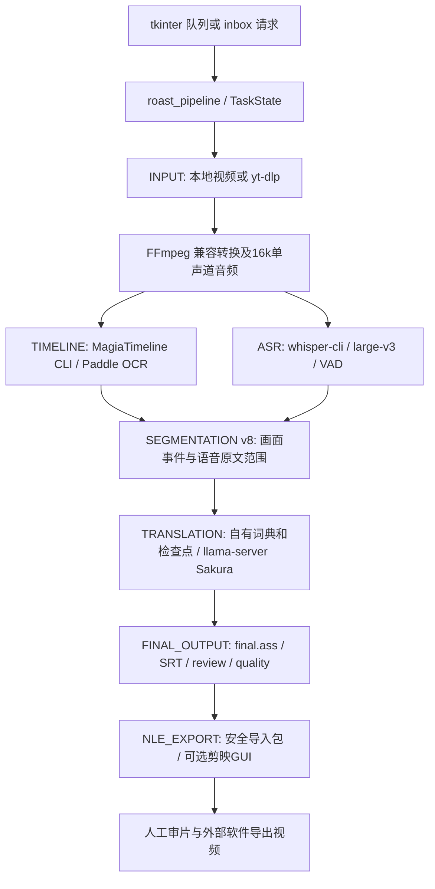

# 现有项目架构与事实审计

审计日期：2026-10-25。范围：`LOCAL_WORKSPACE`，并只读核对配置指向的 D/G 盘工具、已有运行证据及官方上游。只新增本目录七份 Markdown；没有运行制作任务、测试套件、GUI、模型或发布脚本，没有改业务代码、配置、模型、字幕及草稿。

## 1. 结论与证据等级

项目是已有实际产物和恢复证据的 **Windows 本机半自动字幕工具**，最新候选来自 2026-10-12 的第 8 轮实现。下载、提音、Magia 画面轴/OCR、Whisper ASR、Sakura 翻译、分段、ASS/SRT、复核表及剪映导入包均已有实现。最终带中文字幕视频的自动渲染尚未接入主流水线；剪映自动导入的当前版本兼容性、完整内容准确性及跨机器分发仍未验收。

2026-10-25根据用户补充方向复审：已有SRT/ASS应作为主要交付物，人工GUI检修后独立另存，烧录放在最后且可选；FFmpeg没有剪映式GUI，但Subtitle Edit可在图形界面调用它成片。另发现原`--zh-file`路径限制条数/时间且会规范化ASS标签，不适合作为自由人工稿回流入口。具体证据和轻量方案见 [03第9节](03-media-pipeline.md)；不要求先重构或实现完整修订数据库才能手动校对现有字幕。

报告统一使用：

- **[代码]**：从当前源码、配置或 Git 对象直接确认。
- **[产物]**：本次读取既有真实运行记录/文件；不是本次重新运行，也不证明其他素材同样成功。
- **[文档]**：交付或历史说明声称，未获得同范围独立验证。
- **[推断]**：基于调用关系的判断，未做对应行为实测。
- **[未知]**：现有材料不足，列入 07 报告。

最重要的验收依据是 final_usability_audit_20261012.json（本地证据：`implementation_20261010/draft_eval/final_usability_audit_20261012.json:1`，未公开）：`accuracy_accepted=false`、`native_ui_accepted=false`。mixed/speech 两种 35 秒任务各 15 条、13 条待复核、3 处术语未遵循；各次恢复跳过七个 DONE 阶段，保存记录表明字幕和原始交换文件不变。零源字符遗漏是结构覆盖证明，不是识别或翻译准确率。

## 2. 版本、目录与 Git 历史

| 路径 | 实际角色与边界 |
| --- | --- |
| `LOCAL_WORKSPACE/fix_stage` | 当前开发源码。23 个非测试 Python 模块、22 个测试脚本，共 45 个；本次全部通过只读 AST 解析。 |
| `LOCAL_WORKSPACE/implementation_20261010/candidate_20261011` | 本机可用候选，包含 EXE、外置 tools/config。当前其中 43 个 `.py` 与 fix_stage 同名文件逐字节一致；这不是独立安装包验收。 |
| `LOCAL_WORKSPACE/github_publish/guaiwenshu_cut-translate-halfauto` | 已整理的发布源码 Git 仓库。app/tools、app/config、tests、scripts、build、docs；不是全部历史工作区。 |
| `LOCAL_WORKSPACE/implementation_20261010` | 修复实验、真实任务、模型对照、候选快照及证据。大量 `fix_*.py`/`add_*.py` 是历史改写脚本，不能作为日常启动入口。 |
| `LOCAL_WORKSPACE/.research/VoiceTransl_readonly_20261002` | v1.21/v1.30 的部分研究源码快照，无完整 Git checkout；不代表本机 EXE 的完整对应源码。 |
| `LOCAL_WORKSPACE/repair_20261002`、`review_20261002`、`review_20261009` | 历史修复/复现材料。旧缺陷必须对照 v8 重新判断。 |
| `LOCAL_WORKSPACE/archive/legacy_20261010` | 已归档旧入口、日志、发布计划及图像；是恢复材料，不应当作待删除垃圾。 |
| `LEGACY_ROOT`、`EXTERNAL_TOOLS_ROOT` | 配置依赖的原工具/模型/正式目录。当前审计没有部署或改写它们。 |

**[代码] Git：**根目录 `.git` 没有有效仓库内容，`git rev-parse` 失败。不得据此初始化新仓库并声称恢复旧历史。发布镜像有效，当前 HEAD 为 `93df2625f5bfa71e8dd9bb897beac3d01a730b10`，工作树干净。其可见历史只有：

1. `321f01eebd841969fc308369c4990d20026482c6`，2026-10-19，初始 README。
2. `93df2625f5bfa71e8dd9bb897beac3d01a730b10`，2026-10-22，67 文件的源码整理发布。

本次核对发布镜像 app/tools：22 个业务模块与 fix_stage 的 AST 相同，`release_sync.py` 为适配发布布局而不同。早期开发时间和逐次决策不能从这两次 Git 提交重建；8–10 月文档、备份和测试记录只能作为辅助历史证据。见 源码发布记录（本地证据：`docs/GITHUB_源码发布_20261022.md:1`，未公开）。

## 3. 当前真实调用与数据流

阶段名以 [task_state.DEFAULT_STAGES](../../app/tools/task_state.py)（本地证据：`fix_stage/tools/task_state.py`；原审计源码第21行） 为准。两个识别阶段目前顺序运行，不是并行任务图。`jp_ocr.srt` 名字容易误导：默认由 Whisper **语音**识别生成；画面 OCR 在 `timeline.ass` 中，二者含义不同。

| 阶段 | 实际承担者与接口 | 当前产物/行为 |
| --- | --- | --- |
| 输入/下载 | [prepare_input](../../app/tools/roast_pipeline.py)（本地证据：`fix_stage/tools/roast_pipeline.py`；原审计源码第915行）、yt-dlp 命令模板 | 本地文件可引用或复制；链接下载及 info JSON。网站当前下载成功率未重测。 |
| 媒体处理 | [ensure_compatible_video](../../app/tools/roast_pipeline.py)（本地证据：`fix_stage/tools/roast_pipeline.py`；原审计源码第362行）、FFmpeg | 非接受容器/编码转为 H.264 MP4；提单声道 16 kHz WAV。已兼容的视频不统一重编码。 |
| 画面轴/OCR | [magia_timeline_adapter.main](../../app/tools/magia_timeline_adapter.py)（本地证据：`fix_stage/tools/magia_timeline_adapter.py`；原审计源码第247行） | ASCII 临时工作区、任务 YAML、原生 ASS、日志、编码验证；启用 Paddle OCR，禁用 Tesseract。 |
| ASR | [voicetransl_adapter.recognize](../../app/tools/voicetransl_adapter.py)（本地证据：`fix_stage/tools/voicetransl_adapter.py`；原审计源码第75行） | Whisper CLI GGML large-v3；SRT、完整原生 JSON、词时间旁路。非零退出拒收；VAD 时钟冲突可同模型无 VAD 重试。 |
| 分段 | [build_segments](../../app/tools/subtitle_segments.py)（本地证据：`fix_stage/tools/subtitle_segments.py`；原审计源码第236行） | mixed/screen/speech；父语音、画面事件、原文范围、稳定 ID、来源/风险标记；可选 Qwen 对齐默认关闭。 |
| 翻译 | [translate](../../app/tools/voicetransl_adapter.py)（本地证据：`fix_stage/tools/voicetransl_adapter.py`；原审计源码第273行）、[translate_batch](../../app/tools/sakura_client.py)（本地证据：`fix_stage/tools/sakura_client.py`；原审计源码第412行） | 本地 llama-server 的 `/v1/chat/completions`；Sakura 正文逐行协议、父句参考、术语表、重试和逐条恢复。正常流程不运行 VoiceTransl GUI/translate.exe。 |
| 字幕成品 | [publish_segment_output](../../app/tools/subtitle_segments.py)（本地证据：`fix_stage/tools/subtitle_segments.py`；原审计源码第568行）、[run_alignment](../../app/tools/roast_pipeline.py)（本地证据：`fix_stage/tools/roast_pipeline.py`；原审计源码第506行） | 按片段身份接回译文，输出 ASS、review.csv；中文字幕 SRT 位于 subs；质量摘要位于 deliverables。 |
| 后期交付 | [export_nle](../../app/tools/roast_pipeline.py)（本地证据：`fix_stage/tools/roast_pipeline.py`；原审计源码第1344行） | 复制媒体/ASS/复核表到导入包；可选剪映 UI。阶段叫 EXPORT，不意味着生成了 MP4。 |

## 4. 模块清单、完成程度与保留价值

| 模块 | 职责、状态和建议 |
| --- | --- |
| [one_click_roast.py](../../app/tools/one_click_roast.py)（本地证据：`fix_stage/tools/one_click_roast.py`；原审计源码第441行） | 2427 行 tkinter 主界面、设置、串行队列、后台进程、恢复、词典 UI。已有可用候选及启动记录；完整 GUI 交互未验收。保留界面，逐步抽出执行和设置处理。 |
| [roast_inbox.py](../../app/tools/roast_inbox.py)（本地证据：`fix_stage/tools/roast_inbox.py`；原审计源码第154行） | 文本/URL/JSON 请求目录，working/done/failed/status；真实文件队列实现，不是消息中间件。保留，补崩溃遗留 working 请求恢复。 |
| [roast_pipeline.py](../../app/tools/roast_pipeline.py)（本地证据：`fix_stage/tools/roast_pipeline.py`；原审计源码第750行） | 1393 行 CLI、配置、阶段、质量和 NLE 编排。已实现，文件头仍写 skeleton 是陈旧说明，不能据此称整个实现是框架。 |
| [task_state.py](../../app/tools/task_state.py)（本地证据：`fix_stage/tools/task_state.py`；原审计源码第108行） | 原子状态、失败分类、历史、PID 检查、阶段恢复。优先原样保留其数据兼容性；不是跨主机强事务队列。 |
| [artifact_validation.py](../../app/tools/artifact_validation.py)（本地证据：`fix_stage/tools/artifact_validation.py`；原审计源码第100行） | 字幕结构、边界、来源 CSV 与 JSON 校验。保留并补质量规则；可解析不能证明内容正确。 |
| [subtitle_segments.py](../../app/tools/subtitle_segments.py)（本地证据：`fix_stage/tools/subtitle_segments.py`；原审计源码第524行） | v8 主记录、源范围覆盖与身份审计。是重要算法资产；不应退回按时间独立匹配日中两路的旧方案。 |
| [subtitle_axis_align.py](../../app/tools/subtitle_axis_align.py)（本地证据：`fix_stage/tools/subtitle_axis_align.py`；原审计源码第1行） | SRT/ASS 解析、时间与报告公共函数，也保留旧独立合轴路径。共享工具仍被主流程使用；旧 align 不能整文件删除。 |
| [magia_timeline_adapter.py](../../app/tools/magia_timeline_adapter.py)（本地证据：`fix_stage/tools/magia_timeline_adapter.py`；原审计源码第126行）、[magia_utf8_runtime.py](../../app/tools/magia_utf8_runtime.py)（本地证据：`fix_stage/tools/magia_utf8_runtime.py`；原审计源码第1行） | CLI 隔离、编码与私有 UTF-8 副本兼容。针对真实故障的补丁，非任意冗余；更换 OCR 后仍需中文路径验收。 |
| [voicetransl_adapter.py](../../app/tools/voicetransl_adapter.py)（本地证据：`fix_stage/tools/voicetransl_adapter.py`；原审计源码第75行）、[sakura_client.py](../../app/tools/sakura_client.py)（本地证据：`fix_stage/tools/sakura_client.py`；原审计源码第23行） | ASR/翻译运行、模型服务所有权、HTTP/SSE留证、批次校验。保留为默认后端适配器。 |
| [voice_dictionary.py](../../app/tools/voice_dictionary.py)（本地证据：`fix_stage/tools/voice_dictionary.py`；原审计源码第44行）、[dictionary_editor.py](../../app/tools/dictionary_editor.py)（本地证据：`fix_stage/tools/dictionary_editor.py`；原审计源码第1行）、[voice_common.py](../../app/tools/voice_common.py)（本地证据：`fix_stage/tools/voice_common.py`；原审计源码第1行） | native 前/GPT/后词典、用户 JSON 词典、编辑和公共文件/进程函数。保留数据，条件词典兼容并未完成。 |
| [translation_checkpoint.py](../../app/tools/translation_checkpoint.py)（本地证据：`fix_stage/tools/translation_checkpoint.py`；原审计源码第15行） | 翻译输入/模型/词典签名，已完成条目即时保存。值得保留；不等于人工修订版本管理。 |
| [forced_alignment.py](../../app/tools/forced_alignment.py)（本地证据：`fix_stage/tools/forced_alignment.py`；原审计源码第1行） | 可选独立 Qwen 对齐及原始预测审计。已有实现和实验，但真实长片未合格，默认关闭。 |
| [tool_discovery.py](../../app/tools/tool_discovery.py)（本地证据：`fix_stage/tools/tool_discovery.py`；原审计源码第192行） | 工具/模型探测及 ASCII 路径回退；保留，补明确能力/版本验证，避免“最大模型文件”替代语义选择。 |
| [jianying_bridge.py](../../app/tools/jianying_bridge.py)（本地证据：`fix_stage/tools/jianying_bridge.py`；原审计源码第1行）、[jianying_ui_import.py](../../app/tools/jianying_ui_import.py)（本地证据：`fix_stage/tools/jianying_ui_import.py`；原审计源码第1行） | 安全交付包与 GUI 导入，放在可选后期出口。无已证实必须保留自动化的特殊功能。 |
| [jianying_uia_probe.py](../../app/tools/jianying_uia_probe.py)（本地证据：`fix_stage/tools/jianying_uia_probe.py`；原审计源码第1行）、[capture_app_window.py](../../app/tools/capture_app_window.py)（本地证据：`fix_stage/tools/capture_app_window.py`；原审计源码第1行） | Windows 窗口选择/截图诊断；保留维护用途，不放入无 GUI 制作的必要依赖。 |
| [diagnostics.py](../../app/tools/diagnostics.py)（本地证据：`fix_stage/tools/diagnostics.py`；原审计源码第127行） | 白名单诊断 ZIP、脱敏；保留，完整原始本地日志仍含字幕内容，分享前需审查。 |
| [release_sync.py](../../app/tools/release_sync.py)（本地证据：`fix_stage/tools/release_sync.py`；原审计源码第1行） | 白名单发布、备份、核验、回滚；有真实发布历史。保留，审计不执行。 |

## 5. 队列、恢复、缓存与追溯性

**[代码+产物] 已有较强基础，不需要从零引入调度框架：**

- GUI `_worker` 串行处理，支持停止、跳过、遇错继续及自有进程树清理，见 [1595 行](../../app/tools/one_click_roast.py)（本地证据：`fix_stage/tools/one_click_roast.py`；原审计源码第1595行）。GUI 队列主要是内存对象，未开始项目不等于已持久化；未完成任务可从 task.json 扫描恢复。
- `TaskState` 保存 RUNNING/DONE/FAILED/INTERRUPTED/CANCELLED、尝试次数及错误；进程死亡后转 INTERRUPTED，见 [178 行](../../app/tools/task_state.py)（本地证据：`fix_stage/tools/task_state.py`；原审计源码第178行）。原子替换防半写，PID 检查不构成并发写入的排他锁；多启动器抢占同任务有潜在竞争。
- `execute_stage` 比较签名并重新校验产物，必要时使下游失效，TIMELINE 改变可保留 ASR，见 [217 行](../../app/tools/roast_pipeline.py)（本地证据：`fix_stage/tools/roast_pipeline.py`；原审计源码第217行）。七阶段恢复已有保存的真实证据。
- 小文件完整 SHA-256；大于 16 MiB 的媒体/模型用路径、大小、mtime，见 [191 行](../../app/tools/roast_pipeline.py)（本地证据：`fix_stage/tools/roast_pipeline.py`；原审计源码第191行）。这是性能折中，不能抵抗内容改动但元数据未变的情况。
- 翻译检查点和 HTTP/SSE 原始交换留档有助于定位断流、截断及错配；只有完成的响应才接入译文。不存在统一自动重试所有阶段的策略。
- `job_manifest.json`、`jobs_index.json`、task_events JSONL、质量摘要构成追溯基础；媒体 PTS 变换、OCR 框/分数、人工修订和完整 ASR 处理覆盖尚未形成统一记录。
- inbox 只扫描顶层 pending 文件，异常退出后 working 文件不会由现有 `pending_files()` 自动找回，见 [177 行](../../app/tools/roast_inbox.py)（本地证据：`fix_stage/tools/roast_inbox.py`；原审计源码第177行）。任务恢复和请求队列恢复要分开处理。

## 6. 主要问题与耦合

| 优先级 | 发现、证据类型与影响 |
| --- | --- |
| P1 | **[代码] 人工改稿缺少保护层。** final.ass/review.csv 经原子写仍会覆盖目标；外改译文与旧 sidecar 会身份冲突。需要机器结果、人工修订、发布版本分离。详见 04。 |
| P1 | **[产物] 内容准确性未通过。** 人名、否定/关系、漏义和未完句仍需人工；`ready` 只能表示既有规则未发现风险。 |
| P1 | **[代码] 干净安装依赖不完整。** 发布 requirements 未列 PyYAML，而 `voice_dictionary.py:14`、Magia adapter 无条件导入 yaml；本机已有包掩盖了缺口。 |
| P1 | **[代码/条件风险] 命令模板走 shell。** `run_command` 在字符串格式化后 `shell=True`，URL/路径/代理来自输入，未见统一参数化与 shell 字符防护，见 [124 行](../../app/tools/roast_pipeline.py)（本地证据：`fix_stage/tools/roast_pipeline.py`；原审计源码第124行）。有引号不能保证所有 Windows 特殊输入安全；本次未提交攻击输入或证明被利用。建议实现时优先改参数列表。 |
| P2 | **[代码] 无声纯画面文本不具备端到端通路。** 分段函数有 VISUAL_ONLY，但主流程 ASR 必经且要求非空，见 [996 行](../../app/tools/roast_pipeline.py)（本地证据：`fix_stage/tools/roast_pipeline.py`；原审计源码第996行）。 |
| P2 | **[代码] 编排/UI耦合。** GUI 同时处理配置、队列、日志、进程；pipeline 大函数嵌套多个阶段并拼装全局 context，模式和资源依赖容易互相影响。现有阶段接口可以逐步整理，无需先换框架。 |
| P2 | **[代码] 安装目录布局耦合。** Magia 当前工作目录/config/template/models、VoiceTransl `_internal` 和 D/G 绝对路径；候选 EXE 后台仍调用外部 Python。移动目录/其他电脑不保证可用。 |
| P2 | **[代码] 不必要复制的候选点。** Magia 开 OCR 时每任务复制模型，导入包复制视频；非兼容源会另存 H.264。前两项可评估受控共享/链接，转换因 Magia兼容性有现实理由，不能直接删除。 |
| P2 | **[代码+文档] 格式/职责命名陈旧。** jp_ocr 实为 ASR、NLE_EXPORT 不出视频；旧 auto_roast_pipeline 文档和 AGENTS 的 10.9 状态晚于代码已过时。应在后续实施更新入口，不能将旧 R01–R07 全算现存。 |
| P2 | **[未知] 运行峰值与性能。** 没有本轮 CPU/GPU/RAM/VRAM profiling。不能声称换 Python库或删 GUI 就会更快或省显存。 |

`translate_json_batch` 是保留的显式诊断路径；默认是正文协议，不能当作“仍强迫模型输出 JSON”的当前缺陷。旧 `align` 与分段发布共用解析工具，历史修改脚本、打包副本、研究源码的存在也不等于重复执行。

## 7. 环境与分发

**[本次只读版本/元数据检查]** `PYTHON310_ROOT/python.exe` 为 3.10.11；PyYAML 6.0.3、pywinauto 0.6.9、pywin32 312、Pillow 12.2.0、yt-dlp 2026.7.4、imageio-ffmpeg 0.6.0、PyInstaller 6.21.0。包元数据不是完整导入/兼容测试。该解释器没有 torch/paddlepaddle/onnxruntime/faster-whisper/qwen-asr 元数据；外部打包工具可有独立运行时，不能据此称 ASR/OCR 不可用。

配置的 FFmpeg 是 imageio 自带 7.1，支持 libass 和所需媒体滤镜。FFprobe 未在 PATH/该 FFmpeg 同目录发现，但原 VoiceTransl `_internal/ffmpeg/ffprobe.exe` 存在，可在后续验证后显式配置。Magia 上游源码要求 Python 3.12.8+，不能直接塞入主程序 3.10 环境；可选 Qwen 的 CPU 虚拟环境也应隔离。

已核实 Whisper 模型约 2.88 GiB、Sakura GGUF 约 5.82 GiB，合计约 8.71 GiB **磁盘**，不含工具、OCR、VAD、缓存、实验模型。程序 EXE 大小、模型磁盘占用、运行 RAM、GPU VRAM 必须分别统计；不能用权重文件大小推算显存最低值。本轮 CIM 硬件查询被拒、PATH 无 nvidia-smi，当前硬件/驱动及峰值未实时测量，未升级权限。已有 Sakura真实任务日志（本地证据：`implementation_20261010/jobs/sample_s01_v8_user_glossary_candidate_mixed/logs/voicetransl/sakura_server.log:21`，未公开） 记录Vulkan0 / Intel Iris Xe、29/29层offload；这是历史GPU运行证据，日志可用内存与model/KV buffer不是物理显存容量或系统峰值。

可行分发方向是主程序/脚本运行环境、外部引擎、模型仓库和用户任务分别存储，固定版本/能力与许可清单，在移动目录和无 D/G 盘机器上验收。现有 朋友包草案（本地证据：`docs/朋友试用包_打包方案与使用说明草案.md:1`，未公开） 仍是草案。源码仓库未指定主项目许可证；第三方开源不自动赋予主项目同等分发许可。

## 8. 本次检查边界

已检查当前源码模块/导入、全部45脚本语法、配置形状和关键值、22测试脚本及其历史汇总、启动/构建脚本、两次Git提交、关键交接/复盘与真实产物、VoiceTransl部分研究源码及官方文档。保存的发布测试汇总为22/22成功，但**本次没有重跑**；测试会写 test-results/合成媒体，不符合本轮仅新增审计报告的限制。

没有穷举反编译第三方二进制、审查整个 site-packages、重跑长片、验证当前网站下载或操作剪映。更早开发历史、本地 VoiceTransl EXE 对应的精确源码提交、人工金标准确率仍未知。后续阅读顺序：02 组件身份 → 03 媒体 → 04 质量 → 05 方案 → 06 路线 → 07 待确认。
