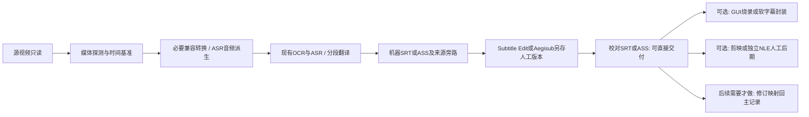

# 媒体流程、FFmpeg与人工字幕工具

审计日期：2026-10-25。事实等级见 [01](01-current-state.md)。以下替代流程为设计，未执行渲染、安装编辑器或操作用户剪映。

**2026-10-25补充结论：优先交付可编辑SRT/ASS，人工在字幕GUI中调整后另存；烧录/封装均为可选末端。FFmpeg自身没有剪映式编辑GUI，但Subtitle Edit已有调用FFmpeg的图形化成片窗口。需要完整视频时间线时再评估Kdenlive/Shotcut。详见第9节，本节优先于原先“以自动成片为首个目标”的排序。**

## 1. 当前剪映承担什么

**[代码] 当前剪映自动化主要做“新建/选择工程、导入视频和字幕、加入时间线、截图记录”，不负责前面的识别翻译，也没有实现自动视频导出。**

- [roast_pipeline.export_nle](../../app/tools/roast_pipeline.py)（本地证据：`fix_stage/tools/roast_pipeline.py`；原审计源码第1344行） 调安全导入包，按开关再调UI importer。
- [run_jianying_bridge](../../app/tools/roast_pipeline.py)（本地证据：`fix_stage/tools/roast_pipeline.py`；原审计源码第561行） 把视频、final.ass、review.csv交给bridge；SRT当前在任务subs目录，不在现有包中。
- [jianying_bridge.py](../../app/tools/jianying_bridge.py)（本地证据：`fix_stage/tools/jianying_bridge.py`；原审计源码第1行） 创建文件包/manifest和说明，探测草稿格式；没有实现剪映草稿生成器或解密修改器。
- [jianying_ui_import.py](../../app/tools/jianying_ui_import.py)（本地证据：`fix_stage/tools/jianying_ui_import.py`；原审计源码第340行） 导入素材/字幕并点击加入轨道；467–510行运行步骤后写completed。动作完成和截图不能证明实际字幕条数、文件身份、起点或没有重复。
- [validate_nle](../../app/tools/roast_pipeline.py)（本地证据：`fix_stage/tools/roast_pipeline.py`；原审计源码第1356行） 现在要求UI状态为completed，已修复旧版仅验JSON语法的问题；仍缺轨道内容读回核验。

**[产物]** 最后可用性审计（本地证据：`implementation_20261010/draft_eval/final_usability_audit_20261012.json:1`，未公开） 明确 `native_ui_accepted=false`。历史10.9流程不能证明当前11.4.2能完整导入/重导入/导出。已有安全导入包不等于通过剪映实际轨道验收。

## 2. 全用途替代矩阵

“可替代”是满足功能的技术可行性，不是已接入或已验收；未见实现的项目不计入现有功能损失。

| 用途 | 当前证据 | FFmpeg原生能力 | 程序/第三方/人工需求及判断 |
| --- | --- | --- | --- |
| 视频导入 | UI导入本地视频并加入轨道 | 直接读取媒体，无需工程导入 | Python检查媒体/流、路径和输出身份。标准自动生产可以去掉剪映导入动作。 |
| 视频导出 | 未见主流程自动导出；由外部人工后期承担 | 编码、封装、进度输出、音视频映射 | 需新增渲染阶段、日志/取消/校验；不能只把现有NLE_EXPORT改名便称完成。 |
| 剪切 | 主流水线未见通用剪辑列表；VoiceTransl研究GUI有独立clip工具 | `-ss/-t`、trim/atrim | Python维护剪辑点和字幕时间映射。stream copy受关键帧约束，精确切点通常需解码重编码。 |
| 拼接 | 未见生产自动拼接 | concat demuxer/filter | 统一参数/时间基准；Python生成清单或滤镜。不是原样复制剪映工程。 |
| 字幕轨道 | 本项目已生成SRT/ASS，再交UI导入 | 可烧录文本或封装软字幕流 | Python管理cue身份与校对回流；FFmpeg不是字幕内容编辑器。 |
| 字幕样式 | final.ass保留模板样式/字段，必要时生成Default | libass渲染ASS；subtitles滤镜可读SRT | Aegisub适合样式/定位；字体需配置和发布许可。剪映专有样式不能保证像素级复现。 |
| 音频提取 | 已经由FFmpeg完成 | 单声道/重采样/PCM | 保留；源音轨与ASR音频不能相互覆盖。 |
| 音量/混音/降噪 | 未见剪映自动化对应处理 | volume/amix/loudnorm/部分降噪滤镜 | Python配置；响度两遍分析、混音听感需验证。高级人声分离要专用模型，不能当作普通滤镜等价替代。 |
| 转场/画面效果 | 未见本项目自动化实现 | xfade等常规滤镜 | Python生成滤镜图；剪映模板/特效市场和复杂美术效果仍适合人工NLE。无需为未用功能保留自动化。 |
| 工程文件生成 | 当前没有真正草稿写入；有格式探测/安全文件包 | 不生成可编辑剪映工程 | 需专门第三方/自研草稿适配与版本测试，属于可选支线，不列默认重构范围。 |
| GUI自动化 | pywinauto、Win32、坐标和窗口探测 | 无需GUI可执行媒体命令 | 可从标准字幕成片路径移出；保留用户自选后期入口。 |
| 人工校对 | review.csv+剪映审片建议；无受保护的回导层 | 无语义/人工判断能力 | Subtitle Edit/Aegisub打开字幕+视频/音频校对，主程序读新版本并渲染。需新增文件回流协议。 |
| 复杂人工后期 | 用户可能在旧草稿中手工完成，代码不能确认全部 | 不能替代交互创作 | 剪映作为可选人工工具保留；先盘点真实工程需求，不能从烧录视频推断轨道结构。 |

FFmpeg滤镜能力以[官方文档](https://ffmpeg.org/ffmpeg-filters.html)为依据；本次也对配置二进制进行了只读能力检查。没有发现现有代码中必须通过剪映自动化才能合理完成的功能。**标准字幕视频交付可以完全绕开剪映自动化；无法据此声称替代用户在剪映中的全部创作能力。** 不使用虚构的“替代百分比”。

## 3. 本机FFmpeg与探测方式

**[本次只读检查]** 配置指向：

`PYTHON310_ROOT/lib/site-packages/imageio_ffmpeg/binaries/ffmpeg-win-x86_64-v7.1.exe`

`-version`为7.1 essentials gyan构建，带`--enable-gpl --enable-version3 --enable-libass`；`-filters`存在ass、subtitles、concat、xfade、amix、loudnorm。编译列出硬件编码支持并不证明本机GPU可用。未进行渲染画质/速度/字体实测。

FFprobe在PATH和上述FFmpeg目录未发现；但 `EXTERNAL_TOOLS_ROOT/VoiceTransl-v1.21-win-sakura/_internal/ffmpeg/ffprobe.exe` 实际存在。因此不是“电脑没有ffprobe”，而是主配置未明确使用。当前 [probe_video](../../app/tools/roast_pipeline.py)（本地证据：`fix_stage/tools/roast_pipeline.py`；原审计源码第302行） 解析FFmpeg人类可读stderr，精度和字段覆盖弱于[ffprobe JSON](https://ffmpeg.org/ffprobe.html)。

建议后续媒体探测接口统一返回：duration、流索引/语言、time_base、start_time、分辨率、SAR/DAR、rotation、平均/名义帧率、音频采样率及必要的帧PTS。优先显式配置/能力核对，不能把任意PATH ffmpeg当作相同构建。

## 4. 推荐媒体流程

1. **保留源媒体**。兼容转换是派生产物，记录输入/输出身份及时间变换。当前H.264转换旨在满足Magia；先证明原媒体可直接解码、颜色/旋转/时间正确，才减少它。
2. **保留低成本音频旁路**。16kHz/mono供ASR；成片使用原音轨或明确处理后的音轨，不把识别WAV误当最终音频。
3. **输出候选字幕**。机器版本写新路径，review与sidecar记录角色和来源。人工编辑器打开副本，另存校对版本。
4. **校对另存即可交付**。人工版保存到机器任务目录外或独立review版本，不要求先回灌旧翻译阶段。仅当要恢复源文关联、逐字段合并或机器再处理时，才做base hash和cue映射。详见04及本报告第9节。
5. **按需渲染为新文件**。可由Subtitle Edit等GUI读取人工字幕调用FFmpeg；将来需主程序自动渲染时再补独立接口。冻结样式/字体，校验新输出，不覆盖源视频/旧成品；人工ASS直接作为渲染输入，不重生成其样式。
6. **验证与交付**。比对实际时长、音视频流、首尾/换屏/重叠字幕画面；保留字幕本身，支持重渲染而无需重新识别翻译。

渲染输入必须显式选择：机器候选、部分已审或已审版本。执行完成和人工质量确认分别记录；需要预览机器结果时允许生成并标记，不增加任意长度/阅读速度硬门槛。

## 5. 标准字幕格式选择

| 格式 | 用途 | 兼容/往返注意 |
| --- | --- | --- |
| SRT | 普通中文字幕正文/时间校对、广泛导入 | 毫秒；样式弱，无可靠持久cue ID，编辑器重编号不表示身份稳定。不能只靠行号接回原文。 |
| ASS | 保留样式、层、定位、同时显示、对白/画面文字分轨 | 百分之一秒；保留PlayRes、Style、Layer、Name/Effect及覆盖标签；导出SRT会丢失这类信息。 |
| JSON旁路 | 原始证据、稳定ID、父句/画面范围、修订谱系 | 不是用户被迫手工编辑的字幕格式；由主程序维护。编辑器可能丢ASS自定义字段，旁路仍不可省。 |
| MP4软字幕 | 需要可开关文本且播放器支持 | mov_text样式保真有限；不能保留全部ASS效果，播放器表现需验收。 |
| MKV字幕流 | 保留ASS样式/多字幕流的可选交付 | 可附字体，但播放器支持/字体分发许可需核对。 |
| 烧录视频 | 固定可见的中文字幕视频 | 字幕像素进入画面，必须视频重编码；后续文本修改需重新渲染，不能从视频无损找回原字幕工程。 |

SRT与ASS精度不同，往返比较应按原始毫秒/实际帧PTS和格式量化解释，不把格式舍入当“自动修正了时间”。默认优先SRT检修正文和时间，需要排版时以ASS为主，不强制在各阶段来回转换。

## 6. Subtitle Edit与Aegisub

官方资料于2026-10-25复核；本机安装、具体版本和操作往返未验收。它们都足以成为人工字幕工具，不要求开发新的字幕GUI。

| 工具 | 更适合的任务 | 连接方式与限制 |
| --- | --- | --- |
| Subtitle Edit | 普通文本/时间校对、波形/视频同步、差错列表、批量格式转换 | [官方文档](https://subtitleedit.github.io/subtitleedit/)列有文件保存、波形、同步与错误检查。推荐作为SRT检修默认候选；只打开本地文件即可，不必启用在线AI或另外下载识别模型。 |
| Aegisub | ASS样式、层/定位、特效和音频定时 | [官方文档导航](https://aegisub.org/docs/latest/audio_timing_tutorial/)包括字幕编辑、音频定时、样式、排版、自动保存。适合ASS主文件；复杂覆盖标签需实际FFmpeg/libass渲染比对。 |

Subtitle Edit当前官方主线已是5系跨平台版本，不能套用旧4.x的全部系统要求；[官方README](https://github.com/SubtitleEdit/subtitleedit)说明Windows最低10 22H2、发行包自包含。实施时固定一个实际测试版本，不因“最新版”自动升级。Aegisub应从[项目维护仓库](https://github.com/TypesettingTools/Aegisub)及其发行渠道选版本。

授权：Subtitle Edit当前仓库为[MIT](https://github.com/SubtitleEdit/subtitleedit/blob/main/LICENSE)；Aegisub主体为[BSD式三条款](https://github.com/TypesettingTools/Aegisub/blob/master/LICENCE)，所带组件各自许可。作为外部编辑器调用最简单；若捆绑发行，仍须核对该版本的完整通知和媒体库。

不默认启动“合并相同文本”“调整所有时长”“全轨平移”等批量修复。真实重复、背景文字和语音跨屏都可能合理，先让用户预览差异。编辑器自动备份能防编辑过程丢失，不能阻止主程序覆盖另一份文件。

## 7. Windows、性能与许可

- 用参数列表调用媒体工具；FFmpeg滤镜内部还有第二层转义，应使用受控工作目录/滤镜文件和测试过的路径编码，覆盖中文、空格、冒号、引号等。不能把`JSON.stringify`或shell双引号当作完整转义方案。
- 字体可用性、fallback、字号/描边、PlayRes、颜色矩阵、HDR/SDR和旋转都影响成片；这些由实际输出验收，不能只检查返回码。
- 减少导入包视频副本、按内容缓存兼容转换/音频、批次复用已核实模型服务，有性能空间；无profiling不承诺倍数提升。硬字幕渲染可能是新增显著耗时，取代手工导出不会消除编码成本。
- [FFmpeg官方许可说明](https://ffmpeg.org/legal.html)指出构建选项影响许可。本机实际启用GPL/version3/libx264，不能按纯LGPL构建打包；需要保留来源、构建信息与对应通知。字体及专有素材许可另算。

## 8. 剪映保留与草稿导出结论

保留旧工程、用户已安装剪映以及手动导入入口。推荐默认交付标准字幕，FFmpeg或GUI成片为可选后续；剪映用于用户选择的后期剪辑、模板、美术与审片。没有必要为了字幕交付而继续维护脆弱坐标点击。

剪映草稿导出仅列可选研究：需要明确版本、格式可读性、样式/媒体相对路径、重导入幂等和工程副本回滚。现有安全包不是草稿。除非用户确认真实需求与验收样本，否则不纳入推荐方案的必做阶段。

## 9. 专项补充：字幕文件优先，怎样保留图形化调整

### 9.1 直接烧录会发生什么

“烧录”“软字幕”“字幕编辑”是三个不同动作：

| 交付形式 | 文字和时间还能怎样改 | 调整后是否要重新编码视频 | 推荐定位 |
| --- | --- | --- | --- |
| 原视频+外挂SRT/ASS | 在编辑器改字、拖起止、拆并、调ASS样式；播放器加载文件预览 | 仅改字幕不用重新编码视频 | 主要工作资产和首选交付物 |
| MKV/MP4内封软字幕 | 将文本轨提取/改写后重新封装；具体格式/样式取决于容器和播放器 | 兼容流可复制，不必重新编码音视频；重新封装仍会读写容器 | 可选的单文件可开关字幕交付 |
| 只有烧录MP4 | 文字已是像素，没有独立字幕轨可改/关闭；OCR或遮盖不是无损找回工程 | 改画面字幕通常要从原视频和字幕重新渲染 | 最终派生成片，不能作为唯一母版 |

**烧录不意味着今后完全不能改，而是不能只拿那份烧录MP4像改字幕轨一样改。** 只要保留原视频、校对SRT/ASS、字体/样式，修改字幕后可以重新成片，无需重新跑下载、OCR、ASR和翻译。不要在已烧录中文的成片上再叠一层纠正版，否则旧字仍在底图中。

基于[FFmpeg命令行/转码说明](https://ffmpeg.org/ffmpeg.html)、[Subtitle Edit软字幕编辑说明](https://subtitleedit.github.io/subtitleedit/features/embedded-subtitles.html)及本地流程作上述工程判断。软字幕可用性要用目标播放器/发布平台验证；平台是否保留软字幕不能默认。

### 9.2 FFmpeg有类似剪映的GUI吗

FFmpeg是命令行媒体处理工具/库，不自带剪映式多轨编辑界面。FFplay是预览播放器，也不是字幕时间轴编辑器。“程序内部用了FFmpeg”不等于FFmpeg负责GUI、字幕编辑和项目管理，这些由前端软件实现。

本轮复核的现成GUI如下；均为官方文档能力，**未在本机安装/实机往返验收**，不把文档截图当本机成功证明。

| 需求 | 优先候选 | 官方已确认的图形化能力 | 适用范围与审查结论 |
| --- | --- | --- | --- |
| 看视频/听音频改字和拖动时间 | Subtitle Edit | 波形上拖字幕边缘改起止、拖整体平移、拆并及视频联动；[波形文档](https://subtitleedit.github.io/subtitleedit/features/audio-visualizer.html) | 最贴近本项目“机器初稿→人工检修”；不要求用它的AI重识别 |
| 人工校对后直接从GUI出视频 | Subtitle Edit | `Video → Generate video with burned-in subtitles`窗口设置字体/编码/音频/新输出位置，内部调用FFmpeg；[烧录文档](https://subtitleedit.github.io/subtitleedit/features/burn-in.html) | 可以先不开发主程序烧录按钮。编辑状态与最终视频输出分开，先保存字幕 |
| ASS定位、字体、描边、分层和特效 | Aegisub | 字幕文字、起止/持续时间、Style/Layer/边距及覆盖标签；[编辑文档](https://aegisub.org/docs/latest/editing_subtitles/) | 原生ASS作为母版。导出SRT会失去排版，参见[导出文档](https://aegisub.org/docs/latest/exporting/)；不把它承诺为通用视频导出器 |
| 像剪映那样同时剪视频/配音并在时间线改字幕 | Kdenlive | 官方26.08手册支持字幕轨拖时长、文本编辑、ASS/SRT等导入、ASS/SRT导出、样式和多层；[字幕手册](https://docs.kdenlive.org/en/effects_and_filters/subtitles.html) | 完整NLE候选；本轮没有证明比剪映更轻或更适合用户，也没有证明复杂ASS全保真 |
| 完整NLE的另一个候选 | Shotcut | 可导入/编辑字幕，设置起止、移动、预览，导出独立SRT；[官方字幕文档](https://forum.shotcut.org/pub/subtitles-panel)、[格式能力](https://www.shotcut.org/features/) | 支持导入ASS/SSA不代表SRT出口保留样式；需要保留项目文件，不能把SRT当全部工程 |

因此不需要开发“FFmpeg版剪映”。若主要是字幕检修，先选Subtitle Edit；排版需求交给Aegisub；只有要改视频画面/拼接/音频/转场时才进入Kdenlive/Shotcut或继续手用剪映。它们之间无需再建立自动鼠标联动，标准字幕文件是交接接口。

普通编辑/波形不要求启用新的ASR模型。Subtitle Edit官方说明“speech-only waveform”等高级项会下载额外识别/分离运行时，首次检修不启用；正常波形可能生成本地缓存，属于后续实际试用时单独验收，不在本轮执行。

### 9.3 现有项目已经能提供什么

本次再次确认现有35秒机器结果存在，未重生成或改写：

- 原始35秒视频（本地证据：`implementation_20261010/draft_eval/test_slices/sample_s01/opening_0_35.mp4`，未公开）。
- 中文SRT（本地证据：`implementation_20261010/jobs/sample_s01_v8_user_glossary_candidate_mixed/subs/zh_machine.srt`，未公开）。
- 带样式ASS（本地证据：`implementation_20261010/jobs/sample_s01_v8_user_glossary_candidate_mixed/deliverables/final.ass`，未公开）。
- 复核CSV（本地证据：`implementation_20261010/jobs/sample_s01_v8_user_glossary_candidate_mixed/deliverables/review.csv`，未公开）。

这些是待校对机器稿，既有质量记录各15条中13条待复核，并非准确成品。可以直接作为将来编辑器试用样本；无需为“先输出字幕”重新搭一条识别/翻译链。

`--no-jianying-ui`和`--skip-jianying-package`已在 [CLI参数](../../app/tools/roast_pipeline.py)（本地证据：`fix_stage/tools/roast_pipeline.py`；原审计源码第771行） 中存在，可在未来制作任务按需关闭后期环节。本轮没有启动该命令；它们并不实现人工版本保护或自由回导。

### 9.4 新发现：不要把已校对ASS直接塞回原翻译入口

**[代码] 旧 `--zh-file` 是机器译文/既定分段输入，不是自由字幕编辑回流接口：**

1. [validate_translation](../../app/tools/roast_pipeline.py)（本地证据：`fix_stage/tools/roast_pipeline.py`；原审计源码第1217行） 要求条数、index、开始和结束与canonical输入完全一致。用户拖时间、拆并字幕后，即使字幕文件本身合法也会失败。
2. [retime_supplied_translation](../../app/tools/roast_pipeline.py)（本地证据：`fix_stage/tools/roast_pipeline.py`；原审计源码第712行）先核对旧sidecar中文本/时间/身份；不能解决随意改字、改轴后的陈旧旁路。
3. [normalize_text](../../app/tools/subtitle_axis_align.py)（本地证据：`fix_stage/tools/subtitle_axis_align.py`；原审计源码第88行）移除`<...>`和`{...}`标签；parse_ass第155行把规范化正文放入cue.text。直接用于--zh-file路径时，人工ASS行内样式/定位标签不会从cue.text保留下来。
4. [run_alignment](../../app/tools/roast_pipeline.py)（本地证据：`fix_stage/tools/roast_pipeline.py`；原审计源码第506行）使用原timeline作为输出模板；[publish_segment_output](../../app/tools/subtitle_segments.py)（本地证据：`fix_stage/tools/subtitle_segments.py`；原审计源码第623行）从该模板取头部/事件样式，再换上cue正文。因此人工ASS的样式表、Style/Layer/边距等也不能承诺通过该入口往返保留。

这些是调用链审查结果，本轮没有往用户任务输入修改文件进行复现。该规范化对识别匹配有用途，问题是把它误用作有样式最终字幕的无损导入器；不应为此全局删除规范化函数。

**最轻量的解决方向：先不回灌。** 主程序交付机器SRT/ASS → 人工另存reviewed.srt/ass → 直接作为字幕成品，或由编辑器/独立渲染入口读取该文件。只有要把人工修改再次用于机器翻译、来源分析或模式重排时，才实现原文谱系/冲突映射。

未来独立渲染入口应把人工ASS原文件交给libass，不经过原文normalize/按旧cue重写；可以只读解析验证时间和字体，不能用解析后的纯文本重建它。原始字幕hash、视频hash及选定版本足以支持初期渲染留证，不必先建完整修订数据库。

### 9.5 建议的最小可用里程碑

**M1：字幕文件交付及GUI检修。** 复用现有机器输出，明确打开SRT/ASS/原视频/复核表，提供另存目录和命名建议；校对结果不写回机器缓存。可只交字幕，不必生成MP4。

**M2：GUI按需成片。** 首先验证Subtitle Edit的GUI烧录；保留原视频与最终ASS/SRT，生成新文件。需要自动批处理时才实现独立FFmpeg渲染阶段。

**M3：可选深度回流或完整NLE。** 需要重新翻译/源范围映射时接回主记录；需要剪视频时进入NLE。二者不是M1/M2的前置条件。

最小验收：一个实际35秒样本，在一个编辑器里改字、拖起止、拆并、调整样式并另存；重开验证；仅改字幕不重跑模型；原机器稿和原视频hash不变。可选成片必须核对更改生效、字体和音画同步。ASS→SRT样式损失、视频剪辑后的时间坐标、自动吸附/全局修复误改分别检查，不能因看起来能预览就认定往返无损。

若剪了视频，字幕时间属于新的视频版本：记录剪辑工程和导出的字幕，不能拿剪后SRT再套原视频，也不能只重新渲染原视频复现多轨剪辑。导入/导出格式支持、主程序理解编辑、NLE工程恢复是三个独立验收。
