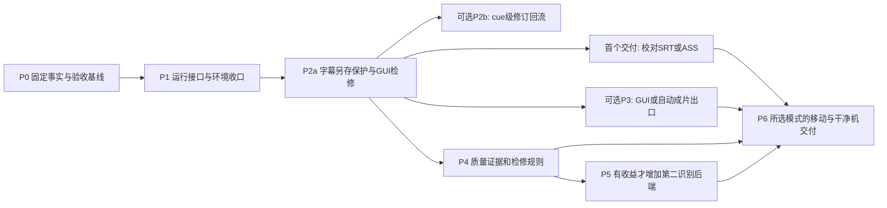

# 推荐方案B的实施路线（仅设计）

日期：2026-10-25。这里只规划渐进式模块化方案。**本次没有实施以下任何阶段。** 后续开始写业务代码、迁移数据、安装或发布须有新的对应任务指令；本轮“继续”仅继续审计。

## 1. 依赖和完成边界

根据2026-10-25补充研究，首个可用目标改为“现有SRT/ASS可在GUI检修、另存、重开和交付”，不以P3自动烧录、P2b完整回流或全部模块化为门槛。P5为条件阶段，也不阻止交付。保留现有GUI、VoiceTransl资源和剪映人工后期入口；满足实际需求后可在M1停止。

工作量粗估：P0 2–3人日、P1 3–5、P2 4–8、P3 3–6、P4 4–8、P6 3–6；约19–36人日，加一定集成余量对应方案B的20–40人日。P5另估5–12人日/一个后端，不含大量金标与许可等待。阶段工时不得替代验收。

## 2. P0：建立可比较、可回滚的基线

**依赖：**确认实施范围、主源码位置、是否计划分发/商用及真实素材使用范围；默认采用本报告建议，不要求用户重新寻找已经存在的素材。

**任务：**

- 以fix_stage/candidate v8建立受控基线，核对发布镜像的来源清单；后续在独立候选目录/分支工作。根空.git不自动初始化，现有镜像历史不重写。
- 保存当前源码/有效配置/词典/模型和工具版本清单及来源，敏感配置只本地保护，不上传；大模型复用已有官方hash/清单，避免反复哈希或重下。
- 选已有35秒、25秒、572.636秒素材及关键失败样例，建立少量独立人工金标。分别标画面文本/帧边界、语音文本/时间、译文和允许多解。
- 基线测量冷/热耗时、程序/工具/模型/缓存磁盘、峰值RAM/VRAM。权限不足的硬件数据记录未知，不以权重大小代填。

**验收：**一个可重现短片任务、一次不变输入恢复、一次输入变化失效的证据可核对；输出、实际引擎、质量未通过项与GUI边界分别记录。金标和机器结果不能互相混充。

**保留：**旧全部生成流程与人工后期。**回滚：**本阶段只产生基线材料，不变更正式任务；后续均指回此基线。

## 3. P1：整理运行接口和环境，不换模型

**依赖：**P0，固定当前运行版本。

**任务：**补PyYAML等实际依赖和分层清单；保持主Python/外部EXE/实验环境独立；把媒体/识别/翻译命令安全改为参数列表和显式能力检查。保留允许自定义命令的兼容入口时明确其信任范围，不把不可信URL直接拼进shell。

保留TaskState和阶段名，逐步抽出runner/配置处理；补同任务排他占用、进程所有权和inbox working遗留恢复。不要重建数据库或调度服务器。为旧配置新增字段保留未知扩展键，不原地重写用户配置。

**验收：**

- 现有行为测试通过，依赖来自干净的项目隔离环境；缺失工具/模型/不支持参数明确报错。
- 中文、空格、引号和Windows特殊路径输入不导致错误解析或额外命令；验证时使用隔离合成输入。
- 停止/跳过只清理本任务进程，失败后队列按用户策略继续；双启动器不抢写同任务；旧working请求可恢复。
- 输入不变可跳过，字幕/词典/模型身份变化只重算相关阶段及下游；所有恢复保留原失败证据。

**保留：**Whisper CLI、Sakura HTTP、Magia兼容副本、GUI、词典与七阶段状态。**回滚：**切回旧runner/配置副本，恢复迁移前task.json；新结果写独立目录，旧任务不逆向覆盖。

## 4. P2a先行：人工另存保护；P2b按需回流

**依赖：**P0/P1用于后续程序改动；已有输出的编辑器试用可直接使用受保护副本，不必等待P1全部整理完成。本轮仅设计，未创建试用副本或安装编辑器。

**P2a任务：**复用现有输出，先在一个编辑器完成原视频+SRT/ASS检修；人工另存到机器任务目录外/独立review版本。明确打开文件/目录和机器稿/人工稿命名，保存输入hash/时间基准；人工结果本身就是交付物。提供现有GUI少量文件入口/CLI；使用Subtitle Edit/Aegisub，不写新字幕编辑器。

**P2b条件任务：**只有用户要把人工修改再次用于翻译、来源审计或模式重排时，再建立source revision、patch、逐字段锁、导入diff及cue lineage。旧`--zh-file`会核对canonical时间/条数，且规范化ASS正文，不拿它充当自由编辑导入。详细证据见03/04补充。

P2b先支持唯一映射的文字/时间修改；拆并、重排、来源变化以人工确认的映射生成新ID。不能为方便而限制用户编辑能力，也不能把不支持的变更悄悄按行数接回。外部编辑器保不住自定义ID时以manifest/差异确认兜底。P2a只交独立字幕时无需先做这些映射。

**验收：**

- P2a：SRT与ASS各至少一次视频/音频校对、另存和重开，中文/日文、换行、样式、时间精度有前后比较；改字、拖起止、拆并均可用，不重跑模型。
- P2a：同样本机器恢复不会触及独立人工文件；只有字幕交付也可完成。ASS保持完整原文件，SRT不宣称保留ASS样式。
- P2b启用后：重新识别、翻译、换词典/模式后，人工原文/译文/时间/样式锁按确认范围保留；人工版原字节可恢复。
- P2b启用后：base同时改变、重编号、拆并/排序、缺sidecar产生明确结果或冲突，不自动丢失/错配；执行状态和确认范围分开。

**保留：**现有机器ASS/SRT、review、原始sidecar、retime supplied功能。**回滚：**停用新回流，回到旧生成出口；人工文件始终是独立导出资产，不依赖新逻辑才能打开。

## 5. 可选P3：媒体探测与GUI/FFmpeg成片出口

**依赖：**P2a人工另存与版本选择；不依赖P2b完整回流。优先复用现有FFmpeg，ffprobe先核版本/能力，不直接安装。

**任务：**先验证Subtitle Edit已有GUI烧录/软字幕窗口；不要求开发主程序FFmpeg前端。用户需要自动批处理时，再以FFprobe JSON记录流/时基、缓存必要派生，并从选定人工字幕直接渲染到新文件。保留SRT/ASS，不能经原文字段规范化/旧模板重建来破坏人工ASS。新自动渲染阶段与旧NLE_EXPORT解耦，剪映自动化移出必需路径。

**验收：**

- 同一短片按机器版与人工版分别生成新文件，不改输入媒体；输出视频/音频可解码、时长合理、无意外丢流。
- 中文/日文字体、描边、ASS层/定位、换屏和片尾实帧核对。VFR、旋转、非零start_time、缺音轨样本有明确处理。
- 取消/编码失败只留候选和日志，不发布半成品，不覆盖旧成片；恢复可跳过识别/翻译。
- 本机没有剪映或不启动剪映也可完成字幕视频；手动剪映入口仍能拿到明确字幕文件。

**保留：**原提音/兼容转换、导入包与剪映人工使用。**回滚：**停用新渲染阶段，继续旧ASS/SRT出口；新成片只是附加产物，不重写旧工程。

## 6. P4：补齐质量证据和人工定位

**依赖：**P2a；可与可选P3分支开发，最终合并前分别验证。来源修订启用时再依赖P2b。

**任务：**按 [04规则矩阵](04-quality-control.md) 集中质量检查，保留OCR帧PTS/框/原分数、ASR原始/有效词时钟和活动/处理覆盖。先利用现有Magia可导出的证据；无法取得时记录unknown，不伪造分数。补纯无声OCR路径，保留画面/语音不同role。建立base关联的人工源文修订，不改原ASR。

**验收：**

- 负/零时长、越界/非有限、源覆盖/身份错误确定拦截；合理多轨同时显示不误删。
- 低置信度、时长、OCR连续性、OCR/ASR冲突、术语/翻译异常都可定位；未知值显式呈现。
- 金标覆盖无声/无屏字幕、逐字显示、真实重复、跨屏口语、不同内容及未完句；分别报告识别、时间、翻译错误和人工耗时。
- 对照当前v8，不能用删字/截断/钳制/降低检查标准取得更好指标。提示阈值可调，无未经要求的句长/片长硬上限。

**保留：**v8原文范围/身份/覆盖算法、当前质量和词典检查。**回滚：**新证据字段按版本保留，新检查可关闭警示；不能自动撤销人工已确认改动或放宽既有完整性校验。

## 7. P5：按证据决定是否增加独立后端

**进入条件：**P4金标和资源测量证明当前某一后端有实际问题，且候选具备合理质量/资源收益。没有收益可跳过。

**任务：**一次只评估一个ASR或OCR后端，例如独立whisper.cpp固定包、faster-whisper或独立Paddle/RapidOCR；使用隔离环境/模型路径，不修改旧VoiceTransl/Magia。已有Qwen失败记录必须纳入反例，不能仅凭新版本宣传启用。

**验收：**同输入、明确模型/解码/硬件和冷/热条件；比较源文/边界/置信度/处理覆盖、峰值RAM/VRAM、完整恢复/取消、实际人工复核量；不以官方benchmark替代本机结果。GGML与CTranslate2资源分开，网络/模型下载须另有授权和大小计划。

**保留：**旧后端始终可选，原始词典和模型不迁移破坏。**回滚：**将任务后端选回旧adapter，新结果保存为实验branch；不把新格式缓存误当旧引擎结果。

## 8. P6：分发、迁移和最后验收

**依赖：**P2a+P4及所选交付模式；只有选择视频自动成片才验P3，选择深度回流才验P2b；若P5采用新后端则包含其结果。分发用途/许可已确认。

**任务：**主程序和外置脚本运行时、可选引擎、模型、用户任务/修订分开存储；路径发现不依赖开发者D/G盘。白名单构建、版本/能力/许可清单、校验值、诊断脱敏。模型/缓存迁移先复制或验证已有文件，再切配置，旧位置保持可回滚；不直接清理旧模型/草稿。

**验收：**

- 干净Windows和移动目录各完成一个真实短片及恢复，含人工字幕另存/重开和失败队列继续；只有选择视频输出才验成片，启用回流才验机器再导入。不只验证EXE启动。
- 离线已有模型可运行，缺资源明确指向，不静默自动下载；CPU/GPU配置各有已验收范围，无法测试的组合公开为未验收。
- 应用/工具/模型/任务磁盘与RAM/VRAM分别报告；包内无个人配置、视频、原任务、凭据或模型目录联接误收。
- 第三方二进制、Sakura模型、字体、复制源码的条款和对应源码/通知要求逐项确认；主项目许可证由用户决定。

**保留：**旧候选和正式版、全部原模型/词典/草稿与编辑后的标准字幕。**回滚：**回到旧完整目录和配置，不依赖单EXE；新用户数据导出为标准字幕+旁路，新旧版本绝不共写同一任务目录。

## 9. 全阶段停止与发布规则

每阶段只在独立候选及数据副本验收，通过后再决定是否进入下一阶段。测试分为结构/fixture、真实引擎、媒体视觉/听觉、编辑器往返、Windows打包、用户验收，不能合并称“全通过”。正式目录部署与发布是后续独立动作，本路线不执行。

如发现新源文错误或人工稿丢失风险，先保留候选/证据并暂停该输出的确认，不靠缩短素材、删台词或更换未验引擎掩盖。首个实施动作是P0固定基线与金标，而不是删除VoiceTransl/剪映、更新全部依赖或抽取上游源码。
