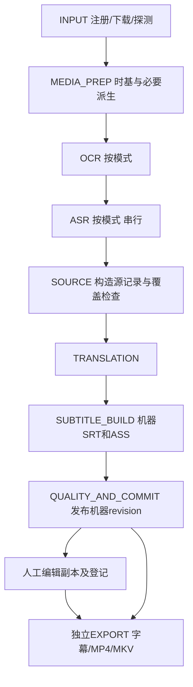

# 自动烤肉机完整升级执行规格

版本：1.1。编制/修订日期：2026-10-25。状态：**规划交付，尚未实施**。适用对象：项目负责人、Claude 或其他开发 AI、验收人员。

本文件以同目录 01—07 调查报告及当前代码为依据，将方案 B 收敛为一条完整升级路线。正文是实施规范；七份调查报告用于解释事实和历史，不能用其中较宽泛的建议覆盖本文件明确的行为。1.0仅新增本计划，1.1仅修订本文件；不改业务代码、旧调查报告、配置、任务、词典、模型或用户字幕。

## 0. 如何执行本计划

### 0.1 约束的含义

- **必须**：属于本版交付条件，不可由开发 AI 取消、替换或缩小。
- **禁止**：任何阶段都不得执行；若确需改变，先提交变更单。
- **默认**：本计划规定的产品初始值，用户可通过明确列出的设置改变。不是让开发者选择一个“合理值”。
- **实测填入**：只允许按规定方法读取版本、路径、哈希、能力和耗时等客观值，并附证据；不是允许自行决定产品需求。
- **阻塞项**：缺少必要事实或用户决策时，停止依赖它的工作包，列出原因；其余不依赖的工作可继续。不得用 mock、假数据、静默降级、删功能代替完成。
- **范围外**：本版不实现，不预留占位按钮，也不以“后续完善”包装成已完成。

“不给 AI 自主填补空间”落实为：需求、可见行为、数据含义、默认值、失败处理、迁移方式、验收口径均固定；未定义的产品行为进入变更单。局部变量名、循环写法、私有辅助函数等不影响外部行为的实现细节无需逐项审批，但不得改变 Interface、不变量和错误语义。

不能诚实地预先写出尚未测得的二进制构建号、模型哈希、编辑器实际往返结果或翻译准确率。本文把这些限定为可复核的测量任务，测量失败即阻塞相应能力，不允许 AI 猜测。人工语义确认也不能由开发 AI 宣称代替用户完成。

### 0.2 决策优先级与变更流程

优先级：用户后续明确要求 > 经用户确认的计划变更 > 本文件 > 原审计路线中的建议。软件安全和用户数据保护仍须遵守。

每个变更单只包含：`编号、受影响 FR/D/W/T、现规范、拟修改规范、原因与证据、数据兼容影响、所需验证、回滚、用户决定`。未经决定的变更不得进入默认行为。每次开始新工作包先核对当前版本的计划和变更单，禁止凭会话记忆续写。

本轮授权仅覆盖计划。后续收到实施指令后按 W00—W10 执行；正式目录部署、公开发布、商用、安装/下载不在本轮动作之内。旧正式目录 `LEGACY_ROOT` 始终保留，正式替换另走已有发布/备份流程。

### 0.3 本次范围基准

用户已明确：**会在GitHub开源发布，不涉及自己的商业用途**。该说明取代先前异步选项“需要公开发布或用于商业用途”的宽泛表述，也取代1.0的“本机使用，预留朋友试用包”假设。

本版目标为可公开的源码、可复现构建/安装说明、独立Windows候选及公开前检查。公开源码是必做交付准备；不规划收费产品、商业服务或为商用替换现有模型。实际push、改变仓库可见性、发布Release仍是后续发布动作，本轮只修改计划。

“自己不商用”不自动解释为“禁止所有下游使用者商用”。主项目开源许可证仍须依据源码来源由项目负责人明确选择，开发AI不得自行给MIT/GPL等许可证追加非商用条款。具体发布清单和许可处置见第19节。

上一轮允许在最小字幕交付处停止。本次用户要求完整升级，故**计划覆盖全部必做工作包和最终完成定义**，中间里程碑只便于独立验收，不等于完整升级已完成。

## 1. 事实基线与本次新增判断

### 1.1 不能重写的事实

| 证据编号 | 已确认事实 | 实施含义 |
| --- | --- | --- |
| E01 | 开发源码在 `fix_stage`；45 个 Python 文件，含 23 个非测试模块、22 个测试脚本 | 复用现有资产；禁止先重建同功能框架 |
| E02 | 有效 Git 镜像位于 `github_publish/guaiwenshu_cut-translate-halfauto`，HEAD `93df2625f5bfa71e8dd9bb897beac3d01a730b10`；根 `.git` 无有效历史 | 从有效镜像建立隔离升级 checkout；不初始化根目录冒充恢复历史 |
| E03 | 镜像 22 个业务模块与 fix_stage AST 相同，`release_sync.py` 为发布布局适配 | W00 再核对差异，保留布局适配，不盲目覆盖镜像 |
| E04 | 当前通过 Whisper CLI、Magia CLI、自有 Sakura HTTP 客户端生成 SRT/ASS | 去除 GUI 联动无需抽取 VoiceTransl 全部源码 |
| E05 | `task_state.py`、翻译 checkpoint、v8 分段/原文覆盖已有真实恢复证据 | 增量补齐排他占用、持久队列和版本保护 |
| E06 | 35 秒 mixed/speech 各 15 条、234 原字符，13 条待复核，准确性/native UI 未验收 | 结构完整和程序完成不能冒充语义正确 |
| E07 | `--zh-file` 要求条数/时间一致，旧 ASS 解析用于匹配时会清除标签 | 新人工字幕导入必须另设入口；不得沿用该链路重建人工 ASS |
| E08 | 目前 `NLE_EXPORT` 生成导入包/可选点击剪映，不生成最终 MP4 | 新字幕交付与渲染独立命名，旧阶段名不继续误导用户 |
| E09 | 旧默认 Python 3.10.11；本次现场确认另有 `PYTHON313_ROOT/python.exe` 3.13.7 | 3.13.7 可作本机兼容性预查，不能直接称作最终安全更新版本 |

关键代码：`roast_pipeline.py:124/217/506/712/996/1217/1344`，`subtitle_segments.py:236/524/568`，`subtitle_axis_align.py:88/154`，`voicetransl_adapter.py:75/273`，`voice_dictionary.py:44`。这些行号对应本轮基线；改动后用函数名和基线提交定位，不要求后续行号不变。

### 1.2 与旧路线相比明确改变的设计

1. 最终必交付是“稳定生成字幕、人工另存并安全登记、重开和导出、按需成片”的完整闭环。字幕先可用，烧录仍由用户主动选择。
2. 人工保护采用**整份不可变修订快照 + 新机器分支**。本版不实现自动三方合并、逐字段自动锁继承或 AI 自动判定拆并映射。这样允许自由编辑，同时避免为复杂回流开发第二个字幕编辑器。
3. 原文也允许在外部编辑器修订；修订原文生成新输入版本，再翻译到新机器版本，不把旧 token 时间强挂到新文字。
4. Python 3.10 仅保留为旧版复现/回滚。官方版本状态已把 3.10 列为 2026-10-01 结束支持，新版主运行时选 **CPython 3.13、Windows x64、普通 GIL 构建**，按 W01 的确定性规则锁定补丁版本。来源：[Python 官方版本状态](https://devguide.python.org/versions/)。
5. 不把“独立后端”误解为必须换模型。Whisper、llama-server、Magia 通过显式资源清单运行，可脱离 VoiceTransl GUI；现有二进制来源未闭合的部分必须如实标注。

## 2. 产品决策与完整范围

### 2.1 固定决策表

| 编号 | 本版决定 | 禁止的替代做法 |
| --- | --- | --- |
| D01 | 保留 tkinter 主界面；只增加任务、版本、文件交付及设置入口 | 改 Electron/Web UI、开发波形/时间线编辑器 |
| D02 | 默认交付 SRT + ASS + 复核报告；默认不烧录、不打开剪映 | 将视频导出作为字幕任务完成前置条件 |
| D03 | SRT 首选 Subtitle Edit；ASS 首选 Aegisub；均为用户指定的外部程序 | 鼠标坐标联动、自动操纵编辑器保存/修复、同时强装多个编辑器 |
| D04 | 普通混合素材默认保持 v8 `mixed`；保留 `screen`、`speech` 原时间轴语义 | 把 screen 偷换成“只 OCR”，或按中文字数切分译文 |
| D05 | 新增明确的“纯画面文字”识别模式，允许没有音轨/没有 ASR | 生成假 ASR、填充空白语音来绕过旧非空校验 |
| D06 | 非商业默认工作流保留 Whisper large-v3 + 现有 VAD/时钟恢复、Magia、Sakura 3.7；模型与第三方引擎外置 | 为并未要求的商用而强换模型；默认启用 Qwen/faster-whisper/RapidOCR、重下等价模型 |
| D07 | 保留 native 普通词典/用户 JSON/风格提示；不兼容语法列出具体行 | 声称全部 GalTransl 兼容，或静默丢弃条件规则 |
| D08 | 人工中文稿整文件保存/登记；只读校验，可自由改字/轴/拆并/排序/样式 | 按行数或模糊文本静默接回旧 cue，重建人工 ASS |
| D09 | 新机器结果永不覆盖人工稿；不自动合并新旧机器/人工内容 | “保留大部分”或自动用新版覆盖所谓低置信度人工段 |
| D10 | 原文修订是完整源字幕版本，后续翻译使用该版本 | 修改原始 OCR/ASR 留证，复用不匹配的词时间 |
| D11 | 单机、一个数据根一个执行器、重推理串行；排队持久化 | 多机共享任务目录、服务器、Redis、数据库迁移 |
| D12 | 工具、模型、用户数据外置；核心程序不依赖 D/G 盘固定位置 | 把开发者全局 Python、整份 VoiceTransl 或模型塞进主 EXE |
| D13 | 主程序支持显式 FFmpeg 硬字幕 MP4 和软字幕 MKV 出口，默认关闭 | 默认烧录、烧录到已含中文硬字幕的成片、静默转成 MP4 软字幕 |
| D14 | 人工稿可单独导出；ASS 样式原字节保存；SRT 转换产生另一派生文件 | 把 ASS→SRT 称作无损转换 |
| D15 | 不增加片长、句长、拼接条数硬上限；异常阅读速度/持续时间仅提示 | 截断源文、删字幕、减少检查来获得“全绿” |
| D16 | 保留旧剪映工程/人工使用；新默认流程不调用剪映自动化 | 新增草稿生成/解密/坐标脚本作为升级必需项 |
| D17 | 保留现有算法和小型 JSON/JSONL 文件；新增少量深模块 | 通用插件市场、通用 DAG 引擎、数据中台 |
| D18 | GitHub开源发布准备必做、用户自己非商业使用；独立候选/干净机验证必做；仓库不捆绑模型、第三方工具二进制、字体、用户素材 | 仅完成本机就宣布全部完成；自动补许可证；上传未经确认的第三方资源；自行按商业产品改需求 |
| D19 | 质量状态与执行状态分开；只有用户确认才能称“人工已审” | 把退出码 0、模型分数高或零警示等同内容验收 |
| D20 | 模型升级/第二 OCR 或 ASR 后端不属于本版必做；有专门变更单才加入 | 为追求“彻底”并行装多套大模型，扩大未验范围 |

### 2.2 必做功能及可观察完成条件

| 需求 | 功能 | 用户最终看到的行为 | 验证组 |
| --- | --- | --- | --- |
| FR01 | 本地视频、单视频 URL、已有源字幕输入 | 路径/媒体/输入模式明确；URL 失败可转本地文件继续 | T01、T07 |
| FR02 | mixed/screen/speech + 纯画面模式 | 模式说明准确；切换只重算有依赖的阶段；无声 OCR 可完成 | T03、T07 |
| FR03 | 日语识别、画面文字、翻译、词典 | 原始证据和译文有明确对应；词典不兼容项可见 | T03、T04、T07 |
| FR04 | SRT/ASS 与原文/复核输出 | 即使没有剪映/编辑器，也能生成并找到字幕 | T03、T07 |
| FR05 | 外部人工检修 | 打开编辑副本、人工保存、登记快照；自由拆并/改轴 | T05、T08 |
| FR06 | 人工稿保护 | 重识别、换词典、重翻译、取消和恢复后人工字节不变 | T02、T05、T07 |
| FR07 | 原文纠错与再翻译 | 修改日文源字幕建立新源版本，旧证据与人工中文保留 | T04、T05 |
| FR08 | 质量检查 | 问题有规则、时间、来源和处理建议；未知分数不造假 | T03、T07 |
| FR09 | 队列/取消/恢复 | 重开能看到未开始任务和中断任务；不会重复执行同一请求 | T02 |
| FR10 | 可重复导出 | 明确选择字幕版本；新文件，保留历史；失败不冒充完成 | T05、T06 |
| FR11 | FFmpeg MP4/MKV | 完整人工 ASS 直接使用；重渲染不重跑模型 | T06、T08 |
| FR12 | 资源/配置管理 | 显式引擎和模型身份；缺资源指出缺项，不自动下载 | T01、T09 |
| FR13 | 旧资产迁移 | 旧任务只读，新项目副本使用；旧配置/词典/模型不破坏 | T05、T09 |
| FR14 | Windows 独立候选与GitHub发布准备 | 不依赖开发者 Python/D/G 盘；移动和干净机可用；公开源码有构建/资源/许可说明，无个人资产 | T09、W10静态核验 |
| FR15 | 日志/诊断 | 可定位失败与恢复；共享诊断默认不含原文/媒体/密钥 | T01、T02、T09 |
| FR16 | 范围及质量诚实标识 | 不支持的媒体/能力有明确提示；未审内容不显示“准确成品” | 全部 |

### 2.3 明确范围外

不做自动配音、人声分离、说话人声纹识别、多语言翻译平台、云翻译、全自动语义纠错、复杂条件词典重实现、视频剪辑/变速/转场编辑器、剪映工程生成、多用户协作、分布式队列、插件市场、模型训练、自动下载器、系统级字体安装、商业授权推定。

用户仍可在剪映等 NLE 人工剪视频。剪后视频作为**新的媒体版本/项目输入**；本版不读取 NLE 工程计算 EDL，不把剪后字幕套回原视频。HDR 色调映射、立体视频、复杂多节目源和非单调损坏时钟不自动修复，处理见第 7 节。

## 3. 用户操作与界面规格

不更换现有窗口框架。主界面分为现有任务区、任务详情区、设置区；增加对话框，不嵌入字幕编辑器。

### 3.1 新任务

必填：输入来源（本地视频 / 单视频 URL）、项目显示名。显示名只影响显示；目录使用随机 project_id，不能把用户输入拼成命令或绝对路径。

识别模式固定为：

| 界面值 | 内部值 | 执行路径 |
| --- | --- | --- |
| 语音与画面联合分析（默认） | `combined` | Magia + ASR；v8 三种时间轴模式可选；默认 mixed |
| 仅语音 | `speech_only` | 不运行 Magia；ASR + `build_segments(..., visual=[], mode='speech')` |
| 纯画面文字 | `visual_only` | Magia；不提 ASR 音频、不启动 Whisper；视觉事件进入源字幕 |
| 已有日文源字幕 | `supplied_source` | 指定原视频 + SRT/ASS；不自动识别；按输入字幕分段翻译 |

combined 的 `screen` 仍是画面驱动的定时方式，**不保证源内容全部来自 OCR**。界面说明必须写清：画面和口语有冲突时保留证据，源文仍可能需要人工修订。

多视频流：排除 attached picture 后只有一个视频流则选择它；否则必须由用户选流。多音轨同理，不默认把第一轨当日语。无音轨时 combined/speech_only 预检提示改选 visual_only，不能悄悄改模式；有音轨但 ASR 空结果按第 8 节处理。

创建任务时固定完整有效配置快照。排队之后修改全局设置不改变已排队请求；用户使用“复制为新任务”才能采用新配置。

### 3.2 队列与任务详情

列表固定显示：名称、输入、模式、执行状态、当前阶段、机器版本、人工版本数、质量状态。百分比只有阶段提供可靠 processed/total 时显示；否则显示当前阶段与已耗时，不估造整体百分比。

操作固定为：开始队列、停止当前、跳过当前、移除未开始请求、恢复中断任务、复制为新任务。停止当前只终止自有进程并把队列置为暂停；跳过当前先取消自有进程，再进入下一请求；失败默认按 `continue_on_error=true` 继续下一请求。

任务详情按钮及条件：

| 按钮 | 条件与结果 |
| --- | --- |
| 打开输出目录 | 有已提交字幕版本即可；打开该版本目录 |
| 打开原视频 | 媒体仍可定位且身份匹配；否则进入“重新定位媒体” |
| 查看复核报告 | 打开本地 HTML 报告；另提供 CSV/JSON 文件链接 |
| 创建校对副本 | 必须先选择版本和格式；创建新 review session，不能覆盖现有副本 |
| 用编辑器打开 | 只打开 session/edit 文件；编辑器未配置时弹路径选择，并允许仅打开目录 |
| 登记校对稿 | 选择 session 或任意外部 SRT/ASS，选择对应媒体版本；生成不可变人工版本 |
| 修订日文原文 | 导出/打开 source session；登记后明确选择“据此生成新机器译文” |
| 导出字幕 | 选择具体机器/人工 revision；复制到新 export 目录 |
| 导出视频 | 选择 revision、MP4 硬字幕或 MKV 软字幕、音轨、输出目录；开始独立导出任务 |
| 标记人工确认 | 对具体 revision 选择文字/时间/样式确认范围，写独立 attestation；不改字幕字节 |

不因编辑器进程退出就自动登记；不自动轮询编辑器保存；不自动运行批量纠错；不强制要求有编辑器才能产字幕。启动编辑器只传文档路径，媒体路径显示在交接说明中，由用户在编辑器打开；不得依赖未经验证的编辑器私有 CLI 参数。

### 3.3 版本选择与确认

任务完成后显示“机器字幕已生成，等待人工检查”。新任务输出标签为 `UNREVIEWED`。登记人工稿不等于审核全部内容，默认 `PARTIAL` 且确认范围为空。确认窗口的文字、时间、样式默认均不勾选。SRT的REVIEWED要求text+timing；ASS要求text+timing+style；SRT的样式项显示“不适用”，不强迫用户确认不存在的样式。

导出版本选择必须明确：一个项目有人工版本时也不能自动取“最新文件”。窗口可预选上次显式选择的 revision，必须显示格式、时间、内容哈希前 12 位和确认范围。命令行必须传 revision_id，不接受 `latest` 隐式替代。

质量硬错误阻止正式字幕/视频导出；用户仍可取出原始文件及诊断。软警示不拦截导出，只在 export manifest 保留 `UNREVIEWED/PARTIAL`；“最终已审”标签只能来自相应人工确认。

### 3.4 设置范围

可见设置仅包括：数据根、工具/模型路径、编辑器路径、识别模式/时间轴模式、OCR 区域、词典/风格文件、CPU/已验证 GPU 运行配置、批量遇错继续、字幕样式、输出 profile、软警示阈值。

禁止新增默认云端开关、自动工具更新、自动模型下载、任意 shell 模板或通用插件配置。旧高级 shell 模板迁移后只保留为原始记录，不执行；等价内置参数列表能覆盖的按固定映射迁移，其他项报告 `CONFIG_UNSUPPORTED_COMMAND`。

## 4. 升级源码与用户数据布局

### 4.1 实施目录

后续实施在仓库根同级新目录 `upgrade_stage/` 中建立有效发布镜像的隔离 checkout/分支 `upgrade/subtitle-workflow-v2`。W00 核对 fix_stage 差异后白名单引入必要当前文件。不得复制历史 jobs、runtime、大模型、cookies、个人 local 配置进入源码。

下述路径是未来设计，不表示本次已创建：

```text
upgrade_stage/
  app/tools/                 # 保留原业务入口与算法模块
  app/tools/upgrade/          # 新增职责明确的模块，见第5节
  app/config/                # 无个人路径的默认配置
  schemas/                   # 本文记录类型对应 JSON Schema
  tests/                     # 复用旧测试，新增风险场景测试
  scripts/                   # 项目内启动、检查、构建
  build/                     # one-dir PyInstaller规格
  docs/upgrade/              # W00基线、决策、完成与验证台账
```

旧根、fix_stage、candidate、正式 D 盘均不作为新开发输出目录。不要边修改 fix_stage 边同步 upgrade_stage，只有一个升级写入源。

### 4.2 程序、资源、用户数据分开

```text
<APP_ROOT>/                  # 可替换的候选程序目录
  roast.exe                  # CLI/worker入口，冻结包内执行
  roast-gui.exe              # 现有tkinter界面
  _internal/                 # 冻结Python/Tcl/Tk及必需包
  defaults/
  notices/
  build-manifest.json

<DATA_ROOT>/                 # 用户首次明确选择，写入探测成功才保存
  settings/app.json
  settings/resources.local.json
  dictionaries/<dict_revision>/
  queue/requests/<request_id>.json
  queue/events.jsonl
  locks/
  projects/<project_id>/
    project.json
    media/media.json
    media/original.ref.json
    media/derived/<media_revision>/
    legacy/                  # 导入的旧小文件快照/来源清单
    runs/<run_id>/
      request.json
      task.json
      events.jsonl
      stages/<stage>/<attempt_id>/
    revisions/machine/<revision_id>/
    revisions/source/<revision_id>/
    revisions/review/<revision_id>/
    reviews/sessions/<session_id>/
      base.json
      edit.srt 或 edit.ass   # 唯一给编辑器直接修改的文件
    reviews/attestations/<attestation_id>.json
    exports/<export_id>/
    logs/
    .pending/                # 尚未提交的候选；不得展示为成品
```

工具/模型库可以位于任意已有目录，由 `resources.local.json` 指向，不要求立刻复制到统一目录；逻辑 resource_id 与实际绝对路径分开。程序更新只替换 APP_ROOT；DATA_ROOT 不包含在安装卸载目标中。不得在模型目录写任务缓存。

默认 DATA_ROOT 建议为用户文档目录下 `AutoRoastData`，首次启动必须展示并允许改选；解析系统实际文档目录，不硬编码用户名。ASCII 临时根默认 `SystemDrive:/AutoRoastTemp`，只在实施运行时创建本程序子目录；若无权限则让用户选一个 ASCII 可写目录，不自动提权。Magia 中文路径兼容逻辑保留。

### 4.3 共同写入与路径规则

- 对原媒体、原词典、原任务只读；需要改变时写新文件。外部字幕原字节必须另存，不做原地 UTF-8 转码。
- 所有正式 revision/export 路径只创建一次；已存在即 `OUTPUT_EXISTS`，禁止 `-y` 覆盖。
- 机器阶段写独立 attempt 目录；完成后关闭句柄、校验、计算 hash，写 manifest；最后一次原子提交指针才使其可见。
- 多文件发布以 manifest 提交为界，不假设多个 `os.replace` 是一个事务。崩溃留下的未提交目录只作为可恢复候选，不列为完成。
- manifest 中托管文件使用相对 POSIX 路径；解析后必须仍在目标 revision 目录内，拒绝 `..`、绝对路径和越界重解析点。外部资源引用只能出现在资源/媒体引用字段。
- 用户显示名不作目录名。Windows 无效字符、保留名、网络盘/权限失败明确报错。v2 共享数据根只支持本机文件系统，不承诺网络共享并发。
- 修改现有不可变文件属于损坏：报 `ARTIFACT_CHANGED`，保留文件，允许另行导入为新版本；不能按新 hash 悄悄认作旧版本。

## 5. Module、Interface 与改动落点

以少量 Interface 封装实际复杂工作，不做每函数一层包装。以下函数名和外部行为固定；私有函数可由实现者组织。没有第二实现时不引入插件注册框架。

| 新/整理后的 Module | Interface | 负责的 Implementation | 旧资产 |
| --- | --- | --- | --- |
| `upgrade/contracts.py` | `load_record(kind,path)`、`validate_record(kind,value)` | 类型/版本/不变量/错误码；不做推理或修复 | artifact_validation 的纯校验 |
| `upgrade/resource_catalog.py` | `inspect_resources(config)`、`resolve_resource(id)` | 工具/model身份、能力、显式路径、缺失诊断 | tool_discovery 的候选定位 |
| `upgrade/process_runner.py` | `run_process(ProcessSpec,cancel,event_sink)` | argv、cwd、日志、Windows自有进程组/取消 | voice_common、现有进程树处理 |
| `upgrade/media.py` | `probe_media(MediaInput)`、`prepare_media(MediaPlan)`、`export_media(ExportRequest)` | ffprobe、时基、派生、字体、FFmpeg及发布校验 | probe/提音/兼容转换函数 |
| `upgrade/recognition.py` | `recognize(RecognitionRequest)` | 按模式调用既有ASR/OCR，输出两类证据 | magia_*、voicetransl_adapter.recognize |
| `subtitle_segments.py` | 现有 `build_segments`/`audit_segment_records` | v8算法保留；新版记录由外层转换 | 原模块，不大改算法 |
| `upgrade/translation.py` | `translate(TranslationRequest)` | 配置快照、词典诊断、逐条检查点和模型服务 | sakura_client、voice_dictionary、translation_checkpoint |
| `upgrade/revisions.py` | `create_session`、`import_revision`、`attest_revision`、`resolve_revision` | 原字节快照、base/媒体绑定、旁路证据、人工状态 | 新小模块，不复用旧有损ASS发布器处理人工稿 |
| `upgrade/quality.py` | `check_quality(QualityInput)` | 固定规则/阈值/定位/HTML与CSV；无机器修字 | 现有质量检查汇总 |
| `upgrade/runner.py` | `submit`、`run_queue`、`resume`、`cancel` | 持久请求、锁、执行/缓存、提交、inbox恢复 | TaskState、execute_stage、roast_inbox |
| `upgrade/cli.py` | 第12节命令 | argparse与退出码，调用相同Interface | roast_pipeline 旧CLI兼容说明 |

GUI只能通过以上 Interface 提交/读取数据。GUI线程不启动/终止任意模型进程、不解析 stdout 生成质量结论、不持有一份与 task.json 矛盾的真状态。

旧 `roast_pipeline.py` 保留为 legacy 入口及逻辑迁移来源，新版 GUI 只调用 v2 runner。旧 `--zh-file` 不重新解释成自由回流；新入口明确命名 `import-review`。旧 `subtitle_axis_align.normalize_text` 继续用于匹配，不得全局删除影响识别。

`jianying_*`、截图/探针、旧 release_sync 保留源码资产，新 v2 主路径不 import GUI 自动化模块；可选旧工具留在 legacy 使用，不承担 v2 完成条件。`forced_alignment.py` 保留但默认禁用，不进入 v2 新任务开关。

## 6. 数据契约（规范性定义）

### 6.1 通用类型和序列化

所有独立保存的新记录根对象必须有 `schema_version=2`，下表嵌套项继承所属记录版本、不重复要求该字段。UTF-8 JSON（无 BOM、LF、键排序仅用于签名）；字符串保留原 Unicode，不改原文大小写/宽窄/假名。机器可读 JSON 禁止 NaN/Infinity。计时以整数毫秒 `ms` 为规范字段，原始 PTS 用整数+有理数保留，不只存格式化秒字符串。

ID：项目/运行/请求/session/修订/导出使用 UUID4 小写标准字符串。逻辑证据 ID 在同一识别产物内稳定；旧 v8 cue ID 原样保存为 `legacy_cue_id`，新版公开主键为 `(source_revision_id,cue_id)`。同一个旧 ID 出现在新来源版本不视为同一内容。

`ArtifactRef={path:string,sha256:64位小写hex,bytes:非负整数,media_type:string}`。托管文件 path 相对其 manifest。`ExternalFileRef={absolute_path:string,sha256:string,bytes:int,mtime_ns:int}`只允许媒体/资源引用，不用于托管产物越界。`ResourceRef={resource_id:string,content_sha256:string,manifest_sha256:string}`。未知分数为 `null`，未知能力为 `unknown`，不能填 0/1 冒充测量。

以下列出的字段均必需，标 `?` 的值可以为 null；数组可以为空但必须存在。未知字段只允许放进 `extensions` 对象；未知 schema 版本只读保留并拒绝执行，不能猜测解释。

### 6.2 配置和资源

`AppConfig` 必有：`schema_version,data_root,ascii_temp_root,resources_file,editor_srt?,editor_ass?,defaults,quality,extensions`。

`defaults` 必有：`recognition_mode=combined,timing_mode=mixed,continue_on_error=true,output_formats=[srt,ass],render_after_run=false,copy_original=false,gpu_profile=verified_existing`。已有语义参数从 W00 有效配置快照迁移；不是从 example 覆盖用户值。

`ResourceManifest` 必有：`resource_id,kind,absolute_path,version_text?,upstream_url?,upstream_revision?,content_sha256,files,capabilities,license_status,inspected_at,extensions`。

- kind 为 `ffmpeg/ffprobe/asr_engine/ocr_engine/translation_engine/model/font/editor`。
- 多文件引擎以清单中每个相对路径/文件hash组合得到 content_sha256；DLL、模板和会影响行为的配置必须列入。
- capabilities 为固定键的三态值：`cpu,gpu_vulkan,gpu_cuda,word_timestamps,vad,ocr_scores,frame_pts,libass,json_probe`；不适用值为 `not_applicable`，未测为 `unknown`。
- license_status 为 `recorded/unresolved/not_for_redistribution`，记录状态不等于法律批准。分发还需 W10 清单。
- 本机路径与来源身份分开；相同hash换位置不改变模型语义。只同名不同hash不能命中旧缓存。

### 6.3 请求、任务与阶段

`JobRequest` 必有：`request_id,project_id,created_at,input,recognition_mode,timing_mode,video_stream_index?,audio_stream_index?,source_revision_id?,config_snapshot,resource_refs,dictionary_revision_id,request_fingerprint,extensions`。

input 为 `{kind:local_video|url, value:string, source_media_id?}`；URL仅允许 http/https 单视频。密码/cookie 内容不进快照，引用本地凭据路径时诊断脱敏。`supplied_source` 必须指定 source_revision_id；其他模式该字段为空。

`TaskRecord`：`run_id,project_id,request_id,status,active_stage?,stages,created_at,updated_at,last_error?,machine_revision_id?,extensions`。

`StageRecord`：`name,status,attempts,input_signature?,output_manifest?,skip_reason?,started_at?,ended_at?,error?`。attempts是按开始顺序的数组，每项为`{attempt_id,status,started_at,ended_at?,input_signature,output_manifest?,error?}`，不只有计数。stage.status 枚举 `PENDING/RUNNING/DONE/FAILED/INTERRUPTED/CANCELLED/SKIPPED`；任务状态另见第10节。SKIPPED 只能表示该模式不需要，不能掩盖失败；缓存复用是 DONE + `cache_hit=true` 事件。

`ProcessSpec`：`executable,argv:list[str],cwd,env_overrides,stdin_mode:none|pipe,log_dir,owner_token,capability_id`。禁止 shell 字符串，禁止将私有完整环境写日志。`ProcessResult`：`exit_code,cancelled,started_at,ended_at,stdout_ref,stderr_ref,observed_engine_id?`。

### 6.4 媒体和识别证据

`MediaRecord`：`media_id,source_ref,source_sha256,duration_ms,selected_video_stream,selected_audio_stream?,streams,clock,derivatives,probe_raw_ref,extensions`。

source_ref为ExternalFileRef；已选择复制原媒体时仍显式指向该副本的绝对路径。其hash必须等于source_sha256。streams为ffprobe规范化的流数组并保留raw_ref；derivatives每项为`{media_revision,artifact_ref,derivation_ref,clock_verified}`。

`clock`：`origin_pts,origin_time_base_num,origin_time_base_den,origin_kind=first_presented_video_frame,normalized_media_id?,mapping_kind=identity|constant_offset|verified_frame_map,mapping_ref?,verified`。不知道时基时 `verified=false`，禁止输出假定已同步的正式字幕/视频。

`SpeechEvidence`：`evidence_id,media_id,audio_artifact,engine_ref,model_ref,language,parents,word_times,processing_intervals,activity_intervals?,coverage_status,raw_refs,extensions`。

- parent：`id,start_ms,end_ms,text,score?,score_kind?,flags`。
- word：`parent_id,char_start,char_end,start_ms,end_ms,raw_clock_ref,timing_valid`。字符范围是 Python Unicode code point 半开区间，禁止 UTF-8 字节索引混用。
- coverage_status：`process_completed_only/activity_compared/unknown`；退出0只能设第一个，不能声称已识别所有语音。

`VisualEvidence`：`evidence_id,media_id,engine_ref,model_refs,roi,events,raw_refs,evidence_level,extensions`。

- roi：归一化矩形 `{left,top,right,bottom}`，0≤left<right≤1、0≤top<bottom≤1；向旧dialog_rect转换必须固定为 `[left,right,top,bottom]` 并留转换值。
- event：`id,ordinal,start_ms,end_ms,text,score?,score_kind?,boxes?,frame_refs,boundary_evidence,flags`。
- evidence_level：`interval_only/frame_supported/scored_frames`。Magia未导出分数时固定 interval_only 或 frame_supported，不模拟分数。
- frame ref 必有实际 PTS、time_base、采样用途、图像 ArtifactRef；“抽了一帧”不等于证明文字边界。

### 6.5 主记录、翻译和质量

`SourceRevision`：`revision_id,project_id,media_id,parent_revision_id?,origin:machine|human,source_subtitle_ref,segments_ref,recognition_refs,provenance_status,created_at,extensions`。

`Segment`：`cue_id,legacy_cue_id?,index,start_ms,end_ms,source_text,role:speech|screen|mixed|unknown,source_ranges,visual_ids,timing_source,flags`。source_ranges 指向该版本的父文字，必须合法且通过覆盖检查。人改源字幕的新段可为 `human_authored`，关联原证据只作为参考，不伪造字符范围。

`TranslationRecord`：`cue_id,source_revision_id,source_text_sha256,target_text,request_ref,raw_response_ref,engine_ref,model_ref,dictionary_revision_id,prompt_sha256,postprocess_trace_ref,flags`。只有完整返回并通过结构校验的译文才提交；源文字/上下文/词典变动使相应签名失效。

`Issue`：`issue_id,rule_id,severity:ERROR|WARNING|INFO,revision_id,cue_ids,start_ms?,end_ms?,source_refs,observed,threshold?,message,recommended_action,verification:measured|inferred|unknown`。阈值仅作提示时不得将严重度偷偷升为 ERROR。

`QualityReport`：`revision_id,rule_set_version,issues,unknown_capabilities,structural_status:valid|invalid,human_status:UNREVIEWED|PARTIAL|REVIEWED,confirmed_scopes,generated_at`。REVIEWED 的确认对象是具体字幕字节hash与媒体id，规则通过不能产生它。

### 6.6 人工修订与导出

`ReviewSession`：`session_id,project_id,base_revision_id,base_subtitle_sha256,media_id,format,edit_relative_path,created_at`。只给 edit 文件写权限约定，base是已提交不可变版本。

`ReviewRevision`：`revision_id,project_id,media_id,base_revision_id?,session_id?,original_file_ref,validated_view_ref,format,encoding,provenance_status:exact|partial|unmapped,correspondences_ref,quality_ref,created_at`。

`Correspondence`：`edited_cue_ordinal,source_cue_ids,mapping_status:exact|candidate|unmapped,reason`。只有唯一且文字+时间精确一致才标 exact；candidate 不可用于自动重翻译/覆盖。用户未做谱系确认时拆并为 unmapped，不阻止完整人工字幕交付。

`Attestation`：`attestation_id,revision_id,subtitle_sha256,media_id,scopes:list[text,timing,style],actor=user,created_at,note`。保存的新版本不继承旧确认；只改标识仍需人工新确认，避免确认被误扩散。

`ExportRequest`：`export_id,project_id,revision_id,media_id,kind:subtitles|mp4_burn|mkv_soft,selected_audio_stream?,profile_id,destination_root,include_media=false,quality_acknowledgement,created_at`。

`ExportManifest`：请求所有字段 + `subtitle_input_ref,fonts,tool_refs,profile_snapshot,output_refs,validation,quality_snapshot,status:COMMITTED,completed_at`。取消/失败不生成 COMMITTED；export目录候选可保留诊断。

### 6.7 格式兼容

机器 SRT 固定 UTF-8 BOM、CRLF、从1连续编号、毫秒；机器 ASS 固定 UTF-8 BOM、CRLF、百分秒。内部毫秒→ASS 用最近10ms、正数半向上舍入；若舍入后非正时长，报告 `TIME_PRECISION_COLLAPSE`，不擅自延长。保存原始毫秒在旁路。

人工文件不按上述机器编码重写。支持 UTF-8（带/不带BOM）、UTF-16LE/BE（有BOM）；其他编码必须用户选择一个 Python codec 并预览，无损原文件照存，解码副本注明编码。禁止 `errors='ignore'`/`replace`。

读取人工 ASS 必须理解其 `[Events] Format` 字段顺序、逗号正文、Comment/Dialogue、样式/层/覆盖标签；校验视图与原字节分开。不得用当前 normalize_text 输出重新序列化人工稿。SRT编号变化只作展示信息，不作身份。

### 6.8 存储根对象和模块请求补全

所有`created_at/started_at/ended_at`用UTC ISO8601带Z保存，界面按Asia/Shanghai或用户系统时区显示；不得混合无时区本地字符串排序。相对路径根和所属记录都必须明确。

| 对象 | 必需字段与约定 |
| --- | --- |
| ProjectRecord（project.json） | `project_id,display_name,created_at,media_ids,run_ids,machine_revision_ids,source_revision_ids,review_revision_ids,export_ids,last_selected_revision_id?,extensions`；这些列表是可重建索引，不取代各manifest |
| QueueEnvelope（queue/requests文件） | `request:JobRequest,status,run_id?,last_error?,created_at,updated_at`；JobRequest提交后不可变，只有envelope状态改变 |
| MachineRevision | `revision_id,project_id,run_id,media_id,source_revision_id,subtitle_files:{srt:ArtifactRef,ass:ArtifactRef},translations_ref,quality_ref,raw_evidence_refs,created_at`；EMPTY也有两个合法空输出和质量报告 |
| StageManifest | `run_id,request_id,stage,attempt_id,input_signature,outputs:list[ArtifactRef],validation_ref,committed_at`；同stage多个attempt只允许一个被task指针选中，历史不覆盖 |
| ConfigSnapshot | `app_config,engine_settings,dictionary_revision_id,resource_refs,accepted_dictionary_warnings,config_sha256`；hash计算排除config_sha256本字段；密钥值不得包含 |
| MediaInput | `input,selected_video_stream?,selected_audio_stream?,project_id`，返回MediaRecord；URL已下载后再探测本地文件 |
| MediaPlan | `media_id,needs_visual,needs_audio,compatibility_profile,run_id,attempt_id`，返回`{media_record,video_for_review,audio_for_asr?,derivation_refs}` |
| RecognitionRequest | `run_id,media_id,recognition_mode,video_artifact,audio_artifact?,roi,engine_settings,resource_refs`，返回`{speech_evidence?,visual_evidence?,skip_reasons,issues}`；缺失由模式解释，不返回伪造空证据 |
| TranslationRequest | `run_id,source_revision_id,segments_ref,config_snapshot,checkpoint_dir`，返回`{translations_ref,checkpoint_ref,raw_exchange_refs,issues}` |
| QualityInput | `revision_id,media_record?,subtitle_ref,parsed_view,source_revision?,recognition_refs,translation_ref?,rule_config,attestations`，返回QualityReport及报告ArtifactRef；缺media只允外部字幕结构检视，不可正式绑定导出 |
| OperationResult | 所有CLI顶层统一`{ok:boolean,operation:string,ids:object,artifact_refs:list,error?:ErrorObject,warnings:list}`；error存在时ok=false；不因有候选文件就ok=true |

`AppConfig.quality`的固定键为`rule_set_version=1,min_duration_ms=500,max_duration_ms=10000,max_cps=15,ocr_probability_min=0.80,asr_probability_min=0.50,ocr_continuity_gap_ms=200,activity_gap_ms=1000`。这些阈值可改为null停用对应软提示，不能停用QC01—QC05/QC17/QC21等硬完整性检查。schema对数值要求有限且非负；max_duration若启用必须大于min_duration。

公开Interface返回值必须符合这里的对象，不返回未说明的大context字典。`create_session(project_id,revision_id,format)`返回ReviewSession；`import_revision(project_id,media_id,file,kind,base_revision_id?,session_id?,encoding?)`中的kind仅`source|review`，返回对应revision；`attest_revision(project_id,revision_id,scopes,note)`返回Attestation；`resolve_revision(project_id,revision_id)`返回验证hash后的具体revision及文件引用。

process/recognition/translation/media的取消token与事件sink由runner注入，不写入JSON配置。数据校验函数只读不修；真正提交副作用只由持项目提交锁的runner/revisions/media出口负责。字段语义改变必须升schema或rule/algorithm版本并附迁移规则，不允许继续叫version2却重新解释已有字段。

## 7. 媒体处理与时间坐标

### 7.1 输入探测

使用显式资源清单中的 ffprobe，参数列表调用 `-v error -show_format -show_streams -of json <绝对媒体路径>`。原始 JSON 保存。原人类可读 stderr 解析只保留 legacy，不作为新版本时长/编码事实。

必须读取：容器、流index/type/codec、duration/start_time/time_base、width/height、SAR/DAR、avg_frame_rate/r_frame_rate、旋转display matrix、色域/transfer/primaries、音频采样率/声道、disposition、语言tag。字段缺失记unknown；不能由文件后缀推断编码或把未知start_time当0。

首次注册媒体计算完整SHA-256一次，保存文件长度/mtime_ns；执行前复核stat。stat变化须重新hash；正在被其他程序改写则拒绝使用并提示稳定后重试。完成渲染前后还要核对实际输入身份。对于同大小同mtime的人为篡改，不宣称stat能发现；“重新验证媒体”功能强制hash。

URL由现有 yt-dlp 获取，输出到本项目新source目录；保留info JSON和实际下载文件身份。固定 `--no-playlist`，播放列表URL不能无意展开成批量任务；用户可显式添加多个单视频请求。认证/代理沿用用户显式配置，不自动读取浏览器cookie、不把cookie内容打包。

### 7.2 唯一的时间轴定义

以选定视频流**第一个实际呈现帧**为 t=0。证据时间换算为：

`t_ms = round_half_up(1000 × (pts × time_base − first_video_presentation_seconds))`。

保留原始PTS与有理数，换算用整数/Decimal，禁止 float 累积。帧序号不能除以平均帧率代替VFR时钟。音轨与该视频原点的偏移必须保留，不能给音轨和视频各自单独减STARTPTS后假称同步。

媒体探测补充取得首呈现帧与末呈现帧+duration；端点缺失时读取帧/包时间，无法确认则 `MEDIA_CLOCK_UNKNOWN`。复杂缺失duration不能只用最后一个字幕结束时间代替视频长度。

常见CFR、起点0、无旋转且Magia可接受的H.264 MP4直接使用原媒体。其他可支持输入生成同一时钟的review/recognition兼容媒体；该媒体作为外部编辑器明确指定的视频，manifest记录它与源媒体的对应关系。

### 7.3 派生媒体的固定策略

1. 原文件不变。视频兼容派生采用现有H.264、CRF18、preset fast；不裁剪、不变速、不强制改帧率，VFR保持呈现时间；旋转按显示方向烘入派生并清除重复旋转元数据。
2. 不分别重置音视频起点。先确定共同视频原点，再处理两个流的偏移；音频晚开始时在ASR WAV前补相同长度静音，早于视频的部分裁去；原始音频不改。
3. ASR WAV为16kHz单声道PCM s16le，时间0与视频时间0一致；时长包含原视频结束前的静音。无音轨不生成假WAV，visual_only无需WAV。
4. ASR/WAV的补静音、裁去前缀、采样率转换均写 `derivation.json`，字段为 `source_media_id,source_stream,origin_offset_ms,trim_before_ms,pad_before_ms,pad_after_ms,output_duration_ms,ffmpeg_ref,argv_ref`。
5. 有不连续/回跳PTS时不能线性映射；记录 `MEDIA_CLOCK_DISCONTINUITY`，保留原媒体，要求用户先提供修复/剪辑后的新媒体。不得“统一减几秒”掩盖。
6. 兼容派生的第一/末帧以及已有字幕边界处核对源PTS映射；若重编码造成不可解释漂移，不进入识别。只依据ffmpeg退出码不合格。
7. 媒体缓存以输入内容hash、所选流、完整派生参数、工具identity、mapping_version签名；相同项目可复用，v2不建跨项目可变共享媒体缓存。

这些是必须满足的时钟不变量，不要求开发者创造一条能处理任意媒体的命令。实现按FFmpeg固定版的参数能力实现并用T06验证；出现本表未涵盖的媒体情况进入变更单，不能自行决定插帧/改速/音频拉伸。

### 7.4 媒体支持和显式边界

| 输入 | 本版规定行为 |
| --- | --- |
| 常见SDR MP4/MKV/WebM、有音轨或无音轨 | 按模式和能力正常处理；容器后缀不作唯一判断 |
| VFR、恒定非零起点、旋转视频 | 必须保留/验证呈现时间与显示方向，包含T06素材；不能标为后续再支持 |
| 多音轨/多视频流 | 用户选定识别/导出使用的流；其他流保留在原文件，不隐式宣称全部带入成片 |
| 源文件本来有日文硬字幕 | 可以OCR；新中文字幕是叠加，默认不抹除日文，不自动修复背景 |
| 源已有中文硬字幕 | 显示提醒并要求选择原视频；只有用户明确确认源选择才继续，不自动检测宣称可靠 |
| HDR/杜比视界、立体视频/特殊节目源 | 可以探测/登记原文件；不自动执行SDR兼容转换/硬字幕成片。显示 `MEDIA_PROFILE_UNSUPPORTED`，原字幕文件仍可独立导入导出 |
| 损坏文件、无法确定时间坐标 | 阻止依赖媒体时间的生成/视频导出；不抹去已有字幕/原文件 |
| 用户剪辑/变速后的文件 | 新media_id；人工字幕必须明确绑定新媒体，原项目保留 |

### 7.5 渲染与软字幕出口

媒体出口与机器字幕任务分开。它只依赖明确选定的revision、对应media_id、字体、FFmpeg能力，不依赖Whisper/Sakura/Magia启动，不调用旧`run_alignment`。

固定输出profiles：

| profile_id | 固定行为 |
| --- | --- |
| `subtitle_files_v1` | 复制用户选择的原格式字幕；附export manifest/quality；include_media默认false |
| `mp4_burn_sdr_v1` | H.264 libx264、CRF18、preset medium、yuv420p；选定视频流；选定音轨AAC 192k、保留采样率/声道；无音轨则不造音轨；不使用shortest裁视频；faststart；不附软字幕 |
| `mkv_soft_v1` | 选定视频/音频流copy，附选定SRT或ASS；字幕默认轨为是、forced为否、语言zh；其他内嵌字幕默认不复制；不丢弃原文件 |

MP4如原画面宽高为奇数，只允许右/下补1像素黑边使yuv420p合法，写入manifest；禁止缩放/裁去内容。SAR/显示比例保持，旋转只处理一次。HDR不走该profile。不得自动换硬编码器；后续硬件编码需要独立profile和新验证。

SRT烧录时生成独立临时ASS作为**派生渲染输入**，并记录来源hash和样式；不改原SRT。ASS烧录直接把完整已选ASS交libass；不force_style覆盖它，不走正文规范化/旧模板发布。

样式默认沿用机器timeline的原样式。没有模板（speech_only/人工SRT）时固定基础ASS为PlayRes1920×1080、Microsoft YaHei、字号80、白字黑描边、Outline2、Shadow2、Alignment2、MarginL/R10、MarginV200、ScaleX/Y100、WrapStyle0；其他字段与已审计Default行一致。此处是继承现有视觉习惯的默认，不宣称最佳字号。用户可另存style profile；人工ASS自身样式始终优先。

字体检查覆盖样式表Fontname与行内`\fn`。若缺字体/必要字形，报 `FONT_MISSING`，允许用户选字体产生新派生style或在编辑器改稿，不能静默fallback并宣称样式验收。字幕文件导出不因本机缺字体而失败；只提示播放环境要求。字体仅从明确路径/系统查询，不安装或自动下载；嵌入MKV字体只在明确允许分发的字体清单内，未确认字体不自动附件。

滤镜路径采用隔离ASCII工作目录，字幕固定文件名`input.ass`，字体固定子目录`fonts/`；原ASS按字节复制到该目录。媒体路径作为独立argv元素。禁止把用户路径直接插入滤镜字符串并靠一层引号解决Windows/FFmpeg两层转义。

导出候选为新export目录下的临时同容器文件，校验后改名并提交manifest。验收：退出0、可ffprobe、选定音视频/字幕流存在、时长偏差不超过 `max(一帧最大呈现间隔,50ms)`、流映射符合profile。超过阈值判失败，不能自动截尾使其通过。编码进度通过 `-progress` 读取；日志长时间不更新只是提示，用户仍可取消，不固定总片长/总运行时间上限。

技术依据采用与现有构建接近的[FFmpeg n7.1官方手册](https://github.com/FFmpeg/FFmpeg/blob/n7.1/doc/ffmpeg.texi)和[ffprobe n7.1文档](https://github.com/FFmpeg/FFmpeg/blob/n7.1/doc/ffprobe.texi)。本轮没有做渲染；上述参数是待T06验证的设计规格，失败必须修复或提交变更，不能在交付中标作已实测。

## 8. 识别、分段、翻译与词典的固定行为

### 8.1 ASR与VoiceTransl整合

保留现有`recognize`的调用和时钟恢复算法：GGML large-v3、ja、VAD开启、Silero显式资源、word timestamps、`-ojf`、`-dtw large.v3`。分块识别关闭；不新增时长硬上限。出现已定义VAD时钟冲突时，仅允许现有同音频同模型无VAD恢复一次，两个尝试均留证；这不是任意失败都重跑两遍。

原生非零退出、原始JSON不完整、非法词时间不能接收残留SRT为成功。词时间不可用但父句合法时，延续v8父句时间包络并标CHECK，不能按字数插值。失败证据不得覆盖。

default GPU配置延续已验资源的参数，UI标“当前已验证配置”；CPU选择必须有该资源实际能力记录。不存在合格CPU路径时提示该项未验，不暗中换后端或下载模型；W09必须完成至少一个可交付运行profile。

已有VoiceTransl本体保留供人工使用，但v2不查找其主GUI是否安装/运行。ASR与翻译资源通过resource_id解析；只要引擎、依赖DLL、权重和配置已登记，运行不依赖安装目录名字。未明确来源的二进制可作为本机受控基线，不能因此称为可再分发包。

不抽取Qt worker、GalTransl框架、未验的原生`/api/jobs`。以后若要完整条件词典或原生插件，另开规格评估，不能悄悄替换当前HTTP语义。

### 8.2 OCR及证据补充

保留现有Magia CLI、ASCII隔离、UTF-8兼容副本。默认配置沿用当前：strategy=dtd、engine=speculative、max_resolution=0、Paddle开启、Tesseract关闭、区域全画面；迁移用户已有区域时保留其有效值。

原始ASS、生成的任务YAML、日志、资源版本全部保留。先读取当前引擎真实提供的数据：只有区间与文字就记录interval_only；有框/分数/帧PTS才填对应字段。不能引用上游源码所支持的字段假装当前二进制已经输出。

为人工检查提供“导出边界参考帧”：按指定event取开始前一呈现帧、开始处首帧、结束前一帧、结束处首帧；重复帧去重只发生在图片缓存，不合并文字事件。用实际PTS标图，不能把请求seek时间写成实际帧时间；端点没有前/后帧记null。

该操作仅按用户选择的问题事件取帧，不全片自动截图，不启动第二OCR模型。这些帧供人判断，不证明原识别边界就是正确帧。低分OCR规则在无分数时报告unknown一次，不给每条伪造低分。

纯画面模式按视觉事件调用既有分段逻辑，不要求ASR非空；无画面文字时输出明确的EMPTY结果和空字幕，不伪造一条空白字幕。combined中未映射视觉事件保留在OCR原文字幕和问题报告，**不擅自把它的文本替换口语或丢弃证据**；若要纳入最终译文，用户通过原文修订加入，或选择visual_only。

### 8.3 分段兼容与来源政策

- combined保持v8的原文范围归属、锚点、重复出现身份、父句包络和排序；建立基线fixtures后不借模块化修改算法。
- speech_only使用ASR正文/时间；没有视觉输入是有意模式选择，不产生“缺OCR”失败。
- visual_only的主源是画面事件，role=screen，时间来源visual；不标成语音内容。
- supplied_source按输入有效Dialogue/SRT cue顺序和时间建立源主记录，用户提供文本为human_authored；不重跑旧自动分段来覆盖人工拆并。
- 不做全局同文去重，不按中文长度分配日文时间，不按单一相似度合并OCR/ASR；同文真实再次出现保留独立事件。
- 分段完整性仍检查非空白源字符未遗漏/未重复归属。visual_only没有语音父句时不能要求存在语音覆盖分母；报告`not_applicable`而不是100%语音覆盖。

空识别：有音轨但Whisper输出空时记 `ASR_EMPTY` 警示，combined可继续使用真实OCR并标待审；speech_only产生EMPTY机器结果；均不能自动认定音频确实无语音。空字幕是合法“未检出”结果，正式成片按钮不可默认加字幕，字幕文件/报告仍能导出。

### 8.4 翻译请求与恢复

使用现有Sakura正文协议，不把默认改成JSON生成。模型和现有style/native guideline先按W00快照锁定。本轮核对的本地有效默认为workers=1、batch_size=10、context_size=16384、gpu_layers=100、temperature=0.3、top_p=0.8；后两项经实际配置缺省和adapter默认解析核对，不是仅抄example。W00如发现用户后来改过配置，记录新旧差异并保留用户明确选择，不自行调参。所有有效参数写进请求快照和签名。

正文多行的cue单独请求，普通单行cue按现有批量机制。完整返回且行数一致才按顺序对应；数量异常保存原响应后拆为逐cue请求；不猜哪条丢失。沿用最大3次尝试（初次+2次重试），禁止外层再乘一轮隐形重试；单cue仍失败则停止该翻译阶段，已完成cue checkpoint保留。

完整性包括HTTP状态、流读取完成、结束原因、非空正文和结构校验。网络断流/被截断不能因HTTP200就成功。模型有限上下文溢出必须报 `CONTEXT_EXCEEDED`，保存完整待译正文；不得截断原文、悄悄少发词条/父句或翻成源文凑数。用户可在新任务调批量或修订源分段。

不设生成总时长硬截止，连接超时固定10秒、连接重试计入上述3次；生成无新内容60秒仅显示等待/取消入口，不终止。模型启动加载与翻译请求分开：先等待自有服务健康就绪，每2秒检查一次进程/健康状态，可随时取消；加载尚未完成不消耗翻译3次尝试，进程退出则立即失败。原SSE/请求保存本地，诊断分享默认不带全文。

模型服务仅loopback。v2默认自己启动已登记的llama-server并保存PID/启动时间/nonce/模型hash/命令；只复用本程序拥有且资源hash一致的服务。端口被无关服务占用时不关闭它、不仅凭`/v1/models`同名就接管，报 `SERVER_PORT_CONFLICT`。本版不提供任意外部HTTP服务作为默认后端。

为保证故障排查简单，当前任务翻译完成/取消后关闭该任务拥有的服务；跨任务常驻复用不列本版优化。已提交译文恢复不需要重启模型。后续若测得冷启动明显影响才通过变更单加入共享服务生命周期。

### 8.5 词典迁移与确定性使用

原文件按字节复制为dictionary revision，记录四类输入：native pre/gpt/post、用户JSON、style、可选guideline/project配置。保留文件顺序、注释、转义、备注、prefix/once规则；绝不把所有词条压平成无注释的普通dict。

先调用现有parser；W04增加逐行诊断，列出不支持的condition/情景规则或格式问题。已识别规则与现有最长词优先/稳定顺序行为一致。不同文件同源不同目标列warning，默认不擅自合并/改优先级；有效优先顺序按现有翻译代码冻结在W00，用fixture证明。

不支持词条首次出现时，任务预检显示文件、行号、原条目和原因；用户可继续使用已支持子集，选择结果写config_snapshot。无交互CLI必须显式 `--accept-dictionary-warnings` 才执行；同一dict revision已经确认过的选择可复用。新的dict hash需重新确认，不每个cue重复询问。

翻译后只按当前可定位源词/替换规则处理，写pre/post trace。术语目标缺失只标记，禁止句尾补人名。`普通词A`与`近音专名B`之类识别歧义不加全局替换规则；词条尚未由用户确认时保留待确认标记。

改词典不改变旧revision与人工稿，也不就地重写旧checkpoint。新任务整批翻译签名失效是本版的明确策略：上下文使精确“只重翻命中词条的单句”有复杂依赖，本版不承诺这一优化。

## 9. 人工版本、原文修订和旧项目导入

### 9.1 创建校对副本

输入具体revision+format，先验证托管subtitle hash；新session目录保存base.json，复制原字节为edit.srt/ass。只将edit文件交给外部编辑器；不得把revisions目录中的唯一文件直接作为可写工作稿。

用户改字、拖起止、拆并、重排、调样式均允许。机器后续工作不读session的临时保存内容作为输入，只有登记后的revision可导出。编辑器备份属于编辑器，主程序不会清理或修改它。

### 9.2 登记中文人工稿：完整算法

1. 用户选择文件、project、media_id、可选base/session。验证媒体存在且hash一致；若已剪辑，先注册新媒体。禁止默认把不同视频视为同一时间轴。
2. 将当前输入文件字节复制到.pending；复制前后stat一致，复制hash与随后读取的源hash相同才继续。编辑器仍在写入则提示先保存后重试，不循环抢读。
3. 原字节保存为original file；按第6.7节解码生成只读解析视图。校验时间/字段/可解析性，不规范化重写原稿。
4. 给导入事件独立ordinal和新revision内部cue ID；即使条数改变仍合法。构造轻量对应关系：同格式、同正文（ASS含全部事件字段）、同时间且两侧都唯一才exact；其他最多candidate/unmapped，不自动配对。
5. 运行质量检查。错误时保留pending候选和报告但不提交可导出revision；警示时允许提交。编辑器无意丢掉ASS样式与本来有意改样式不能自动分辨，列样式差异供人判断。
6. 提交ReviewRevision，manifest记录实际原字节hash、base/media和provenance状态。即使机器base已产生更新，仍可登记到旧base，提示`BASE_SUPERSEDED`，不把人工稿移到新base。
7. 没有sidecar/base的外部字幕也允许登记，provenance=unmapped；能编辑/播放/渲染不代表源文对应已审计。导出manifest如实保留这一状态。

ASS不能通过旧`--zh-file`、normalize_text、旧timeline模板重新生成。自定义ASS注释、Style、Layer、Name、Effect、Margin、覆盖标签原样保存；只读检查不删除未知字段。

### 9.3 机器重跑与人工选择

ASR/OCR/词典/模式变化创建新run和机器revision。原人工版保持原路径、hash、媒体绑定和确认范围；界面显示“有新的机器版本，当前人工稿基于旧版本”。本版**不执行自动三方合并**。

用户可以继续导出旧人工稿，也可从新机器版创建新session，通过编辑器人工吸收变化。不得阻止用户使用旧人工稿，只要对应媒体身份不变、字幕结构有效；质量/来源提示继续显示。

这一整文件策略就是本版的人工作品保护机制，不要求同时建立逐字段锁数据库。未来若用户要求自动合并，必须另写冲突/拆并映射规格，不得在本版开发中自行补进来。

### 9.4 日文原文修订

导出canonical源SRT和原始OCR/ASR参考文件，编辑源SRT后按同样快照协议登记SourceRevision。任何改字、时间、拆并都会形成新source revision，原始识别证据保持不变。源ASS也允许导入，但只以其显示文字/时间作为译前输入；其日文样式原字节保留在源版本，不自动当成中文成品样式。中文机器ASS按第7.5节生成。

新源字幕以用户时间与分段为准，进入supplied_source路径。原v8 char range与token时间只有全文、时间、分段均唯一精确相同时才可作为exact参考；其余timing_source=human、source_ranges空、provenance=partial/unmapped，不能把旧token坐标赋给新文字。

“据此生成新机器译文”只执行翻译、机器字幕发布和质量，不重跑识别、不重置人工时间。新revision需要完整翻译（允许复用签名完全相同且上下文相同的checkpoint），旧中文人工版继续保留。源文本语义是否正确由用户判断，程序只验合法结构。

### 9.5 格式转换和导出

默认导出所选revision的原格式，不在人工ASS旁自动声称存在同样已审的SRT。用户明确选择“另导出SRT（会失去ASS排版）”时：从ASS的显示文本生成新SRT，保留时间/换行，移除样式标签，保留原ASS；派生文件在manifest标lossy=true，所有人工确认不自动继承，只引用原确认供人复核。绘图模式Dialogue不能伪装成文本字幕，转换时列明被省略的绘图事件并需用户确认格式损失。

机器版同时提供SRT/ASS，二者来自同一canonical segments和译文；人工版本可能只有一种格式，不能把旧机器SRT当该人工ASS的对应最新版。人工SRT转ASS使用第7节style profile，标derived，原SRT保留。

### 9.6 旧配置和旧任务迁移

迁移只生成新project和副本，不在旧task.json加字段，不改变旧candidate路径。必须保存`legacy/source-manifest.json`：源目录、导入时间、各小文件hash、旧程序/分段版本、原媒体引用。

旧机器final.ass/zh_machine.srt可以作为unreviewed机器快照导入；若用户指出其中有手改，按人工外部文件导入并标来源未审计。不能从文件修改时间猜是否人工。已有人工字幕目录由用户选文件，不递归批量认定所有ASS都是最终稿。

旧task/checkpoint只读展示历史状态；v2不把旧DONE直接转换成新DONE。只有媒体hash、参数、模型、词典、canonical身份和产物校验均满足新签名时，才能登记为已导入的可复用artifact；缺项保持旧快照供查看，v2需要时只重跑缺乏依据的阶段。不得为了“迁移成功”编造缺失模型hash。

旧词典逐字节导入新revision；旧机器路径解析到resource_id；未知配置键保存在`legacy_extra`，不执行。用户可选择迁移原媒体副本，但默认仅引用并校验；模型缓存不自动移动。迁移出错删除/修复的对象仅限新.pending，不碰旧目录。

## 10. 调度、状态、缓存、重试和取消

### 10.1 计算阶段图

v2固定阶段如下；复用TaskState实现能力，但存于全新v2 task.json，不给旧七阶段套新含义。



模式对应：

| 模式 | OCR | ASR | SOURCE |
| --- | --- | --- | --- |
| combined | 运行 | 有音轨运行；无音轨预检要求改模式 | v8 mixed/screen/speech |
| speech_only | SKIPPED/MODE | 运行 | v8 speech，无visual输入 |
| visual_only | 运行 | SKIPPED/MODE | 视觉事件；无语音覆盖要求 |
| supplied_source | SKIPPED/USER_SOURCE | SKIPPED/USER_SOURCE | 读取指定源revision，保持人工段与时间 |

渲染、人工登记不是机器任务阻塞阶段。新v2无必需NLE_EXPORT；任务生成字幕即计算完成，不等待用户关闭编辑器。

### 10.2 任务与队列状态机

request：`QUEUED → RUNNING → COMPLETED | FAILED | INTERRUPTED | CANCELLED`。取消未开始请求直接CANCELLED，记录动作；不得删除其原JSON来隐藏历史。失败/中断可恢复，恢复增加attempt不重置历史。EMPTY也可COMPLETED，但必须在结果说明未检出字幕。

启动执行器取得数据根的OS排他锁；本版用本地锁文件句柄+`msvcrt.locking`锁定固定1字节，锁文件不在持锁期间删除。锁元数据在独立owner JSON，PID仅用于显示，不能替代锁判定。多个GUI可以查看；第二执行器返回`EXECUTOR_BUSY`。

每项目修订/指针提交另有短期排他锁；GUI登记人工稿和机器完成提交不得同时覆盖project.json。长时间模型执行不持该提交锁。锁顺序固定：数据根执行锁 → 项目提交锁；GUI只取项目锁，不反向等待数据根锁。

每个request先持久化再显示“已加入队列”。按created_at、request_id稳定顺序执行；同request_id重复提交返回原请求而不再运行。相同视频但新request_id是合法新任务，不按URL自动删除重复请求。阶段manifest一旦提交，随后task/project/request索引写入中断时，启动恢复用run_id+request_id核对已提交manifest并重建指针，不能重跑已提交阶段；JSONL和索引本身不构成比manifest更高的成功证据。

程序启动时扫描RUNNING：若OS锁已释放且不存在有效所属worker，转INTERRUPTED；可恢复列表展示原阶段和错误。不要仅凭PID存在就认定是旧worker。没有用户点击恢复/启用继续队列，不自动开始耗时推理。

inbox旧pending/working兼容：请求内容入库生成稳定request_id并写来源映射，成功入库后才移动原请求到已接管目录；崩溃恢复依映射查同request_id，不能既重入库又恢复旧run。working中无映射的文件重新解析入队，保留源文件副本与恢复事件。

### 10.3 缓存签名与失效表

签名采用规范JSON的SHA-256，包含相关数据内容身份、参数、模块/算法版本和工具identity。小文本/字幕每次读取校验hash；大媒体/模型首次完整hash并在移动/变化时校验。缓存不是人为防篡改系统，metadata加速边界必须在诊断中说明。

| 变化 | 重跑/重建 | 保留 |
| --- | --- | --- |
| 原媒体内容或选视频流 | MEDIA_PREP及其全部下游 | 旧run、旧人工版；不再声称属于新媒体 |
| 识别音轨 | 音频派生、ASR、SOURCE及下游 | 与视频不变的OCR证据 |
| OCR区域/引擎配置/模型 | OCR、SOURCE及下游 | ASR证据、原媒体/音频 |
| ASR模型/VAD/语言 | ASR、SOURCE及下游 | OCR证据、原媒体 |
| timing_mode | SOURCE及下游 | OCR/ASR |
| 源字幕修订 | SOURCE引用、TRANSLATION及下游 | 原识别/旧译文/旧人工版 |
| 词典/style prompt/翻译模型/生成参数 | TRANSLATION及下游 | 识别、canonical原文时间；旧人工版 |
| 输出字体/机器样式 | SUBTITLE_BUILD及质量；相关视频导出 | 识别和译文；人工ASS不受全局样式影响 |
| 软警示阈值 | 质量报告新版本 | 字幕字节及全部模型产物 |
| 人工字幕变化 | 新review revision；对应export | 机器run、识别/翻译 |
| 资源路径变化且内容hash相同 | 只更新本机路径绑定并重新能力检查 | 可兼容缓存；不因盘符不同重翻译 |

SOURCE与TRANSLATION如果输出内容hash和完整依赖签名确实相同，允许复用已提交结果；不能仅因为cue数量相同就跳过。旧目录里有同名文件不代表artifact有效。

### 10.4 错误与重试

统一错误对象：`code,stage,message,retryable,artifact_refs,details`；用户消息不暴露密钥。最低错误码集合：

| 类别 | 错误码 | 行为 |
| --- | --- | --- |
| 输入/资源 | INPUT_MISSING、RESOURCE_MISSING、RESOURCE_CHANGED、CAPABILITY_MISSING | 预检失败；不启动模型；修复资源后同请求新attempt |
| 配置/内容 | CONFIG_UNSUPPORTED_COMMAND、DICTIONARY_UNSUPPORTED、CONTEXT_EXCEEDED | 等用户处理或已规定确认；不静默降级 |
| 媒体 | MEDIA_CLOCK_UNKNOWN、MEDIA_CLOCK_DISCONTINUITY、MEDIA_PROFILE_UNSUPPORTED、MEDIA_CHANGED | 保存诊断；不生成假同步输出 |
| 进程 | PROCESS_FAILED、PROCESS_CANCELLED、SERVER_PORT_CONFLICT、EXECUTOR_BUSY | 不接收残留结果；只操作自有进程 |
| 数据 | SCHEMA_UNSUPPORTED、ARTIFACT_CHANGED、SOURCE_COVERAGE_ERROR、TRANSLATION_IDENTITY_ERROR | 拒绝复用/提交；保留原证据 |
| 人工/导出 | REVIEW_FILE_BUSY、SUBTITLE_INVALID、TIME_PRECISION_COLLAPSE、FONT_MISSING、OUTPUT_EXISTS、EXPORT_VALIDATION_FAILED | 原稿和旧成片不变；修正后新attempt |

ASR仅既有时钟恢复一次；翻译按第8节；下载保留yt-dlp已冻结重试设置并写快照；媒体/OCR/渲染不在外层自动反复重试。用户点恢复才新attempt。磁盘满、权限错误属于FAILED，不能把半文件提交为成品。

### 10.5 子进程与停止

所有工具以argv、显式cwd、`shell=False`启动，隐藏非交互控制台。Windows使用自有Job Object/已有等价进程树机制记录所有权；执行器意外结束时自有worker/工具得到清理。不能按进程名杀全机ffmpeg/python/llama-server。

取消顺序：设置cancel token，向支持的自有子进程发退出请求，等待3秒，然后终止该所有权范围的进程树；这里3秒是取消清理宽限，不是模型生成时限。检查点只保留此前完整完成项；正在生成的半条输出保留日志，不提交为译文。

GUI关闭有运行任务时只提供“取消当前并退出”或“返回”，不实现隐形后台常驻。外部字幕编辑器不加入模型Job Object，退出主程序不得关闭用户编辑器或丢未保存稿。

### 10.6 日志与共享诊断

每attempt有stdout/stderr、argv、资源identity、输入输出hash、开始/结束/取消及错误；完整文本交换只存在用户项目本地。`events.jsonl`负责历史观察，task/request快照是当前状态；末尾不完整JSONL行保留并忽略读取，不从不完整行推断成功。

默认诊断ZIP白名单：build/resource版本与hash、脱敏路径、错误码、阶段耗时、规则计数、无正文的schema/状态摘要。默认排除视频、截图、字幕全文、HTTP正文、cookie、环境变量、模型、个人配置。用户明确选择“附内容用于排错”才增加指定文件，并先展示清单。日志和候选不自动按时间删除。

## 11. 质量检查的完整规则

### 11.1 处理级别

ERROR是结构或身份不能成立，阻止该版本正式提交/导出；WARNING是可疑内容，允许人工决定；INFO用于未知证据/模式说明。允许原样取出失败输入用于修复，不允许给它贴已验收标签。

本版不自动修正文字、合并/删除字幕、移动边界或全轨平移。自动处理只包括确定性格式序列化、已验证媒体坐标变换和完全相同的内部重复提交去重；都生成新派生，记录变换，不改人工原文件。

### 11.2 规则表

| 规则 | 检测定义/默认值 | 级别 | 处理 |
| --- | --- | --- | --- |
| QC01_PARSE | SRT块/ASS事件无法完整解析、未知编码、Dialogue字段不足 | ERROR | 显示文件/行号，保留原字节 |
| QC02_TIME | 非整数规范时间、start<0、end≤start、NaN/Inf | ERROR | 不补时长、不取绝对值 |
| QC03_BOUNDS | 时间超出对应媒体范围；SRT容差≤1ms，ASS≤10ms仅用于格式量化，原值保留 | ERROR；容差内量化INFO | 不钳制到片尾，不削去文字 |
| QC04_IDENTITY | 重复内部ID、source_revision不匹配、原文hash/输出manifest不一致 | ERROR | 拒绝陈旧缓存/错配 |
| QC05_COVERAGE | 机器source非空白字符遗漏或重复归属 | ERROR | 需要修分段，不能通过删原文通过 |
| QC06_ORDER | 机器SRT非连续index或未按规范排序 | ERROR | 修生成逻辑；人工文件顺序/编号变化只INFO，保留原文件 |
| QC07_DURATION | 非空字幕duration<500ms或>10000ms | WARNING | 默认提示，可在质量设置设null关闭；不是产品硬限 |
| QC08_SPEED | `可见非空白Unicode字符数 / duration秒 > 15` | WARNING | ASS标签不计字符；不缩句/截字；该值为初始提示策略非行业金标 |
| QC09_OVERLAP | 同role同layer时间交集>0且非相同内部artifact重复提交 | WARNING | 给出两条字幕和交集；不同role/layer同显INFO；无role的外部文件按unknown提示 |
| QC10_OCR_SCORE | 后端明确给出0—1高值更可信分数且score<0.80 | WARNING | 未校准分数标明raw；其他分数类型无适配阈值则INFO/unknown |
| QC11_ASR_SCORE | 已注册score_kind=whisper_token_probability且token概率<0.50 | WARNING | 只在真实字段存在时；logprob等不能擅自套用此阈值 |
| QC12_SCORE_UNKNOWN | 本次OCR/ASR未提供可解释分数 | INFO | 每后端汇总一次，不给每条假分数 |
| QC13_OCR_CONTINUITY | 同ROI相邻事件：相同比较文本、间隔≤200ms；或前后文本严格前缀关系且间隔≤200ms | WARNING | 标可能闪烁/逐字显示，不自动合并；附可导出边界帧 |
| QC14_SOURCE_CONFLICT | v8 TEXT_CONFLICT/TEXT_ALIGNMENT_AMBIGUOUS/VISUAL_MAPPING_UNRESOLVED | WARNING | 显示OCR和ASR两栏与时间；不判谁正确 |
| QC15_WORD_CLOCK | 原生词时钟被拒、缺失、父句包络代替精确字词 | WARNING | 显示timing_source及原始/恢复证据 |
| QC16_ACTIVITY_GAP | 真实活动区间存在且其内有≥1000ms没有ASR字幕覆盖 | WARNING | 标潜在漏识别；VAD缺失则INFO unknown，不能宣称检测完备 |
| QC17_TRANSLATION | 行/ID不一致、未结束响应、空译文对应非空源文 | ERROR | 不接收半成品；按第8节重试/停止 |
| QC18_TERMS | 当前missing_required_terms、未确认译名、日文残留规则触发 | WARNING | 复用现有词典/例外表；不在句尾补词 |
| QC19_UNCERTAIN | 当前不确定标记/未完句/未映射视觉 | WARNING | 展示源文及候选；不自动续写缺句 |
| QC20_REVIEW_BASE | 人工base更新、来源映射不完整、编辑器改了样式表 | INFO/WARNING | 保留人工版可用性，不自动变基/合并 |
| QC21_MEDIA_BINDING | 字幕绑定的media_id与导出媒体身份不同 | ERROR | 明确注册新媒体并由用户重新绑定，不能按同文件名认可 |
| QC22_FONT | 视频导出所需字体/字形缺失 | ERROR仅视频出口 | 字幕导出仅WARNING；不能静默fallback |
| QC23_EMPTY | 全部识别为空或源字幕为空 | WARNING | 标EMPTY、保留报告；不造占位cue |

QC13比较文本只在计算视图中用NFKC+去空白；原文不变。更复杂的日语语义相似度、名字/数字自动纠错和“高分自动通过”不实现。QC16依赖活动证据；无证据就明确unknown，不为本版强装一个VAD/声纹系统。

样式控制的换行、屏幕文字与口语可能不同均应保留；QC09不是“重叠就删除”的规则。机器SRT有合法同时显示内容时仍输出并WARNING，ASS保留层；用户可在编辑器排版。

### 11.3 复核交付

每个机器/人工revision提供：

- `quality.json`：上述机器可读记录。
- `review.csv`：UTF-8 BOM；列固定为`revision_id,cue_id,start,end,role,source_text,translation_text,rule_ids,severity,message,source_ref,provenance_status`；按CSV规则引号转义。在展示CSV中，对首个非空白字符为`=,+,-,@`或起始为tab/CR的单元格加前导英文单引号，避免表格软件作为公式解释；JSON/字幕保留原文，不将这个展示前缀写回源数据。说明CSV不是无损回流格式，不能靠仅加双引号宣称防公式执行。
- `review.html`：离线静态表，时间、源/译文并列、规则说明、文件链接和边界帧路径；HTML正文/属性全部转义，不执行字幕内容中的脚本；不嵌在线CDN/遥测。
- 独立日文ASR/OCR参考字幕以及canonical source SRT；文件标题明确来源，不继续把ASR叫`jp_ocr`。

报告只帮助定位，不新建编辑器。波形负责语音边界，视觉文字出现/消失看帧；不能用“吸附静音”自动修OCR轴。人工确认按revision整体的text/timing/style范围记录，单条问题备注可以在CSV另存，不把修改CSV当执行指令。

## 12. CLI、配置兼容与构建运行

### 12.1 唯一入口及命令契约

开发运行等价形式为`python -m upgrade.cli`，分发运行是`roast.exe`。以下命令名/必选参数固定，GUI调用同一Interface；命令仅为未来规格，本轮未执行。

```text
roast resources inspect --config FILE --report FILE
roast submit --config FILE --video FILE --mode MODE [--timing-mode MODE]
roast submit --config FILE --url URL --mode MODE [--timing-mode MODE]
roast submit --config FILE --project ID --source-revision ID --mode supplied_source
roast queue run --data-root DIR
roast queue cancel --data-root DIR --request ID
roast resume --data-root DIR --run ID
roast review create --data-root DIR --project ID --revision ID --format srt|ass
roast review import --data-root DIR --project ID --media ID --file FILE [--session ID]
roast source import --data-root DIR --project ID --media ID --file FILE [--base ID]
roast review attest --data-root DIR --project ID --revision ID --scopes text,timing,style
roast export --data-root DIR --project ID --revision ID --kind subtitles|mp4_burn|mkv_soft --destination DIR
roast migrate --config FILE --legacy-job DIR
roast diagnose --data-root DIR --project ID --destination DIR
```

`--mode`枚举为第3节四个值；`--timing-mode`只用于combined，speech_only固定speech、visual_only固定screen。若不适用却传值则报参数错误，不静默忽略。submit用video/url互斥，不能同时给。音视频流选择和output profile若不能唯一解析，返回结构化`NEEDS_SELECTION`，CLI不靠猜测继续。

补充参数固定如下，不能只在GUI中存在而CLI无法表达：

| 命令 | 参数与默认 |
| --- | --- |
| submit | `--video-stream N`、`--audio-stream N|none`；单一合法流可省略，否则必须选；`--copy-original`默认false；`--accept-dictionary-warnings`默认false；`--project ID`可选，不指定就新建项目 |
| review/source import | `--encoding CODEC`默认按BOM/UTF-8规则；`--base ID`可选；review的session/base同时给出时必须一致 |
| export | `--profile ID`缺省按kind唯一匹配第7.5节；`--audio-stream N|none`默认用该项目已选音轨；`--include-media`仅subtitles可用且默认false；`--convert-to srt|ass`仅用户明确转换时使用，默认原格式 |
| review attest | scopes是明确列出的非空子集；SRT不接受style作为必需确认；不得接受`all-auto` |

submit只持久化并返回project_id/request_id，不自动启动推理；`queue run`取得执行锁后运行，队列耗尽即退出，不常驻后台。resume把指定run的失败/中断请求排回队列并保留原配置；执行器正在运行时按队列顺序处理，否则需显式queue run。修改配置必须复制为新请求。

命令返回stdout一份JSON摘要，日志写stderr/文件；退出码0成功、2参数/配置、3资源/媒体不支持、4进程执行失败、5数据/身份校验失败、6被取消、7排他占用冲突。`review attest`是用户操作入口，自动流水线禁止调用它伪造人工确认。

旧CLI参数保留在legacy帮助中，v2不得接受`--zh-file`然后悄悄走另一语义。提供旧到新用法映射：`--video-file→submit --video`、`--jp-file→source import`、`--zh-file→review import`（后两项明确语义不同，不自动执行迁移），`--no-jianying-ui`在v2不需要，自动化默认不存在。

### 12.2 Python和依赖锁

主运行时锁定规则：CPython3.13、Windows x64、普通GIL、非debug。W01先用已有3.13.7做只读兼容预查；正式候选选**W01冻结当日已经发布、Python.org仍提供Windows x64完整安装发行的最高3.13补丁版本**，保存URL、版本、SHA256/发行签名验证结果和冻结日期。不得安装3.14/3.15或自由线程版作为“顺便升级”。

如果最高3.13补丁只有源码、没有可复现Windows发行，或依赖不兼容，形成阻塞记录并提交运行时变更单；不得拿3.13.7冒充已更新版本，也不得自行回退到3.10作为新版交付。实际安装下载只发生在后续有对应实施授权时，本轮没有执行。

依赖政策：先固定既有有效版本，新增遗漏的PyYAML6.0.3；Pillow12.2.0、yt-dlp2026.7.4、PyInstaller6.21.0作为兼容验证起点。并非承诺这些组合在3.13已验收。W01用实际导入/构建和目标功能判定；需要升级某个包必须附具体兼容/安全问题及最小版本变更，不批量`pip install -U`。

核心需要的包与legacy可选包分锁：pywinauto0.6.9/pywin32312只在确有核心导入需求时保留相应项，否则留legacy组；不能为减少requirements就删旧源码资产。主进程不importtorch/Paddle/Qwen。imageio-ffmpeg不再承担不透明的唯一FFmpeg发现来源，已有其二进制可注册为独立资源；冻结程序不把全局site-packages打包。

W01生成完整transitive lock与wheel/发行hash，使用`--no-system-site-packages`隔离环境。模型/外部引擎保持各自运行时，不把Magia源码要求的Python塞进主环境。发布前重新检查已锁版本是否有阻断发行的问题；任何版本变化只重验受影响的验证组。

### 12.3 打包形式

使用PyInstaller **one-dir**，GUI与CLI共享同一内部运行时，UPX关闭。全部worker通过`roast.exe worker ...`内部子命令执行冻结模块；不得继续调用`PYTHON310_ROOT/python.exe`或把`sys.executable tools/foo.py`当冻结解释器。

程序目录包含默认配置、schemas、必要模板、通知和build manifest；不包含用户local配置/模型/视频/jobs/研究目录/项目链接。OCR/ASR/翻译引擎由资源目录提供。公开仓库和首版可分发程序包不捆绑模型、第三方工具二进制或字体，只提供资源检查、经核实的官方获取地址、版本/hash和配置说明。冻结包内不可避免的Python/Tcl/Tk/Python依赖及构建工具运行时另列许可清单，不能因没有捆绑模型就省略这些组成部分。后续若要打第三方引擎整合包，必须单独变更分发范围。

“主程序能启动”“本机真实流程通过”“无开发环境机器可用”分别记状态，不能只双击EXE就完成FR14。CPU/GPU路径分别列验收矩阵，不用模型磁盘体积推导最低显存。

## 13. 工作包与依赖路线

执行顺序固定。代码实施只在收到后续实施指令后开始。每包结束提交`completion-Wxx.md`，包含需求ID、改动清单、实测/复用证据、剩余阻塞、回滚点。禁止把未运行的验收写PASS。


不要求并行开发多个工作包；并行会扩大接口漂移，本版默认顺序推进。文档/fixtures可提前准备，但不能提前修改未冻结的Interface。

### W00 基线与执行规格冻结

**依赖**：本计划已作为实施范围；公开GitHub且自己非商业使用的目标已由用户明确，无需重问。**范围**：FR01—FR16的基线及源码权利核对，不写功能代码。

任务：

1. 建立upgrade_stage隔离checkout；记录有效Git HEAD，比较fix_stage当前AST/配置种子，输出白名单差异。保留release_sync布局差异，不复制旧私有目录。
2. 计算源码/小配置/已有样本hash，登记现有引擎/模型文件身份；已有可信hash可核对后复用，不反复hash数GB。
3. 固定现有35秒mixed/speech任务、572.636秒素材、失败例和既有测试结果；读取旧证据，不为了“开始计划”再跑全模型。
4. 建立`baseline.json`、`decisions.md`、`validation-ledger.json`、`resources-inventory.json`、`effective-config.private.json`。私有配置不入公开版本库。
5. 将本计划的FR/D/QC/W/T作为可追踪编号；按D18与第19节登记源码来源/主许可证待决定项，先准备有依据的许可选择交负责人决定，不由开发AI赋予授权。词典待确认条目如实记录。

**验收**：证据路径存在；基线不称语义已通过；源码/配置/工具来源可定位；没有用户目录被写入。**回滚**：丢弃新checkout/基线副本即可，旧项目不变。**保留旧功能**：全部。

### W01 运行时、配置、资源与存储基础

**依赖**：W00。**对应**：FR12/FR14/FR15。

任务：实施第4/6/12节；新增contracts/resource_catalog、配置版本读写；完成Python3.13选定与隔离依赖锁；PyYAML显式声明；资源逻辑ID替代硬编码D/G路径；能力检查只调用版本/help/小探针；建立不可变revision提交原语和数据目录写入检查。

**改动面**：新upgrade/contracts、resource_catalog，tool_discovery调用点、默认配置、锁文件、构建入口。不得在此包改ASR/OCR/分段算法。

**验收**：T01；缺少任一必需工具时出现具体错误，未启动模型；安装目录移动后资源可重新绑定；新schema拒绝未知版本；用户配置未知旧键留档；3.13依赖导入/CLI帮助可运行。**回滚**：切旧完整目录；新DATA_ROOT无业务产物也不影响旧任务。

### W02 持久队列、进程所有权和恢复

**依赖**：W01。**对应**：FR09/FR15/FR06。

任务：复用TaskState/execute_stage概念实现v2阶段记录、持久request、OS锁、inbox working回收、取消流程、事务提交指针和错误对象；所有工具参数化。worker由统一入口调用，GUI不直接控制外部任意PID。

**改动面**：process_runner、runner、task_state可复用纯函数、roast_inbox兼容接管。只用合成子进程证明生命周期，不启动大模型。

**验收**：T02；双执行器只有一个能写；入队后崩溃不丢未开始项；中断后不重复接收inbox；取消不杀无关进程；失败/半产物不变DONE；相同request_id幂等。**回滚**：停止v2worker后用旧候选，v2请求留档；不把v2task拷给旧TaskState执行。

### W03 媒体坐标与两类识别接入

**依赖**：W02。**对应**：FR01/FR02/FR03/FR12。

任务：ffprobe MediaRecord、时基/派生、显式选流、existing ASR/Magia适配、canonical证据、visual_only路径、ASR_EMPTY、OCR分数unknown表达。复用真实保存的ASR/OCR输出开发，不每改一个字段重跑模型。

**改动面**：media、recognition，magia/voicetransl adapter输出收口。保留VAD恢复与ASCII补丁；不换权重。

**验收**：T03中识别/时钟fixture + T06媒体小素材；combined/speech_only/visual_only/supplied_source每条阶段skip规则准确；没有音轨时不造WAV；raw与normalized证据都在；非零/VFR/旋转时钟有确定记录。真实引擎最终整体验证留W09一次完成，期间只有新故障需要最小实测时补跑。

**回滚**：恢复该包前候选，旧引擎、模型和源媒体未改；新派生目录保留，不原地覆盖。**保留**：旧三模式仍可在旧候选使用。

### W04 主记录、词典、翻译和机器字幕

**依赖**：W03。**对应**：FR03/FR04/FR07。

任务：将v8算法接入新SourceRevision，不改核心匹配；按四模式构建原文；固定翻译签名、Sakura服务所有权、词典逐行诊断、批次/单句恢复；输出机器SRT/ASS及来源文件，移除新流程对NLE_EXPORT的依赖。

**改动面**：translation、subtitle_segments外层转换、artifact_validation适用调用点；原sakura/voice_dictionary尽量原样复用。未知词典语法不能实现一半后标完整支持。

**验收**：T03/T04；基线v8 fixture canonical源范围/时间/文本保持；翻译断流/错行不提交；三次重试没有外层倍增；词典遗漏不句尾补词；无剪映也产生完整字幕输出。**回滚**：切W03前/旧候选，旧词典字节与模型不变；失败的新revision不得成为当前指针。

**里程碑M1**：新框架能够交付可编辑机器字幕。M1不是完整升级终点。

### W05 人工中文/日文修订闭环

**依赖**：W04。**对应**：FR05/FR06/FR07/FR10。

任务：实现session、原字节快照、只读字幕解析、中文review/source import、精确/未映射标记、确认范围、独立版本选择；原文新版本→supplied_source→新译文。不得开发自动三方合并或新字幕GUI。

**改动面**：revisions、cli对应入口、source提交调用。此包不改变旧normalize_text默认语义。

**验收**：T05；ASS自定义字段/样式/标签字节保留；自由拆并/改时可登记；旧base更新仍可导出旧人工稿；缺sidecar不会猜映射；重新识别/翻译/换词典后已提交人工文件hash不变；原文修改不复用错词时钟。

**回滚**：关闭v2新入口，直接取人工SRT/ASS继续用外部编辑器；其使用不依赖本程序。**保留**：旧全部机器产物/人工副本。

### W06 质量规则与人工定位

**依赖**：W05。**对应**：FR08/FR16。

任务：实施QC01—QC23、JSON/CSV/HTML、来源并列、边界帧按需导出、人工确认范围。阈值均按第11节，不由开发AI为了减warning修改。

**验收**：T03质量表；一组表驱动输入覆盖每个硬错和软警示类别；OCR/ASR不同文字不会被改成同文；无分数显示unknown；合理跨角色重叠不删除；CSV/HTML内容安全；帧标签是实际PTS。**回滚**：停用新报告展示可继续使用原字幕；硬性身份/数据保护不得关闭以绕过失败。

### W07 独立字幕/视频出口

**依赖**：W05/W06及W03媒体能力。**对应**：FR10/FR11。

任务：实现三个profile、明确revision选择、字体检查、ASCII滤镜工作目录、MP4/MKV流映射、取消/失败候选与最终提交。Subtitle Edit自行烧录仍可用，主程序出口为显式便利入口。

**验收**：T06；无模型进程也能从已选人工ASS渲染；文字/位置/样式来自完整人工文件；音轨/无音轨正确；MKV可提取字幕对照；半成品不发布；旧成片/源视频不变。只有硬字幕profile重编码视频，软字幕不得为了绕过映射失败静默转码。

**回滚**：禁用新视频出口；独立字幕仍可交付，并可在外部GUI成片。**里程碑M2**：受保护的人工字幕和显式成片闭环完成。

### W08 GUI整合和旧项目迁移

**依赖**：W07。**对应**：FR01/FR05/FR09/FR13/FR16。

任务：现有tkinter接新Interface，完成第3节按钮/状态/参数；新任务不提供默认剪映自动化；旧任务只读导入；资源重新定位、词典警告确认、原文修订分支、显式导出版本。

**验收**：T05迁移部分和T08；按钮只在规定条件可用；用户可不装编辑器而产字幕；编辑器打开的是session副本；GUI关闭不杀编辑器；旧配置未重写；看不到“模型完成=人工已审”的错误标签。

**回滚**：保留旧完整GUI候选；已登记人工字幕可独立打开；新旧GUI不得共写旧job。不得把“回滚”实现成删除新版用户数据。

### W09 真引擎、编辑器和便携候选验收

**依赖**：W08，所需资源和样本可用。**对应**：全部FR的实际集成证据。

任务：按第14节T07/T08/T09执行限定规模的最终验证；生成one-dir候选，验证冻结worker，不使用开发者Python。未改变模块的纯测试复用相同build证据，真实任务输出集中到独立acceptance目录。

**验收**：短片两种既有模式、一个纯画面样本、一次长片全流程及中断恢复；一个SRT编辑器往返、一个ASS格式往返；移动路径与无开发环境验证；用户只需审核已准备的具体结果，不要求重新寻找仓库已有素材。

**回滚**：拒收当前候选、回到上一版本目录；仅重测失败项及受影响链。真实内容准确性未获人工确认时标待确认，不制造通过率。

### W10 最终交付、GitHub开源发布准备和回滚材料

**依赖**：W09本机/干净机功能通过；源代码来源、主项目许可证和实际分发内容的许可记录已按第19节闭合。未捆绑的第三方工具之二进制再分发疑问，不应无差别阻塞自己独立源码的发布准备；实际复制进源码的部分则必须解决。

任务：交付程序目录、依赖/资源清单、配置说明、升级/回滚说明、使用流程、已测矩阵、已知限制、验证台账、源码变更清单。按第19节生成白名单公开源码目录、负责人已选的LICENSE、第三方通知、构建/资源说明和发布manifest；只生成可审查结果，不自动push或改仓库可见性。审核所有拟公开文件及程序包无个人任务/凭据/模型误收；保留旧候选与资源。

**验收**：第16/19节清单逐项有证据；用户能明确找到机器字幕、人工字幕、源版本和成片，并有可供公开审查的源码与安装文档。仅交本机候选不再满足完整范围。发布前材料就绪与实际已上传分开报告；主许可证未定或拟分发内容权利不明则W10阻塞，不能声称开源发布准备完成。

**回滚**：退出新程序→选旧完整候选和旧配置→旧数据仍原位置；新版人工字幕可手动导出给旧流程/编辑器。正式D盘目录如未来部署，必须使用已有备份、校验与恢复流程，不以复制单EXE代替。

### 13.1 粗估工作量与排序原则

| 工作包 | 熟悉本项目的工程师人日粗估 |
| --- | --- |
| W00 | 1—2 |
| W01 | 3—4 |
| W02 | 3—5 |
| W03 | 4—6 |
| W04 | 3—5 |
| W05 | 4—6 |
| W06 | 2—4 |
| W07 | 3—5 |
| W08 | 3—5 |
| W09 | 3—5 |
| W10 | 2—3 |
| 合计 | 31—50人日，不含等待人工语义确认/许可证决定或澄清/提供测试机 |

这是本次完整闭环的粗估，比上一轮“最小字幕可用”的范围更大，不是AI执行时长承诺。不按日期强行宣布完成；也不因架构看起来更整齐增加计划外模块。发生超出范围的复杂媒体/第三方兼容问题时先隔离阻塞，不一并更换全部后端。

## 14. 最小充分验证计划

### 14.1 减少测试的具体规定

1. 保留旧22个测试资产，W00按依赖分类。开发每包只运行受影响的测试组；不要求每次运行所有旧脚本，也不逐文件强制写新测试。
2. 新测试围绕用户可见Interface和数据丢失风险。普通getter、目录名、按钮文字微调、JSON字段赋值不单独写单元测试；不测实现自己刚写的私有调用次数作为功能证明。
3. 同一张表覆盖相近边界例，不为每条QC规则启动独立模型/媒体进程。用既有原始ASR/OCR/翻译响应fixture验证解析/恢复/身份；fake结果只能证明协议，不能证明真实引擎准确性。
4. 大模型实机任务集中W09，原则上每个规定场景一次。改变算法/后端/参数、出现失败或证据失效才重跑对应场景；不为“多确认一遍”反复跑长片。
5. 不使用覆盖率百分比、测试数量、连续绿灯次数作为完成指标。以下9组通过且无影响范围外的新故障即可停止扩大测试。
6. 不在真实用户目录注入故障；所有取消/断流/损坏/锁冲突使用acceptance副本或临时路径。验证后保留有价值的证据，清理另按明确范围执行。

### 14.2 固定素材

| ID | 已有来源/后续构造 | 使用范围 |
| --- | --- | --- |
| S01 | `implementation_20261010/draft_eval/test_slices/sample_s01/opening_0_35.mp4`；已有manifest hash `42517c6f9cac573db5f5d42c14e2c245f08f9f3d6bba5bb98d8df91754124a2f` | 真识别翻译、字幕编辑、短片成片、已知人名/冲突 |
| S02 | `LEGACY_ROOT/kilo_stage/work/sample_s02_long/source/normalized_h264.mp4`；同目录input_video.webm/audio.wav；历史报告media_end_ms=572636 | 长片全流程、恢复、片尾/覆盖；W00核对当前hash/时长 |
| S03 | S01复制派生为无音轨视频，只在acceptance目录，图像不变 | visual_only端到端，验证不启动Whisper |
| S04 | S01既有机器ASS/SRT、segments、review、原生Whisper/Magia证据 | 快速fixture；不是新人工金标 |
| S05 | 后续用FFmpeg构造3秒图像/声音标记短素材，分别含VFR、恒定非零PTS、旋转、无音轨 | 时基与渲染确定性检查；不用于语义准确率 |
| S06 | 手工短ASS fixture：2个Style、2个Layer、行内position/font、换行、正文逗号、Comment | ASS原字节保存与libass视觉验证 |
| S07 | `implementation_20261010/draft_eval/test_slices/sample_s01/middle_300_335.mp4` | 已有中段参考；仅长片中段出现疑问时使用，不默认再跑一遍模型 |

S01/S02目前存在；本轮只读取路径/大小与已有证据，没有重跑或新切片。旧native草稿及机器译文都不是人工金标准。S05/S06在实施时由测试代码创建，不能把它们当真实影视素材质量证明。

### 14.3 九个验证组

| ID | 验证内容与明确断言 | 运行频率/不需要做的事 |
| --- | --- | --- |
| T01 配置/资源/参数 | 用临时文件验证中文、空格、单引号、`&`、括号路径仍是单argv；NUL/不存在路径被拒；未知schema/缺模型/非法命令模板报指定码；有效配置快照不随设置修改；依赖隔离导入 | W01一次；相关代码变更重跑。不得传Windows本就不允许的双引号文件名假测“路径支持” |
| T02 持久化/中断 | 两执行器竞争、提交中断、inbox working遗留、同request重复、完整cue后断流、取消自有进程/保留无关进程、重开队列可恢复；人工文件hash不变 | 使用合成子进程/fixture，不用GPU。W02及状态代码变更时运行 |
| T03 分段/质量契约 | 复用v8 frozen evidence验证mixed/screen/speech原字符覆盖/时间/身份；visual_only/空源语义；QC硬错逐类触发、warning不改稿、score未知不填数、跨角色同显保留、OCR/ASR不互覆 | 表驱动一次跑完。相同fixture可严格比canonical，真实重新识别不强制必须还是234字符 |
| T04 翻译/词典协议 | loopback真实HTTP读写但非真实模型：完整SSE、断流、少/多行、单cue重试、context溢出、同名外部server不接管；pre/gpt/post/once/prefix/unsupported行；完成条目恢复不重复请求 | 改客户端/词典/检查点时运行；不测“翻译语义正确” |
| T05 人工/迁移 | SRT改字+改轴+拆并+重编号；ASS字段/标签原字节保留；base过期/无sidecar/文件正写入/原media不符有确定结果；原文改稿生成新source；旧任务副本迁移后旧hash不变 | 无模型即可。改revision/导入/迁移时运行 |
| T06 媒体/导出 | S05/S06真实FFmpeg：VFR/offset/rotation时钟、单音轨/无音轨、MP4字幕实帧、MKV字幕轨及提取对照、缺字体拒绝、取消/失败不发布、已存在输出不覆盖；导出不启动模型 | W03媒体部分和W07出口部分各跑本次新增覆盖；之后只按改动复跑 |
| T07 真实引擎集成 | S01 combined/mixed完整运行；同识别证据切combined/speech，不重跑ASR/OCR；S03 visual_only；S02一次全流程；一次翻译阶段中断/恢复；不变请求再恢复0次模型调用；已有人工稿hash不变 | W09固定一轮。长片中断在首个完整翻译批次后做，续跑完成，不从头另跑一整片 |
| T08 实际人工工作流 | S01在Subtitle Edit改字、拖时间、拆并、保存重开、登记导出；S06在Aegisub保存重开并用实际渲染比对层/样式；主GUI与选定revision一致；用户确认范围真实 | 一次具体验收版本。编辑器缺失须对应安装授权/用户选择，不用官网截图代替 |
| T09 冻结包/移动/目标机 | one-dir包不借开发者Python；中文/空格新路径和新DATA_ROOT；模型/工具重新绑定；离线已有资源完成S01/恢复/人工导入；缺资源友好报错；诊断不带私密内容；候选目录移动后旧人工数据可用 | 同一最终build测一次。真正无开发环境Windows另记录结果；本机去PATH不冒充干净机 |

T08要求两种**格式**的实际往返，SRT使用Subtitle Edit、ASS使用Aegisub为指定方案；若只安装一个且实测同时保真两种格式，可提交工具替代变更单，不能未经证明自动声称两软件兼容都已验。安装/下载仍是后续实施权限问题，本轮没执行。

### 14.4 人工内容验收的有限且必要范围

本版承诺流程完整、识别证据可追溯、方便纠错，**不承诺零错误自动翻译**。因此不建立大量人工金标或要求每次把整片翻译人工评分。

W09准备S01全部15个既有段的源/译/画面对照，由用户或具备日中判断能力的验收者确认：专名、主客体、否定/数字、未完句、源内容是否对应。已知错误必须能够通过原文修订或中文编辑完成纠正并保留；不能把AI自己重写的译文直接作为金标。

S02只做一次完整程序运行，结构/身份检查全片；人工听看首30秒、中段300—330秒、末30秒，以及QC标出且与回归有关的问题区间。抽检只能报告这些区间结论，不宣称整片翻译准确率。若发现新增系统性漏段/重复/漂移，定位修复并重测受影响路径。

机器语义仍有错误时，若本版已完整定位/保留证据且人工修订闭环可用，可通过“半自动字幕工具”功能验收；报告必须保留具体错误与人工环节，不能改称全自动准确成片。若出现不可纠正、不可定位的错配/人工稿损坏，则功能验收失败。

### 14.5 证据台账与复跑规则

每条验证记录固定字段：`test_id,requirement_ids,build_sha,config_sha,resource_manifest_sha,input_hashes,evidence_kind,executed_at,status,evidence_paths,observed,expected,remaining_limitations`。

status只用`NOT_RUN/PASS/FAIL/BLOCKED`；evidence_kind为`static/fixture/real_http/real_engine/media_visual/editor_manual/packaging/user_acceptance`。复用旧证据时额外写`reused_from`及与当前变更无关的理由，不把旧测试日期改成今天。

修改与证据失效关系：分段逻辑→T03/T07；媒体时钟→T03相关项/T06/T07；翻译参数/模型→T04/T07；revision存储→T02/T05/T08；纯GUI入口→T08；构建/依赖→T01/T09及有变更依赖的真实路径。README/文档改字不触发模型重跑。

最后只运行当前最终build尚无有效证据的组，加一次跨模块短片集成；已经有同build的T07短片证据则不再重复。失败修复后重跑失败组与直接受影响的集成场景，禁止盲目扩大成全模型全素材矩阵。

## 15. 未决事项如何关闭，禁止AI补写

### 15.1 阻塞登记表

| 编号 | 尚缺事实/决定 | 允许的处理方法 | 阻塞范围/不允许做法 |
| --- | --- | --- | --- |
| B01 | 本地引擎精确构建来源及依赖清单 | W00读取版本/help、已有发行包/记录、hash；字段不能确认就null并标来源缺失 | 不阻止本机复用；阻止宣称可再分发/随意更新到新二进制 |
| B02 | Python3.13正式补丁/依赖组合 | W01按固定版本规则锁定并实测；不兼容提交具体变更 | 阻塞新版冻结包，不准以3.10作为默认替代 |
| B03 | Magia是否实际输出score/框/PTS | W03读原始输出；只有区间就按interval_only | 不阻止字幕交付；阻止相关高置信度/逐帧准确性声明 |
| B04 | 本机CPU/GPU实际profile与峰值 | W09从实际引擎日志/可用系统计数获取；无法测写NOT_MEASURED | 只承诺已测profile；不能用模型文件大小代填显存 |
| B05 | 编辑器本机版本和往返 | 选定具体发行版本并执行T08；保存版本及hash | 阻塞该编辑器的已验兼容声明；不能操作网站文档代替实机 |
| B06 | 译名/风格尚有未确认条目 | 保留已有词典；提供具体命中例供用户确认 | 不全局替换专名、不自编世界观；不阻止机器草稿生成 |
| B07 | 字体在目标环境及分发许可 | 检查实际字体/字形；缺失提示选择；捆绑前查许可 | 不阻止SRT/ASS导出；阻止保真视频验收/未许可字体捆绑 |
| B08 | 真实语义人工确认 | 提交S01具体对照、错误修订结果 | 人工验收未做即NOT_RUN，不由开发AI代签 |
| B09 | 目标干净Windows环境 | 用户/负责人提供测试机或可用隔离环境，执行T09 | 可交本机中间成果，但缺干净机证据阻塞完整升级验收；不能只改PATH假装完成 |
| B10 | 主项目许可证、实际发布文件的来源与许可 | 公开且自己非商业的用途已定；W00查源码来源并提交明确许可证选择，负责人决定；W10核实际发布内容 | 阻塞未获授权内容的开源发布准备；不自行添加LICENSE；未捆绑的外部资源单列限制，不把全部疑问扩大为全项目不能开发 |
| B11 | 本表之外的新媒体/业务歧义 | 提交0.2变更单，有证据与具体提案 | 只暂停依赖项；不添加“智能自动判断”兜底 |

Sakura模型卡当前标CC BY-NC-SA4.0及非商用说明，见[官方模型卡](https://huggingface.co/SakuraLLM/Sakura-GalTransl-7B-v3.7)。本次明确自己非商业使用后，没有为了商用而强制替换该模型的需求；保留原条款、外置获取及具体版本记录，不把权重一并改许可。VoiceTransl固定版LICENSE与README声明的疑问沿用调查报告02的记录，不能由开发AI作法律裁定。独立进程调用解决代码耦合，不自动解决复制源码/捆绑二进制的义务；分层处理见第19节。

### 15.2 原07报告逐项去向

| 原问题编号 | 本计划的决定/处理位置 |
| --- | --- |
| V01 | E02/W00：使用真实两提交历史，早期历史未知不阻止升级 |
| V02/V03 | B01：现有二进制清单固定，本机继续，外发需来源闭合 |
| V04 | B01/B03、8.2：Magia来源与证据字段分开确认 |
| V05 | D06/D20、8.1：本版不引入未验原生API，不构成必做阻塞 |
| Q01 | D04/D05、3.1/8.3：四种识别路径；原三种定时语义保留；冲突不自动统一 |
| Q02 | D07/B06：用户词典保留，具体译名由用户确认 |
| Q03/Q04 | 14.2/14.4：短片全段内容检查、长片结构全量与明确范围抽检 |
| Q05 | QC16/B04：处理覆盖≠语音全识别；未知不冒充可靠 |
| Q06/Q07 | 8.2、QC10/12/13：原证据、边界帧、重复身份、不自动合并 |
| Q08 | QC07/08/10/11/13/16：默认数值固定且只警示，无新增产品硬上限 |
| Q09 | FR02/W03：visual_only不依赖ASR |
| Q10 | 旧剪映test4对应工程保留历史待查；D16排除v2自动化，不用它阻止新字幕链路 |
| E01/E02 | D03/T08/B05：指定格式/工具和实测版本，无编辑器也能交字幕 |
| E03/E04 | D08—D10、9节：自由改稿、整文件版本、确认范围，不自动合并 |
| E05 | D02/D13、7.5：字幕默认；MP4硬字幕/MKV软字幕显式可选；MP4软字幕不在本版 |
| E06 | 7.2—7.4/T06：VFR/offset/rotation必验，HDR特殊处理边界明确 |
| E07 | 7.5：保留模板，无模板固定旧Default；不抹原字幕、不默认双语、不改原音频 |
| E08/E09 | D16/2.3：保留人工剪映，不验/不开发其自动化与草稿作为v2门槛 |
| R01/R04 | W01/12.2：主Python3.13、引擎独立、PyYAML与依赖锁 |
| R02 | B04/16.2：实测profile和资源，区分磁盘/RAM/VRAM |
| R03 | W03/W07/T06：真实FFmpeg能力、字体、时间/流/画面验证 |
| R05/R09 | 4节/10.3：资源ID、内容hash与元数据快速检查边界、只复制/引用迁移 |
| R06 | 8.5：词典字节保留与不兼容行确认，不默默丢规则 |
| R07/R08 | W02/10.2/T02：持久队列、OS锁、inbox恢复、幂等 |
| R10 | 8.4：只复用自有且hash明确的服务，外部端口冲突报错 |
| R11 | 6.3/10.5/T01：argv与shell=False，不保留任意输入模板执行 |
| R12 | 10.6：本地全证据与共享诊断严格分开 |
| R13 | 12.3/W09/T09：one-dir内置worker、移动与干净机分别验 |
| R14 | D18/B09/B10/第19节：GitHub开源、自己非商业已确认；源码公开准备和干净机验证必做，模型/工具二进制外置 |

原问题已通过“固定决定、明确范围外或有责任人的阻塞项”覆盖。不能把仍未知的客观字段写成已解决；也不要求用户重复提供仓库中已经存在的素材和配置。

## 16. 最终完成定义与交付清单

### 16.1 功能完成必须同时满足

1. FR01—FR16的必做本机功能都有对应代码和有效验证证据；无计划内按钮指向空实现/模拟成功。
2. 新流程没有VoiceTransl GUI/剪映自动化必需依赖，模型和普通词典语义仍保持；没有为了升级而丢掉VAD恢复/源覆盖/翻译checkpoint。
3. 四种输入/识别路径均按规格工作；无音轨不伪造ASR；OCR与ASR原文独立可查。
4. 机器SRT/ASS清晰可取；用户能自由编辑、登记、重开、选择版本、导出；人工ASS原字节保留。
5. 人工稿、原视频、旧任务/词典在重跑、取消、迁移和导出后hash不变；新机器版本不自动合并/覆盖人工版。
6. 原文修订形成新源版本，后续译文对应新版本；旧token证据不被错用。
7. 时间基准、源范围、配置、模型、词典和输出身份可追溯；缺失分数和活动覆盖明确unknown。
8. 硬错误拒绝正式发布，软警示支持人工决定；“人工已审”必须有具体用户确认记录。
9. 不变输入恢复不重复推理；只改人工字幕/渲染设置不调用ASR/OCR/翻译；中断恢复不接受半条结果。
10. 显式MP4/MKV出口有实帧/流/时长证据；字幕永远保留，后改字幕可用原媒体重新导出。
11. one-dir候选通过本机冻结运行、移动路径及真正干净Windows验证；GitHub公开源码清单、许可证、第三方通知、可复现构建与资源说明已准备并核验。
12. 当前已知内容错误和不支持范围已写清，数据保护/身份错配/系统性丢段问题没有未解决的发布阻断项。

B08用户内容确认未完成时，可交“工程候选，待用户验收”；不能称完整最终验收已完成。B09干净机未完成时只能声明本机与已测移动范围，阻塞本次完整升级验收。B10阻塞有关内容的开源发布准备；本机功能可独立报告完成，但不能据此宣布用户要求的全部交付完成。不设置商业验收或收费产品里程碑。

### 16.2 性能与体积报告口径

单独记录：程序包磁盘字节、外部引擎磁盘字节、模型权重字节、任务缓存/媒体副本字节、主进程与子进程峰值RAM、GPU显存/共享内存（能测则分开）、阶段耗时、模型启动次数、实际复用次数。任何未测项填NOT_MEASURED。

不承诺“删GUI就显存降低”“模型8.71GiB就需要8.71GiB显存”或特定倍数加速。可确定的效率验收是：恢复/纯编辑导出0次推理、没有强制全片重编码才能改字幕、默认不为剪映包复制视频、串行资源不叠加加载不必要模型。

Magia复制资源仍按现有兼容策略执行；若实测成本高，只能对只读已验证资源改为受控共享/链接，并列变更及写入检测。不能为了节省磁盘破坏原安装或让多任务共写一套模板。性能改进不能以删除证据/截断文本取得。

### 16.3 后续实施交付物

| 交付物 | 内容 |
| --- | --- |
| 独立升级源码与可回滚提交 | 工作包顺序、与基线差异、无用户数据入库 |
| one-dir候选 | GUI/CLI/内部worker、默认配置、schema、必要模板、通知 |
| `baseline.json`/`build-manifest.json` | 基线及程序/配置/资源身份、实际运行时 |
| 完整依赖锁与资源清单 | 程序依赖与外部模型/工具分开，license状态及获取来源 |
| `validation-ledger.json` | T01—T09、证据类型、实测/未测与限制 |
| 本地使用说明 | 创建任务→取字幕→编辑→登记→选版本→导出，含原文纠错 |
| 迁移/回滚说明 | 旧任务导入副本、模型重新定位、旧完整候选切回 |
| 已知限制与人工验收表 | 内容错误、媒体范围、GPU/CPU/编辑器版本、待确认项 |
| GitHub公开源码与发布准备材料 | 白名单源码树、负责人选定的LICENSE、THIRD_PARTY_NOTICES、RESOURCE_SOURCES、构建说明、干净机结果、文件hash清单；不含个人数据/模型/第三方工具二进制/字体 |

### 16.4 回滚矩阵

| 出问题的部分 | 立即回退 | 数据保留要求 |
| --- | --- | --- |
| 主运行时/冻结包 | 用上一完整候选目录，不用新EXE覆盖旧版 | DATA_ROOT原样保留 |
| 媒体处理 | 切旧识别路径或使用已验证兼容媒体 | 原媒体/派生mapping/失败日志不删除 |
| ASR/OCR/翻译接入 | 选回已登记原引擎/配置，创建新run | 新旧raw、checkpoint都保留，禁止跨身份拼接 |
| 质量规则 | 回到前一rule_set报告；保留硬身份校验 | 字幕字节/人工确认不撤销；不靠关闭硬错误发布 |
| 人工登记/GUI | 独立打开已保存SRT/ASS，停用有问题入口 | 人工原文件不依赖程序恢复 |
| FFmpeg出口 | 交字幕；外部编辑器GUI按需成片 | 原视频/已选字幕/旧成片保留 |
| 迁移/发布 | 停用新project，重新指向旧候选与旧配置 | 新迁移副本也保留，回滚不做反向覆盖 |

## 17. 给开发AI的执行指令

以下内容可以直接与本文件一起交给Claude；不是让它自行重新设计一套路线。

> 你的任务是实施本文件当前版本中已获用户授权的工作包。先核对W00基线与变更单，按W00—W10顺序工作。不要改动正式D盘、旧candidate、原媒体、旧词典和模型。产品行为以FR/D/数据契约/QC为准；不明确的客观字段按规定测量，不明确的新产品行为提交变更单，不得自行决定。不得引入新GUI、队列服务器、额外默认模型、自动语义修正或人工稿自动合并。每包只改其允许范围，用第14节对应验证组确认；不重复跑无关测试和长片。不把fixture、mock或历史结果当本次真实引擎/用户验收。完成报告必须列实际改动、证据、未完成阻塞和回滚点。未通过验收的包不得标完成，不为得到成功状态删功能、缩素材、截文本或放宽硬校验。

### 17.1 每包开始前的固定检查

1. 当前计划版本/变更单是否与实施依据一致。
2. 前置工作包是否有有效完成记录；本包所需阻塞项是否关闭。
3. 当前写目录是否upgrade_stage与独立DATA_ROOT；旧目录是否只读引用。
4. 本包允许修改文件、不能改变的行为、要运行的T组是否明确。

### 17.2 每包结束的固定报告模板

```text
工作包：Wxx；计划版本：1.1；基线提交：...
需求：FRxx；决策：Dxx；验证：Txx
实现：用户可观察的新行为、修改文件、契约是否变化
验证：PASS/FAIL/BLOCKED/NOT_RUN；证据类型与路径；输入/资源/build hash
数据保护：旧文件与人工文件hash比较结果
未完成：明确事项、原因、影响范围；无则写无
回滚：可使用的完整候选/提交/配置位置
下一包：仅列依赖已满足的工作
```

### 17.3 第一条实际实施任务

收到用户后续实施指令后，先做W00：采用已确认的GitHub开源/自己非商业范围，建立隔离checkout，固定现有源码/配置/工具与S01/S02的基线，登记旧准确性未验结论，核对源码来源并准备主许可证决定材料。完成后进入W01。**第一步不是删除VoiceTransl/剪映、为商用换模型、更新全局Python、重写分段算法或下载模型。**

## 18. 依据和本次文档验证边界

本地依据：

- [01 当前状态](01-current-state.md)、[02 VoiceTransl](02-voicetransl-analysis.md)、[03 媒体与GUI](03-media-pipeline.md)、[04 质量](04-quality-control.md)、[05 方案比较](05-refactoring-options.md)、[06 原路线](06-implementation-roadmap.md)、[07 待确认事项](07-open-questions.md)。
- [原调查完整合并版](完整调查报告_合并版_供Claude.md)，原文不改；本计划是后续执行规格，不替代原事实证据。
- 开发源码`fix_stage/tools/`与本次只读复核的config；有效Git镜像及其requirements/build；已有slice_manifest和真实运行报告。

外部资料只用于核对工具职责/生命周期与许可记录；本计划中的具体流程、阈值、数据格式和工作包是本项目的设计决定，不声称上游已经替本项目实现：

- [Python版本生命周期](https://devguide.python.org/versions/)：3.10结束支持、新主运行时决策依据。
- [FFmpeg固定版命令文档](https://github.com/FFmpeg/FFmpeg/blob/n7.1/doc/ffmpeg.texi)、[ffprobe文档](https://github.com/FFmpeg/FFmpeg/blob/n7.1/doc/ffprobe.texi)：媒体后端和机器可读探测。
- [Subtitle Edit烧录窗口](https://subtitleedit.github.io/subtitleedit/features/burn-in.html)：外部GUI可提供成片操作，FFmpeg本体不是字幕编辑GUI。
- [Aegisub字幕编辑](https://aegisub.org/docs/latest/editing_subtitles/)：ASS编辑工具选择；本机往返仍需T08。
- [Sakura官方模型卡](https://huggingface.co/SakuraLLM/Sakura-GalTransl-7B-v3.7)：模型用途/许可单独审查，不由推理库许可证替代。

本次只完成文档规划及静态核对，没有安装/启动编辑器、执行模型、渲染视频、创建升级checkout、迁移数据、运行业务测试或修改现有业务文件。未来计划中的PASS必须由后续实施产生的证据支持。

## 19. GitHub开源发布规格（1.1新增，用户已明确自己非商业使用）

### 19.1 已定范围与仍需明确的授权

已定：源码将在GitHub开源，项目负责人自己不用于商业用途；本次没有商业版、付费API、收费翻译服务或商用模型选型要求。D06继续保留当前模型，不因先前异步选项中的“或用于商业用途”误加替换项目。

尚未指定：主项目采用哪一份开源许可证。W00先核对拟公开代码的来源、复制/修改过的第三方片段、现有通知及许可兼容性，再将具体可用方案交项目负责人选择；开发AI不得替权利人决定授权。对独立自有代码与直接复制的第三方代码分别登记，不因调用一个GPL进程就机械断言整仓必须GPL，也不因只调用CLI就机械断言所有代码都可随意MIT授权。

GitHub公开可见并不自动提供完整的开源复用许可，见[GitHub维护的无许可证说明](https://choosealicense.com/no-permission/)。标准开源定义不允许一概禁止商业用途，见[OSI开源定义第6项](https://opensource.org/osd)。因此本计划将“自己不商用”作为项目用途说明，**不自动写成对全部下游的禁止商用条款**；若用户以后明确要求禁止他人商用，应重新确定“开源”还是带用途限制的源码公开，不能给标准许可证随意附加矛盾条款。

本轮不创建实际LICENSE文件、不宣布已经获准重新授权任何第三方内容。源码来源不能确认的条目进入B10，先隔离其拟发布文件并说明影响，不让AI猜一个许可证了事。

### 19.2 分层发布清单

| 层/内容 | 本版GitHub仓库与首版发布包的规定 |
| --- | --- |
| 自有应用源码、schemas、无私有信息的配置模板、构建脚本 | 进入公开白名单；采用负责人确认且与实际来源相容的许可证 |
| 直接复制/修改的第三方源码和补丁 | 逐项标来源/固定revision/修改说明，保留要求的通知；来源/条款未闭合的不发布，不擅自删功能伪装已完成 |
| Python/Tcl/Tk/Python库与冻结运行时 | 源码仓库保存依赖锁与获取说明；候选包实际包含项记录版本、license和所需通知/源码获取信息；PyInstaller钩子隐式带入的DLL也计入 |
| Whisper/llama-server/Magia/VoiceTransl及FFmpeg/ffprobe工具二进制、其DLL | 不随本版仓库/首版公开包捆绑；提供经核对的上游获取链接、已验版本/构建、hash和资源登记步骤，不能只让用户去找作者的D/G盘 |
| Whisper、Sakura、OCR/VAD模型权重及实验模型 | 不上传、不加入Git LFS、不挂Release；仅提供官方获取地址、模型身份、大小、许可和校验方式，不自动下载 |
| Windows系统字体/其他未明确授权再分发字体 | 不随源码或程序包复制发布；本机调用、缺失提示、用户配置保持第7节行为 |
| 用户视频/截图/原文转写/翻译结果/真实词典/日志/任务/编辑稿 | 不发布；真实验收证据留本地。公开测试只使用自造或明确获准公开的合成fixture |
| 当前审计/计划中的个人绝对路径与历史案例 | 当前原文留本地；若发布文档，另生成经审核的公开版本，将路径改为仓库相对路径/占位示例，去除私有案例，不覆盖本地原报告 |

此处“不捆绑”是本项目首版的固定分发选择，不是声称上游一概禁止分发。用户如以后要求整合资源包，应另评实际组件与构建的条件，不能偷加进当前Release。

### 19.3 Sakura、VoiceTransl与FFmpeg的具体处置

- **Sakura**：官方模型卡仍标CC BY-NC-SA4.0，本项目非商业使用方向不要求为商用换模型；权重外置，说明页保留模型作者、上游地址及条款链接，不把主代码LICENSE套到权重。若以后重新分发/修改权重，单独核对署名、非商业、相同方式共享等实际要求；当前不实施。依据：[模型卡](https://huggingface.co/SakuraLLM/Sakura-GalTransl-7B-v3.7)、[CC BY-NC-SA 4.0](https://creativecommons.org/licenses/by-nc-sa/4.0/)。
- **VoiceTransl**：固定v1.21的LICENSE为GPLv3文本，README有此前记录的非商业声明疑问。默认只保留自己的CLI/HTTP适配与资源说明，不复制整个上游源码/安装包；自己代码若实际含有复制片段，仍须追踪并处理其条款。不能仅因自己非商业就跳过GPL对应源码/通知等适用义务。依据：[固定版本LICENSE](https://github.com/shinnpuru/VoiceTransl/blob/788a25b59e8f8c0d5556ab47c18a4a9d17e3931f/LICENSE)。
- **FFmpeg**：按实际构建记录许可；现有GPL/version3/libx264构建不能当作无条件LGPL二进制。首版只提供获取/版本/能力说明；若后续捆绑，需按该构建处理对应源码与通知等事项。依据：[FFmpeg n7.1许可说明](https://github.com/FFmpeg/FFmpeg/blob/n7.1/LICENSE.md)。

外置资源只是将发布内容说清楚，不是绕过许可的技术手段；主项目自己的源码和冻结依赖仍要正常审查。也不宣称这些资料已替所有权利人作出许可结论。

### 19.4 W00/W10的可执行产物

W00新增`source-origin-inventory.json`：字段固定为`path_or_group,content_sha256_or_manifest,origin:self_authored|third_party_copied|third_party_modified|dependency|unknown,upstream_url?,upstream_revision?,license_file?,notice_required?,distribution_scope,decision,reason`。

独立自有模块可以按目录清单分组；存在第三方片段、修改或来源不明的文件才逐项调查，不为每行代码写重复台账。不可确认的字段保持null/unknown并列负责人决定，不把文件名相似直接当复制证明。

W10必须生成：

1. `LICENSE`：由负责人决定后写入的实际许可证正文；未决定时准备项为BLOCKED，不能提交占位LICENSE冒充开源。
2. `THIRD_PARTY_NOTICES.md`：仅列实际包含/复制的内容，及必须保留的通知、来源、修改说明；不拿泛泛的项目链接代替确切版本。
3. `RESOURCE_SOURCES.md`：外部工具/模型的官方地址、实际验证版本/hash、磁盘体积、许可/用途条件、手动安装/登记方式；明确“程序包不含这些资源”。不从作者个人盘符复制安装说明。
4. `BUILD.md`与现有依赖锁：从干净源码和固定依赖构建one-dir候选的步骤、Python/Tcl/Tk要求、资源不随构建收集的规则。
5. 公开版`README.md`：项目非商业维护意图、主源码许可证与外部资源条款的区分、字幕优先/人工检修/模型质量限制、实际已验Windows/CPU/GPU组合。不宣称“全部内容同一个许可证”或“人人零配置运行”。
6. `public-source-manifest.json`：相对路径、文件大小、SHA256、分类；与拟发布tree逐项一致；不给私有文件自动脱敏后直接发布，须先核输出。
7. `publication-readiness.md`：源码来源/许可、公开文件清单、干净机验证、构建/资源文档各自PASS/FAIL/BLOCKED；记录尚未push，不写“已发布”。

公开文件采用显式白名单，不把整个工作区直接`git add .`；特别排除`.research`、旧runtime、jobs、私有配置、cookie、原始审计日志、模型目录联接。拟公开分支的可达历史也要核对，不能只看最新树干净；发现旧敏感内容时准备隔离的清洁发布方案并报告，不擅自重写已共享历史。

### 19.5 验证负担与完成边界

不新增第10组模型测试。第19节增加的是W00/W10的静态来源/清单核验；T09仍负责一次冻结包、移动、干净机流程。源码与二进制内容清单比对、通知/依赖资料完整性不需要重跑ASR/OCR/翻译。

公开源码准备完成必须同时满足：负责人已经选定主LICENSE；实际发布文件来源/通知已处理；白名单与发布树一致；没有私有数据/模型/未列二进制；构建/外部资源说明不依赖开发者电脑。缺少任一项则只称中间成果。冻结候选和干净机测试继续按FR14/T09验收。

实际GitHub推送/Release在收到后续发布指令后执行：先核对目标仓库和现有远端，使用已审核的tree与manifest；发布后读回目标commit/tree和文件身份，失败不得声称成功。不新建或改可见性、不改许可证、不上传资源来代替用户明确决定。

### 19.6 本次修订记录

`CHANGE-001`：用户明确“会开源在GitHub上，不会商业用途”。1.1已更新范围、D06/D18、FR14、W00/W10、B09/B10、最终完成定义和交付清单；未添加商业后端替换任务，未修改识别/翻译算法、数据契约、人工稿保护或9组必要验证。原01—07报告与原合并版保留作为历史调查，08版本1.1作为后续实施规格。
