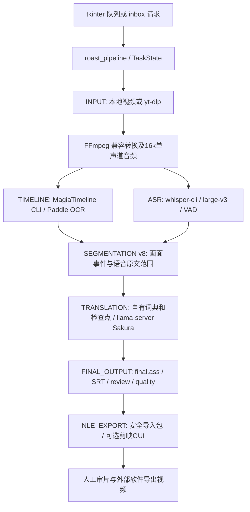
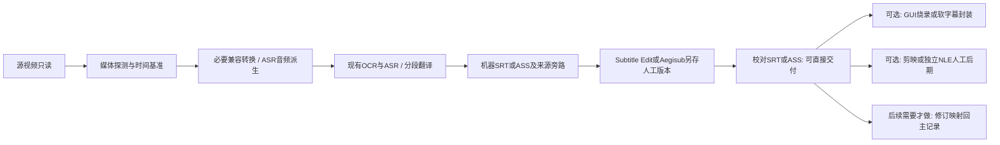
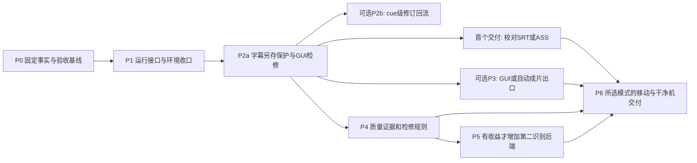

# 现有项目架构与事实审计

审计日期：2026-10-25。范围：`LOCAL_WORKSPACE`，并只读核对配置指向的 D/G 盘工具、已有运行证据及官方上游。只新增本目录七份 Markdown；没有运行制作任务、测试套件、GUI、模型或发布脚本，没有改业务代码、配置、模型、字幕及草稿。

## 1. 结论与证据等级

项目是已有实际产物和恢复证据的 **Windows 本机半自动字幕工具**，最新候选来自 2026-10-12 的第 8 轮实现。下载、提音、Magia 画面轴/OCR、Whisper ASR、Sakura 翻译、分段、ASS/SRT、复核表及剪映导入包均已有实现。最终带中文字幕视频的自动渲染尚未接入主流水线；剪映自动导入的当前版本兼容性、完整内容准确性及跨机器分发仍未验收。

2026-10-25根据用户补充方向复审：已有SRT/ASS应作为主要交付物，人工GUI检修后独立另存，烧录放在最后且可选；FFmpeg没有剪映式GUI，但Subtitle Edit可在图形界面调用它成片。另发现原`--zh-file`路径限制条数/时间且会规范化ASS标签，不适合作为自由人工稿回流入口。具体证据和轻量方案见 [03第9节](03-media-pipeline.md)；不要求先重构或实现完整修订数据库才能手动校对现有字幕。

报告统一使用：

- **[代码]**：从当前源码、配置或 Git 对象直接确认。
- **[产物]**：本次读取既有真实运行记录/文件；不是本次重新运行，也不证明其他素材同样成功。
- **[文档]**：交付或历史说明声称，未获得同范围独立验证。
- **[推断]**：基于调用关系的判断，未做对应行为实测。
- **[未知]**：现有材料不足，列入 07 报告。

最重要的验收依据是 final_usability_audit_20261012.json（本地证据：`implementation_20261010/draft_eval/final_usability_audit_20261012.json:1`，未公开）：`accuracy_accepted=false`、`native_ui_accepted=false`。mixed/speech 两种 35 秒任务各 15 条、13 条待复核、3 处术语未遵循；各次恢复跳过七个 DONE 阶段，保存记录表明字幕和原始交换文件不变。零源字符遗漏是结构覆盖证明，不是识别或翻译准确率。

## 2. 版本、目录与 Git 历史

| 路径 | 实际角色与边界 |
| --- | --- |
| `LOCAL_WORKSPACE/fix_stage` | 当前开发源码。23 个非测试 Python 模块、22 个测试脚本，共 45 个；本次全部通过只读 AST 解析。 |
| `LOCAL_WORKSPACE/implementation_20261010/candidate_20261011` | 本机可用候选，包含 EXE、外置 tools/config。当前其中 43 个 `.py` 与 fix_stage 同名文件逐字节一致；这不是独立安装包验收。 |
| `LOCAL_WORKSPACE/github_publish/guaiwenshu_cut-translate-halfauto` | 已整理的发布源码 Git 仓库。app/tools、app/config、tests、scripts、build、docs；不是全部历史工作区。 |
| `LOCAL_WORKSPACE/implementation_20261010` | 修复实验、真实任务、模型对照、候选快照及证据。大量 `fix_*.py`/`add_*.py` 是历史改写脚本，不能作为日常启动入口。 |
| `LOCAL_WORKSPACE/.research/VoiceTransl_readonly_20261002` | v1.21/v1.30 的部分研究源码快照，无完整 Git checkout；不代表本机 EXE 的完整对应源码。 |
| `LOCAL_WORKSPACE/repair_20261002`、`review_20261002`、`review_20261009` | 历史修复/复现材料。旧缺陷必须对照 v8 重新判断。 |
| `LOCAL_WORKSPACE/archive/legacy_20261010` | 已归档旧入口、日志、发布计划及图像；是恢复材料，不应当作待删除垃圾。 |
| `LEGACY_ROOT`、`EXTERNAL_TOOLS_ROOT` | 配置依赖的原工具/模型/正式目录。当前审计没有部署或改写它们。 |

**[代码] Git：**根目录 `.git` 没有有效仓库内容，`git rev-parse` 失败。不得据此初始化新仓库并声称恢复旧历史。发布镜像有效，当前 HEAD 为 `93df2625f5bfa71e8dd9bb897beac3d01a730b10`，工作树干净。其可见历史只有：

1. `321f01eebd841969fc308369c4990d20026482c6`，2026-10-19，初始 README。
2. `93df2625f5bfa71e8dd9bb897beac3d01a730b10`，2026-10-22，67 文件的源码整理发布。

本次核对发布镜像 app/tools：22 个业务模块与 fix_stage 的 AST 相同，`release_sync.py` 为适配发布布局而不同。早期开发时间和逐次决策不能从这两次 Git 提交重建；8–10 月文档、备份和测试记录只能作为辅助历史证据。见 源码发布记录（本地证据：`docs/GITHUB_源码发布_20261022.md:1`，未公开）。

## 3. 当前真实调用与数据流

阶段名以 [task_state.DEFAULT_STAGES](../../app/tools/task_state.py)（本地证据：`fix_stage/tools/task_state.py`；原审计源码第21行） 为准。两个识别阶段目前顺序运行，不是并行任务图。`jp_ocr.srt` 名字容易误导：默认由 Whisper **语音**识别生成；画面 OCR 在 `timeline.ass` 中，二者含义不同。

| 阶段 | 实际承担者与接口 | 当前产物/行为 |
| --- | --- | --- |
| 输入/下载 | [prepare_input](../../app/tools/roast_pipeline.py)（本地证据：`fix_stage/tools/roast_pipeline.py`；原审计源码第915行）、yt-dlp 命令模板 | 本地文件可引用或复制；链接下载及 info JSON。网站当前下载成功率未重测。 |
| 媒体处理 | [ensure_compatible_video](../../app/tools/roast_pipeline.py)（本地证据：`fix_stage/tools/roast_pipeline.py`；原审计源码第362行）、FFmpeg | 非接受容器/编码转为 H.264 MP4；提单声道 16 kHz WAV。已兼容的视频不统一重编码。 |
| 画面轴/OCR | [magia_timeline_adapter.main](../../app/tools/magia_timeline_adapter.py)（本地证据：`fix_stage/tools/magia_timeline_adapter.py`；原审计源码第247行） | ASCII 临时工作区、任务 YAML、原生 ASS、日志、编码验证；启用 Paddle OCR，禁用 Tesseract。 |
| ASR | [voicetransl_adapter.recognize](../../app/tools/voicetransl_adapter.py)（本地证据：`fix_stage/tools/voicetransl_adapter.py`；原审计源码第75行） | Whisper CLI GGML large-v3；SRT、完整原生 JSON、词时间旁路。非零退出拒收；VAD 时钟冲突可同模型无 VAD 重试。 |
| 分段 | [build_segments](../../app/tools/subtitle_segments.py)（本地证据：`fix_stage/tools/subtitle_segments.py`；原审计源码第236行） | mixed/screen/speech；父语音、画面事件、原文范围、稳定 ID、来源/风险标记；可选 Qwen 对齐默认关闭。 |
| 翻译 | [translate](../../app/tools/voicetransl_adapter.py)（本地证据：`fix_stage/tools/voicetransl_adapter.py`；原审计源码第273行）、[translate_batch](../../app/tools/sakura_client.py)（本地证据：`fix_stage/tools/sakura_client.py`；原审计源码第412行） | 本地 llama-server 的 `/v1/chat/completions`；Sakura 正文逐行协议、父句参考、术语表、重试和逐条恢复。正常流程不运行 VoiceTransl GUI/translate.exe。 |
| 字幕成品 | [publish_segment_output](../../app/tools/subtitle_segments.py)（本地证据：`fix_stage/tools/subtitle_segments.py`；原审计源码第568行）、[run_alignment](../../app/tools/roast_pipeline.py)（本地证据：`fix_stage/tools/roast_pipeline.py`；原审计源码第506行） | 按片段身份接回译文，输出 ASS、review.csv；中文字幕 SRT 位于 subs；质量摘要位于 deliverables。 |
| 后期交付 | [export_nle](../../app/tools/roast_pipeline.py)（本地证据：`fix_stage/tools/roast_pipeline.py`；原审计源码第1344行） | 复制媒体/ASS/复核表到导入包；可选剪映 UI。阶段叫 EXPORT，不意味着生成了 MP4。 |

## 4. 模块清单、完成程度与保留价值

| 模块 | 职责、状态和建议 |
| --- | --- |
| [one_click_roast.py](../../app/tools/one_click_roast.py)（本地证据：`fix_stage/tools/one_click_roast.py`；原审计源码第441行） | 2427 行 tkinter 主界面、设置、串行队列、后台进程、恢复、词典 UI。已有可用候选及启动记录；完整 GUI 交互未验收。保留界面，逐步抽出执行和设置处理。 |
| [roast_inbox.py](../../app/tools/roast_inbox.py)（本地证据：`fix_stage/tools/roast_inbox.py`；原审计源码第154行） | 文本/URL/JSON 请求目录，working/done/failed/status；真实文件队列实现，不是消息中间件。保留，补崩溃遗留 working 请求恢复。 |
| [roast_pipeline.py](../../app/tools/roast_pipeline.py)（本地证据：`fix_stage/tools/roast_pipeline.py`；原审计源码第750行） | 1393 行 CLI、配置、阶段、质量和 NLE 编排。已实现，文件头仍写 skeleton 是陈旧说明，不能据此称整个实现是框架。 |
| [task_state.py](../../app/tools/task_state.py)（本地证据：`fix_stage/tools/task_state.py`；原审计源码第108行） | 原子状态、失败分类、历史、PID 检查、阶段恢复。优先原样保留其数据兼容性；不是跨主机强事务队列。 |
| [artifact_validation.py](../../app/tools/artifact_validation.py)（本地证据：`fix_stage/tools/artifact_validation.py`；原审计源码第100行） | 字幕结构、边界、来源 CSV 与 JSON 校验。保留并补质量规则；可解析不能证明内容正确。 |
| [subtitle_segments.py](../../app/tools/subtitle_segments.py)（本地证据：`fix_stage/tools/subtitle_segments.py`；原审计源码第524行） | v8 主记录、源范围覆盖与身份审计。是重要算法资产；不应退回按时间独立匹配日中两路的旧方案。 |
| [subtitle_axis_align.py](../../app/tools/subtitle_axis_align.py)（本地证据：`fix_stage/tools/subtitle_axis_align.py`；原审计源码第1行） | SRT/ASS 解析、时间与报告公共函数，也保留旧独立合轴路径。共享工具仍被主流程使用；旧 align 不能整文件删除。 |
| [magia_timeline_adapter.py](../../app/tools/magia_timeline_adapter.py)（本地证据：`fix_stage/tools/magia_timeline_adapter.py`；原审计源码第126行）、[magia_utf8_runtime.py](../../app/tools/magia_utf8_runtime.py)（本地证据：`fix_stage/tools/magia_utf8_runtime.py`；原审计源码第1行） | CLI 隔离、编码与私有 UTF-8 副本兼容。针对真实故障的补丁，非任意冗余；更换 OCR 后仍需中文路径验收。 |
| [voicetransl_adapter.py](../../app/tools/voicetransl_adapter.py)（本地证据：`fix_stage/tools/voicetransl_adapter.py`；原审计源码第75行）、[sakura_client.py](../../app/tools/sakura_client.py)（本地证据：`fix_stage/tools/sakura_client.py`；原审计源码第23行） | ASR/翻译运行、模型服务所有权、HTTP/SSE留证、批次校验。保留为默认后端适配器。 |
| [voice_dictionary.py](../../app/tools/voice_dictionary.py)（本地证据：`fix_stage/tools/voice_dictionary.py`；原审计源码第44行）、[dictionary_editor.py](../../app/tools/dictionary_editor.py)（本地证据：`fix_stage/tools/dictionary_editor.py`；原审计源码第1行）、[voice_common.py](../../app/tools/voice_common.py)（本地证据：`fix_stage/tools/voice_common.py`；原审计源码第1行） | native 前/GPT/后词典、用户 JSON 词典、编辑和公共文件/进程函数。保留数据，条件词典兼容并未完成。 |
| [translation_checkpoint.py](../../app/tools/translation_checkpoint.py)（本地证据：`fix_stage/tools/translation_checkpoint.py`；原审计源码第15行） | 翻译输入/模型/词典签名，已完成条目即时保存。值得保留；不等于人工修订版本管理。 |
| [forced_alignment.py](../../app/tools/forced_alignment.py)（本地证据：`fix_stage/tools/forced_alignment.py`；原审计源码第1行） | 可选独立 Qwen 对齐及原始预测审计。已有实现和实验，但真实长片未合格，默认关闭。 |
| [tool_discovery.py](../../app/tools/tool_discovery.py)（本地证据：`fix_stage/tools/tool_discovery.py`；原审计源码第192行） | 工具/模型探测及 ASCII 路径回退；保留，补明确能力/版本验证，避免“最大模型文件”替代语义选择。 |
| [jianying_bridge.py](../../app/tools/jianying_bridge.py)（本地证据：`fix_stage/tools/jianying_bridge.py`；原审计源码第1行）、[jianying_ui_import.py](../../app/tools/jianying_ui_import.py)（本地证据：`fix_stage/tools/jianying_ui_import.py`；原审计源码第1行） | 安全交付包与 GUI 导入，放在可选后期出口。无已证实必须保留自动化的特殊功能。 |
| [jianying_uia_probe.py](../../app/tools/jianying_uia_probe.py)（本地证据：`fix_stage/tools/jianying_uia_probe.py`；原审计源码第1行）、[capture_app_window.py](../../app/tools/capture_app_window.py)（本地证据：`fix_stage/tools/capture_app_window.py`；原审计源码第1行） | Windows 窗口选择/截图诊断；保留维护用途，不放入无 GUI 制作的必要依赖。 |
| [diagnostics.py](../../app/tools/diagnostics.py)（本地证据：`fix_stage/tools/diagnostics.py`；原审计源码第127行） | 白名单诊断 ZIP、脱敏；保留，完整原始本地日志仍含字幕内容，分享前需审查。 |
| [release_sync.py](../../app/tools/release_sync.py)（本地证据：`fix_stage/tools/release_sync.py`；原审计源码第1行） | 白名单发布、备份、核验、回滚；有真实发布历史。保留，审计不执行。 |

## 5. 队列、恢复、缓存与追溯性

**[代码+产物] 已有较强基础，不需要从零引入调度框架：**

- GUI `_worker` 串行处理，支持停止、跳过、遇错继续及自有进程树清理，见 [1595 行](../../app/tools/one_click_roast.py)（本地证据：`fix_stage/tools/one_click_roast.py`；原审计源码第1595行）。GUI 队列主要是内存对象，未开始项目不等于已持久化；未完成任务可从 task.json 扫描恢复。
- `TaskState` 保存 RUNNING/DONE/FAILED/INTERRUPTED/CANCELLED、尝试次数及错误；进程死亡后转 INTERRUPTED，见 [178 行](../../app/tools/task_state.py)（本地证据：`fix_stage/tools/task_state.py`；原审计源码第178行）。原子替换防半写，PID 检查不构成并发写入的排他锁；多启动器抢占同任务有潜在竞争。
- `execute_stage` 比较签名并重新校验产物，必要时使下游失效，TIMELINE 改变可保留 ASR，见 [217 行](../../app/tools/roast_pipeline.py)（本地证据：`fix_stage/tools/roast_pipeline.py`；原审计源码第217行）。七阶段恢复已有保存的真实证据。
- 小文件完整 SHA-256；大于 16 MiB 的媒体/模型用路径、大小、mtime，见 [191 行](../../app/tools/roast_pipeline.py)（本地证据：`fix_stage/tools/roast_pipeline.py`；原审计源码第191行）。这是性能折中，不能抵抗内容改动但元数据未变的情况。
- 翻译检查点和 HTTP/SSE 原始交换留档有助于定位断流、截断及错配；只有完成的响应才接入译文。不存在统一自动重试所有阶段的策略。
- `job_manifest.json`、`jobs_index.json`、task_events JSONL、质量摘要构成追溯基础；媒体 PTS 变换、OCR 框/分数、人工修订和完整 ASR 处理覆盖尚未形成统一记录。
- inbox 只扫描顶层 pending 文件，异常退出后 working 文件不会由现有 `pending_files()` 自动找回，见 [177 行](../../app/tools/roast_inbox.py)（本地证据：`fix_stage/tools/roast_inbox.py`；原审计源码第177行）。任务恢复和请求队列恢复要分开处理。

## 6. 主要问题与耦合

| 优先级 | 发现、证据类型与影响 |
| --- | --- |
| P1 | **[代码] 人工改稿缺少保护层。** final.ass/review.csv 经原子写仍会覆盖目标；外改译文与旧 sidecar 会身份冲突。需要机器结果、人工修订、发布版本分离。详见 04。 |
| P1 | **[产物] 内容准确性未通过。** 人名、否定/关系、漏义和未完句仍需人工；`ready` 只能表示既有规则未发现风险。 |
| P1 | **[代码] 干净安装依赖不完整。** 发布 requirements 未列 PyYAML，而 `voice_dictionary.py:14`、Magia adapter 无条件导入 yaml；本机已有包掩盖了缺口。 |
| P1 | **[代码/条件风险] 命令模板走 shell。** `run_command` 在字符串格式化后 `shell=True`，URL/路径/代理来自输入，未见统一参数化与 shell 字符防护，见 [124 行](../../app/tools/roast_pipeline.py)（本地证据：`fix_stage/tools/roast_pipeline.py`；原审计源码第124行）。有引号不能保证所有 Windows 特殊输入安全；本次未提交攻击输入或证明被利用。建议实现时优先改参数列表。 |
| P2 | **[代码] 无声纯画面文本不具备端到端通路。** 分段函数有 VISUAL_ONLY，但主流程 ASR 必经且要求非空，见 [996 行](../../app/tools/roast_pipeline.py)（本地证据：`fix_stage/tools/roast_pipeline.py`；原审计源码第996行）。 |
| P2 | **[代码] 编排/UI耦合。** GUI 同时处理配置、队列、日志、进程；pipeline 大函数嵌套多个阶段并拼装全局 context，模式和资源依赖容易互相影响。现有阶段接口可以逐步整理，无需先换框架。 |
| P2 | **[代码] 安装目录布局耦合。** Magia 当前工作目录/config/template/models、VoiceTransl `_internal` 和 D/G 绝对路径；候选 EXE 后台仍调用外部 Python。移动目录/其他电脑不保证可用。 |
| P2 | **[代码] 不必要复制的候选点。** Magia 开 OCR 时每任务复制模型，导入包复制视频；非兼容源会另存 H.264。前两项可评估受控共享/链接，转换因 Magia兼容性有现实理由，不能直接删除。 |
| P2 | **[代码+文档] 格式/职责命名陈旧。** jp_ocr 实为 ASR、NLE_EXPORT 不出视频；旧 auto_roast_pipeline 文档和 AGENTS 的 10.9 状态晚于代码已过时。应在后续实施更新入口，不能将旧 R01–R07 全算现存。 |
| P2 | **[未知] 运行峰值与性能。** 没有本轮 CPU/GPU/RAM/VRAM profiling。不能声称换 Python库或删 GUI 就会更快或省显存。 |

`translate_json_batch` 是保留的显式诊断路径；默认是正文协议，不能当作“仍强迫模型输出 JSON”的当前缺陷。旧 `align` 与分段发布共用解析工具，历史修改脚本、打包副本、研究源码的存在也不等于重复执行。

## 7. 环境与分发

**[本次只读版本/元数据检查]** `PYTHON310_ROOT/python.exe` 为 3.10.11；PyYAML 6.0.3、pywinauto 0.6.9、pywin32 312、Pillow 12.2.0、yt-dlp 2026.7.4、imageio-ffmpeg 0.6.0、PyInstaller 6.21.0。包元数据不是完整导入/兼容测试。该解释器没有 torch/paddlepaddle/onnxruntime/faster-whisper/qwen-asr 元数据；外部打包工具可有独立运行时，不能据此称 ASR/OCR 不可用。

配置的 FFmpeg 是 imageio 自带 7.1，支持 libass 和所需媒体滤镜。FFprobe 未在 PATH/该 FFmpeg 同目录发现，但原 VoiceTransl `_internal/ffmpeg/ffprobe.exe` 存在，可在后续验证后显式配置。Magia 上游源码要求 Python 3.12.8+，不能直接塞入主程序 3.10 环境；可选 Qwen 的 CPU 虚拟环境也应隔离。

已核实 Whisper 模型约 2.88 GiB、Sakura GGUF 约 5.82 GiB，合计约 8.71 GiB **磁盘**，不含工具、OCR、VAD、缓存、实验模型。程序 EXE 大小、模型磁盘占用、运行 RAM、GPU VRAM 必须分别统计；不能用权重文件大小推算显存最低值。本轮 CIM 硬件查询被拒、PATH 无 nvidia-smi，当前硬件/驱动及峰值未实时测量，未升级权限。已有 Sakura真实任务日志（本地证据：`implementation_20261010/jobs/sample_s01_v8_user_glossary_candidate_mixed/logs/voicetransl/sakura_server.log:21`，未公开） 记录Vulkan0 / Intel Iris Xe、29/29层offload；这是历史GPU运行证据，日志可用内存与model/KV buffer不是物理显存容量或系统峰值。

可行分发方向是主程序/脚本运行环境、外部引擎、模型仓库和用户任务分别存储，固定版本/能力与许可清单，在移动目录和无 D/G 盘机器上验收。现有 朋友包草案（本地证据：`docs/朋友试用包_打包方案与使用说明草案.md:1`，未公开） 仍是草案。源码仓库未指定主项目许可证；第三方开源不自动赋予主项目同等分发许可。

## 8. 本次检查边界

已检查当前源码模块/导入、全部45脚本语法、配置形状和关键值、22测试脚本及其历史汇总、启动/构建脚本、两次Git提交、关键交接/复盘与真实产物、VoiceTransl部分研究源码及官方文档。保存的发布测试汇总为22/22成功，但**本次没有重跑**；测试会写 test-results/合成媒体，不符合本轮仅新增审计报告的限制。

没有穷举反编译第三方二进制、审查整个 site-packages、重跑长片、验证当前网站下载或操作剪映。更早开发历史、本地 VoiceTransl EXE 对应的精确源码提交、人工金标准确率仍未知。后续阅读顺序：02 组件身份 → 03 媒体 → 04 质量 → 05 方案 → 06 路线 → 07 待确认。

---

# VoiceTransl 身份、职责与整合可行性

审计日期：2026-10-25。证据等级沿用 [01](01-current-state.md)。本报告区分本机安装、固定版本研究源码、当前上游；没有启动或修改 VoiceTransl。

## 1. 先确认是哪一个项目

**可确认是 [shinnpuru/VoiceTransl](https://github.com/shinnpuru/VoiceTransl)，基于 GalTransl 的桌面字幕/翻译项目。** 它不是一个叫 VoiceTransl 的统一识别模型，也不是本项目直接调用的远端翻译服务。

| 对象 | 核对结果 |
| --- | --- |
| 本机安装标识 | `EXTERNAL_TOOLS_ROOT/VoiceTransl-v1.21-win-sakura`；当前配置的模型/原生翻译资源指向此目录。目录版本为 v1.21；不能仅凭目录名证明 EXE 精确源码版本。 |
| 固定研究基线 | 官方tag v1.21指向 `788a25b59e8f8c0d5556ab47c18a4a9d17e3931f`，本次GitHub API已核对。已有部分源码在 `LOCAL_WORKSPACE/.research/VoiceTransl_readonly_20261002/v1.21`；不含完整源码和完整依赖，也没有 .git。 |
| 另一研究快照 | v1.30，`b5f7e5038763aeb3420ac872c0bd191112f92227`，只作差异研究，不能算本机已升级。 |
| 本次官方复核 | GitHub API 确认官方 main 为 `b70799cc2ccf80fbcaa566634bcc6f07fd16cc88`（2026-10-17）；[该版 README](https://github.com/shinnpuru/VoiceTransl/blob/b70799cc2ccf80fbcaa566634bcc6f07fd16cc88/README.md) 已描述 CrispASR/Qwen3-ASR 工作流。 |
| 开源许可 | 固定 v1.21 的 [LICENSE](https://github.com/shinnpuru/VoiceTransl/blob/788a25b59e8f8c0d5556ab47c18a4a9d17e3931f/LICENSE) 为 GPL v3 文本；README 同时写有禁止商业用途，存在声明不一致，见第 7 节。 |
| 本地修改版 | 有本项目自己的适配器、ASCII 路径资源副本和 Magia 私有兼容补丁；没有证据表明完整 VoiceTransl GUI 被自行重编译。VoiceTransl 本机 EXE 精确对应提交及是否含上游外补丁仍未知。 |

身份与历史证据见 2026-10-02 专项复盘（本地证据：`docs/PROJECT_REVIEW_20261002_字幕错位重复与VoiceTransl.md:121`，未公开）；该文描述的旧 JSON 翻译协议等缺陷已被 v8 修改，不能直接沿用为当前结论。

## 2. 当前项目实际上怎样使用它

**[代码] 正常流程绕开 VoiceTransl 主 GUI，也不运行原生 translate.exe。**

1. 主程序先用自配 FFmpeg 提取 WAV。
2. [recognize](../../app/tools/voicetransl_adapter.py)（本地证据：`fix_stage/tools/voicetransl_adapter.py`；原审计源码第75行） 运行 `LEGACY_ROOT/runtime/whisper/whisper-cli.exe`，模型指向 VoiceTransl 安装目录中的 GGML。
3. [translate](../../app/tools/voicetransl_adapter.py)（本地证据：`fix_stage/tools/voicetransl_adapter.py`；原审计源码第273行） 读取自己维护的片段、词典和提示词，启动/复用 `LEGACY_ROOT/runtime/llama/llama-server.exe`，通过本地 OpenAI 兼容 HTTP 接口翻译。
4. 字幕身份、分段、错误处理、恢复和最终输出由本项目负责。

既有专项核对的 D 盘 Whisper/llama-server 与 G 盘 VoiceTransl 对应文件哈希相同；配置事实和组件来源相符。配置里的 `translation.executable=.../translate.exe` 仍被保留/探测，不表示默认 translate 路径实际执行它。VoiceTransl 主要提供 **现成引擎包、模型、词典格式及兼容资源**。

两种接口不可混淆：

- llama-server `/v1/chat/completions` 是当前实际翻译接口。
- v1.21 的 GalTransl/server.py（本地证据：`.research/VoiceTransl_readonly_20261002/v1.21/GalTransl/server.py:2858`，未公开） 实现 `/api/jobs`、`/api/jobs/<id>`、项目/缓存/问题接口；`serve()` 默认 loopback:12333（3263 行）。它提交的是准备好的翻译项目，非直接“视频到成片”接口。本项目未接入，打包 EXE 的可启动入口、安装版本支持程度和稳定性未实测。

原生 translate.parse_arguments（本地证据：`.research/VoiceTransl_readonly_20261002/v1.21/translate.py:46`，未公开） 接收项目目录或 YAML 与翻译模板；不能把它当成现有自有 SRT adapter 的同参数替换物。

## 3. ASR、模型和时钟

| 能力 | 本机当前路径 | VoiceTransl研究源码/上游能力与边界 |
| --- | --- | --- |
| ASR模型 | GGML `ggml-large-v3.bin`，语言 ja；当前运行的是 whisper.cpp CLI | v1.21 MainWorker._process_single_audio（本地证据：`.research/VoiceTransl_readonly_20261002/v1.21/app.py:2641`，未公开） 按模型名前缀分支 whisper 与 faster-whisper。存在分支不等于本机用了后者。 |
| faster-whisper | adapter 92–93 行明确拒绝把 GGML 当 CTranslate2 模型 | 独立后端需自己的模型、CTranslate2/运行环境、词时间/VAD语义测试；不能只改 engine 字符串。 |
| 模型下载/管理 | 主程序检查配置路径存在，通过工具发现选择资源；未见生产自动模型下载/校验注册中心 | v1.21 GUI 1114 行从 whisper、whisper-faster 目录枚举本地模型。完整下载/更新机制未从本地部分源码建立闭环，不承诺自动下载/迁移。 |
| VAD | recognize 116–121 行传 `--vad --vad-model`；缺失启用模型明确失败；未配置时找 EXE 旁 Silero v5.1.2 | 已有 VAD 但不是说话人识别，也不能证明所有语音被识别。 |
| 字词/分段时间 | `-ojf -dtw large.v3`，保存原生 JSON 和 token 对应；v8 验证坐标 | whisper.cpp token/DTW并非人工确认的强制对齐金标。日文 BPE 字节需无损重组，不能按字符数猜词时长。 |
| 时钟恢复 | VAD父句/词时钟冲突时，保存两次完整证据，同音频同模型无 VAD 再识别，只有合格词时间才选择 | 这是本项目 adapter 的功能，不能当作直接抽走上游 ASR 后自然保留的能力。见 [150–224 行](../../app/tools/voicetransl_adapter.py)（本地证据：`fix_stage/tools/voicetransl_adapter.py`；原审计源码第150行）。 |
| 长音频切块 | 当前 `segment_enabled=false`，GUI保存也固定关闭，adapter 未按 segment_minutes 执行分块 | v1.21 GUI有 `_split_audio`、`_merge_segment_translations`（2689/2726行），依赖GUI配置、FFmpeg和翻译项目；没有被本项目接入。 |
| 说话人识别 | 当前adapter没有说话人 diarization 输出/模型/任务阶段 | 当前材料不能确认完整安装包所有可选功能是否支持；不得将原生句子 speaker 字段当作声纹分离。 |
| GPU/CPU | 独立 EXE 承担推理，翻译 server 有 `gpu_layers`，不依赖主Python导入torch；本机目录有ggml-cpu/ggml-vulkan DLL | 历史真实Sakura日志已记录Intel Iris Xe/Vulkan0和29/29层offload，证明曾走GPU路径；本轮未重测驱动/峰值。Whisper的实际GPU执行仍需对应识别日志，不由翻译GPU推定。 |
| 脱离GUI | 已经实现且有真实任务证据 | 原生GUI可留给用户独立操作；无需为“去GUI”先复制整个源码。 |

本次只读 stat：large-v3 为 3,095,033,483 字节（约2.88 GiB），Silero 为885,098字节；Sakura GGUF为6,254,196,608字节（约5.82 GiB）。这些是磁盘文件大小，不是峰值RAM或最低显存。

GPU证据：sakura_server.log第21行（本地证据：`implementation_20261010/jobs/sample_s01_v8_user_glossary_candidate_mixed/logs/voicetransl/sakura_server.log:21`，未公开），127行offload、129行model buffer约5532MiB、149行KV buffer896MiB。日志还报15457MiB free，不能将它称为独立物理显存容量，更不能将两个buffer之和等同整机峰值。

## 4. 翻译、上下文和词典兼容

### 4.1 已经使用的处理链

源SRT和分段身份 → native译前替换 → 相关GPT词条/用户词典 → 用户风格及父句上下文 → Sakura正文请求 → 行数/完整响应验证或拆单句重试 → native译后替换 → 可定位原词替换 → 术语/日文残留/不确定标记 → SRT与身份sidecar。

证据：[translate 295–359行](../../app/tools/voicetransl_adapter.py)（本地证据：`fix_stage/tools/voicetransl_adapter.py`；原审计源码第295行）、[翻译后处理513–598行](../../app/tools/voicetransl_adapter.py)（本地证据：`fix_stage/tools/voicetransl_adapter.py`；原审计源码第513行）、[plain_translation_payload](../../app/tools/sakura_client.py)（本地证据：`fix_stage/tools/sakura_client.py`；原审计源码第365行）。

- 存储：native `dict_pre.txt`、`dict_gpt.txt`、`dict_after.txt`；用户 `translation_glossary.json` 支持 flat/带default等结构；风格为 `translation_style_prompt.txt`。当前 seed 在 fix_stage/config，原用户词表不得合并覆盖。
- [load_native_dictionary](../../app/tools/voice_dictionary.py)（本地证据：`fix_stage/tools/voice_dictionary.py`；原审计源码第44行） 处理制表符、转义、GPT箭头/备注、前缀`^^`和单次`1^`。按长词优先应用普通替换。
- `pre_src/post_src/pre_dst/post_dst/pre_jp/post_jp/pre_zh/post_zh/mono/diag` 等条件/情景语法被跳过并警告；这不是完整 GalTransl 词典兼容。direct SRT 缺少原生句子情境元数据。
- 上游固定版 [GalTransl/Dictionary.py](https://github.com/shinnpuru/VoiceTransl/blob/788a25b59e8f8c0d5556ab47c18a4a9d17e3931f/GalTransl/Dictionary.py#L34) 确有上述条件/情景词典，依赖CSentense，并有条件组合/前后处理语义；不能用普通字符串替换宣称等价。
- [native_glossary_prompt](../../app/tools/voice_dictionary.py)（本地证据：`fix_stage/tools/voice_dictionary.py`；原审计源码第99行） 只注入相关词条；提示词注入不能保证模型遵循。源文本中的错字也可能使词条不命中。
- [ensure_required_terms](../../app/tools/voice_dictionary.py)（本地证据：`fix_stage/tools/voice_dictionary.py`；原审计源码第218行） 当前只原位替换可确认原词；缺失目标交给 review，**没有旧版句尾追加译名行为**。
- `trainer_context` 等上下文分支是有限启发式，不能当作完整世界书或人物关系推理。
- 当前客户端保留完整父句/同批参考；已在待译正文完整出现的父句不重复塞入system，所有审计参考仍保存。画面OCR自动注入翻译参考的退化实验已回退，不是生产默认能力。

### 4.2 重试、批量、缓存和完整性

[translate_batch](../../app/tools/sakura_client.py)（本地证据：`fix_stage/tools/sakura_client.py`；原审计源码第412行） 默认最多三次尝试（初次+2次重试）；多行cue单独请求；普通单行返回数量正确才按顺序对应，记录明确为“非语义验证”。数量不一致保存完整响应，再逐条请求，不猜缺行归属。

[translation_signature](../../app/tools/translation_checkpoint.py)（本地证据：`fix_stage/tools/translation_checkpoint.py`；原审计源码第15行） 包括原文、提示词、词典、模型/适配器及native资源签名；完整条目即时保存，响应断流不接成正式结果。默认生成没有固定时间/输出token截止，模型循环可能需要用户停止；不能为了得到完成状态丢弃台词或静默截断。

[start_server](../../app/tools/sakura_client.py)（本地证据：`fix_stage/tools/sakura_client.py`；原审计源码第158行） 复用已有服务时验证模型名称，自启服务仅loopback并只关闭自己拥有的进程。同名不同权重仍不能由 `/v1/models` 名称证明内容身份，应在未来清单补强。

### 4.3 上游隐藏职责，不应遗漏

固定v1.21源码确认还包括：

| 能力 | 证据 | 本项目使用情况 |
| --- | --- | --- |
| 音频提取、视频硬/软字幕合成、剪切、音频配图 | app.py synth/clip/audiosynth（本地证据：`.research/VoiceTransl_readonly_20261002/v1.21/app.py:2509`，未公开）、3070行提音 | 本项目提音已独立；合成/剪切未走这些GUI函数。 |
| SRT转项目JSON、翻译后SRT/LRC/双语合并 | srt2prompt.py（本地证据：`.research/VoiceTransl_readonly_20261002/v1.21/srt2prompt.py`，未公开）、prompt2srt.py（本地证据：`.research/VoiceTransl_readonly_20261002/v1.21/prompt2srt.py`，未公开）、app 2726行 | 当前主流程不依赖该JSON往返，不必为了兼容原生CLI增加同类转换。 |
| 原生译前/后处理、对话分析与插件钩子 | LLMTranslate.preprocess_trans_list/postprocess_trans_list（本地证据：`.research/VoiceTransl_readonly_20261002/v1.21/GalTransl/Frontend/LLMTranslate.py:244`，未公开） | 自有adapter只复用词典子集；不能声称继承全部插件/情景规则。 |
| 分块、缓存、问题检查、项目恢复 | 同文件318/439/456行及postprocess流程 | 本项目有自己的TaskState/translation_checkpoint；两套缓存不是可互换数据库。 |
| Sakura原生上下文、退化检测、重试和cache | CSakuraTranslate（本地证据：`.research/VoiceTransl_readonly_20261002/v1.21/GalTransl/Backend/SakuraTranslate.py:25`，未公开），120/253/298/382行 | 值得对照，但不能将上游修复/填原文等策略默认为适合本项目。 |
| 下载、人声分离、总结、批量GUI管理 | app `vocal_split`2428、`summarize`2457、`run`2802及README | 未见主流水线调用；不能据README说已整合。 |

未发现上游这些职责是当前烤肉助手不可替代的隐藏依赖。真正必须保留的是已经投入使用的识别/翻译语义、词典子集、时钟恢复和证据机制。

## 5. 按能力比较四种整合方式

下表“保留”指保留**现有 CLI/HTTP 调用**，不是重新依赖 GUI。成本是相对判断，未经实际开发工时测量。

| 能力 | 1 保留现有调用 | 2 直接内部模块 | 3 提取适配源码 | 4 独立库/工具实现 |
| --- | --- | --- | --- | --- |
| ASR+VAD | 低成本，沿用GGML/真实回归；锁定EXE参数与版本 | 调GUI worker会引入Qt、全局cwd、配置和进程注册；收益低 | 抽取模型分支看似小，时钟/路径/进程仍需自维护 | 独立whisper.cpp最接近现状；faster-whisper需新模型和运行时，作为第二adapter比较后再选 |
| 字词时间/时钟恢复 | 保留当前旁路、VAD重试最稳 | 上游返回字段与本地规范记录不同，仍需adapter | 易漏BPE字节、父句坐标、失败证据；维护成本高 | 独立强制对齐可辅助，但当前Qwen长片失败；不能默认升级 |
| 普通native词典 | 当前实现已够用且可迁移 | 完整原生字典依赖句子类型和project config | 可小范围提取但引入GPL来源追踪/兼容测试 | 维持现有自有parser和测试最小；不要“简化”丢失前缀/转义/备注 |
| 条件/情景词典 | 当前跳过，必须明确告知 | 原生完整项目接口可能更合适，需要补句子元数据 | 隐含依赖多，不推荐硬抽 | 独立重做成本中高，需要真实条件词条样本；暂不承诺全兼容 |
| Sakura翻译/上下文 | 当前HTTP+正文协议/留证最容易回滚 | 可评估原生项目CLI/API保完整后处理；需要入口实测 | CSakuraTranslate依赖BaseTranslate、配置、句子、cache/chatbot等，抽取并不轻 | llama.cpp继续独立提供HTTP；新的模型/翻译API只在有质量收益时加adapter |
| 批量/重试/缓存 | 当前有真实恢复证据，优先保留 | 双调度/双缓存需桥接，不能直接import替换 | 复制会产生两套易漂移的状态语义 | 对现有机制补充即可，无需再引入队列框架 |
| 提音/合成/字幕转换 | 提音已用FFmpeg，原生GUI无需参与 | GUI方法依赖控件和cwd，收益很小 | 抽FFmpeg拼串代码还要重写转义/错误管理 | FFmpeg+现有SRT/ASS模块成本最低；新增成片出口即可 |
| 其他下载/分离/总结 | 保留VoiceTransl供用户手动用，不占主流程 | 原生CLI/API入口逐项确认后再接 | 依赖和许可证范围大 | 有明确需求才选独立工具，本轮不扩范围 |

## 6. 开发、维护、性能与扩展取舍

| 维度 | 保留CLI/HTTP | 直接内部模块 | 抽源码 | 独立后端 |
| --- | --- | --- | --- | --- |
| 开发成本 | 最低，补契约/能力探测 | 中高，要装齐上游运行时并适配版本 | 高，需追踪传递依赖与补丁 | 中，whisper.cpp近似；faster/新OCR需重新验收 |
| 维护风险 | 参数漂移可通过版本固定/探针发现 | 私有类/对象/配置改变直接传播 | 成为自维护fork，跟进上游最难 | 库接口更明确，仍须固定版本和模型 |
| 兼容性 | 现有GGML、GGUF、词表/缓存保留最好 | 原生项目完整，但自有cue_id需桥接 | 易漏条件词典、上下文、cache | 明确转换策略；GGML不通用到CTranslate2 |
| 性能 | 不会因保留外部EXE自然变慢；可测批次服务复用 | 推理模型/后端不变时无固有加速 | 删除GUI主要减少壳体，不会自动减权重/VRAM | 可量化/批处理，但需同音频同配置实测，不能引用上游benchmark当本机收益 |
| 许可 | 外部工具/权重各自核对，捆绑有分发义务 | 直接链接/组合需要评估GPL兼容 | GPL代码复制/修改来源和对应源码义务更直接 | 按库及模型独立许可选型，不能只看主库MIT |
| 扩展性 | 现有adapter可增加第二实现 | 受上游内部架构约束 | 变成fork路线 | 高，但不应一次装多个重后端 |

独立候选参考：[whisper.cpp](https://github.com/ggml-org/whisper.cpp)；[faster-whisper官方说明](https://github.com/SYSTRAN/faster-whisper)确认其基于CTranslate2、使用不同模型格式和运行依赖。AMD/Intel机器不能直接照搬NVIDIA CUDA配置。没有本机比较前不指定它优于现有whisper.cpp。

## 7. 许可证与分发边界

1. VoiceTransl 固定v1.21 LICENSE为GPLv3；其README又写非商用，二者表述不一致。需保留具体版本文件并在计划分发/商用前请上游澄清，不把README一条话擅自合成为新许可证。
2. 复制GPL源码和直接引入内部模块前应审查组合方式、修改来源、对应源码及通知要求。以独立进程调用降低代码耦合，不能据此宣称捆绑二进制没有许可义务。
3. Whisper.cpp上游为[MIT](https://github.com/ggml-org/whisper.cpp/blob/master/LICENSE)，这不覆盖VoiceTransl GUI、全部第三方动态库、模型或FFmpeg。
4. [Sakura 3.7官方模型卡](https://huggingface.co/SakuraLLM/Sakura-GalTransl-7B-v3.7)标注 **CC BY-NC-SA 4.0** 并有非商用说明；不能因为llama.cpp开放就按无限制商用模型分发。模型卡与本地权重的精确revision对应仍须保留现有校验清单。
5. 主项目发布镜像没有指定自己的许可证，第三方LICENSE不能代替主项目授权决定。先外置用户自行选择工具/模型可减少捆绑范围，但不能掩盖来源和条款。

这是基于具体文件的工程许可风险清单，未替任何权利人作许可解释或裁定。当前只读使用和本报告不涉及重新分发。

## 8. 推荐

**保留现有 Whisper CLI 与 Sakura HTTP 作为默认适配器，保留原 VoiceTransl 安装供独立人工使用；逐步解除安装目录布局绑定，不提取整个GUI或GalTransl框架。**

仅当用户确实依赖目前跳过的条件词典、原生项目插件或原生cache时，先验证其稳定CLI/本地项目API，再决定是否增加第二翻译路径。对简单普通词典继续复用现有数据/测试即可。独立ASR/OCR后端应在同一金标集证明质量、时钟、恢复及资源收益后加入，不自动替换默认。

实施前仍需：精确安装包来源/哈希与对应源码、第三方组件构建信息、真实条件词典样本、GPU/CPU能力与峰值、原生API入口及许可声明澄清。统一列于 [07](07-open-questions.md)。

---

# 媒体流程、FFmpeg与人工字幕工具

审计日期：2026-10-25。事实等级见 [01](01-current-state.md)。以下替代流程为设计，未执行渲染、安装编辑器或操作用户剪映。

**2026-10-25补充结论：优先交付可编辑SRT/ASS，人工在字幕GUI中调整后另存；烧录/封装均为可选末端。FFmpeg自身没有剪映式编辑GUI，但Subtitle Edit已有调用FFmpeg的图形化成片窗口。需要完整视频时间线时再评估Kdenlive/Shotcut。详见第9节，本节优先于原先“以自动成片为首个目标”的排序。**

## 1. 当前剪映承担什么

**[代码] 当前剪映自动化主要做“新建/选择工程、导入视频和字幕、加入时间线、截图记录”，不负责前面的识别翻译，也没有实现自动视频导出。**

- [roast_pipeline.export_nle](../../app/tools/roast_pipeline.py)（本地证据：`fix_stage/tools/roast_pipeline.py`；原审计源码第1344行） 调安全导入包，按开关再调UI importer。
- [run_jianying_bridge](../../app/tools/roast_pipeline.py)（本地证据：`fix_stage/tools/roast_pipeline.py`；原审计源码第561行） 把视频、final.ass、review.csv交给bridge；SRT当前在任务subs目录，不在现有包中。
- [jianying_bridge.py](../../app/tools/jianying_bridge.py)（本地证据：`fix_stage/tools/jianying_bridge.py`；原审计源码第1行） 创建文件包/manifest和说明，探测草稿格式；没有实现剪映草稿生成器或解密修改器。
- [jianying_ui_import.py](../../app/tools/jianying_ui_import.py)（本地证据：`fix_stage/tools/jianying_ui_import.py`；原审计源码第340行） 导入素材/字幕并点击加入轨道；467–510行运行步骤后写completed。动作完成和截图不能证明实际字幕条数、文件身份、起点或没有重复。
- [validate_nle](../../app/tools/roast_pipeline.py)（本地证据：`fix_stage/tools/roast_pipeline.py`；原审计源码第1356行） 现在要求UI状态为completed，已修复旧版仅验JSON语法的问题；仍缺轨道内容读回核验。

**[产物]** 最后可用性审计（本地证据：`implementation_20261010/draft_eval/final_usability_audit_20261012.json:1`，未公开） 明确 `native_ui_accepted=false`。历史10.9流程不能证明当前11.4.2能完整导入/重导入/导出。已有安全导入包不等于通过剪映实际轨道验收。

## 2. 全用途替代矩阵

“可替代”是满足功能的技术可行性，不是已接入或已验收；未见实现的项目不计入现有功能损失。

| 用途 | 当前证据 | FFmpeg原生能力 | 程序/第三方/人工需求及判断 |
| --- | --- | --- | --- |
| 视频导入 | UI导入本地视频并加入轨道 | 直接读取媒体，无需工程导入 | Python检查媒体/流、路径和输出身份。标准自动生产可以去掉剪映导入动作。 |
| 视频导出 | 未见主流程自动导出；由外部人工后期承担 | 编码、封装、进度输出、音视频映射 | 需新增渲染阶段、日志/取消/校验；不能只把现有NLE_EXPORT改名便称完成。 |
| 剪切 | 主流水线未见通用剪辑列表；VoiceTransl研究GUI有独立clip工具 | `-ss/-t`、trim/atrim | Python维护剪辑点和字幕时间映射。stream copy受关键帧约束，精确切点通常需解码重编码。 |
| 拼接 | 未见生产自动拼接 | concat demuxer/filter | 统一参数/时间基准；Python生成清单或滤镜。不是原样复制剪映工程。 |
| 字幕轨道 | 本项目已生成SRT/ASS，再交UI导入 | 可烧录文本或封装软字幕流 | Python管理cue身份与校对回流；FFmpeg不是字幕内容编辑器。 |
| 字幕样式 | final.ass保留模板样式/字段，必要时生成Default | libass渲染ASS；subtitles滤镜可读SRT | Aegisub适合样式/定位；字体需配置和发布许可。剪映专有样式不能保证像素级复现。 |
| 音频提取 | 已经由FFmpeg完成 | 单声道/重采样/PCM | 保留；源音轨与ASR音频不能相互覆盖。 |
| 音量/混音/降噪 | 未见剪映自动化对应处理 | volume/amix/loudnorm/部分降噪滤镜 | Python配置；响度两遍分析、混音听感需验证。高级人声分离要专用模型，不能当作普通滤镜等价替代。 |
| 转场/画面效果 | 未见本项目自动化实现 | xfade等常规滤镜 | Python生成滤镜图；剪映模板/特效市场和复杂美术效果仍适合人工NLE。无需为未用功能保留自动化。 |
| 工程文件生成 | 当前没有真正草稿写入；有格式探测/安全文件包 | 不生成可编辑剪映工程 | 需专门第三方/自研草稿适配与版本测试，属于可选支线，不列默认重构范围。 |
| GUI自动化 | pywinauto、Win32、坐标和窗口探测 | 无需GUI可执行媒体命令 | 可从标准字幕成片路径移出；保留用户自选后期入口。 |
| 人工校对 | review.csv+剪映审片建议；无受保护的回导层 | 无语义/人工判断能力 | Subtitle Edit/Aegisub打开字幕+视频/音频校对，主程序读新版本并渲染。需新增文件回流协议。 |
| 复杂人工后期 | 用户可能在旧草稿中手工完成，代码不能确认全部 | 不能替代交互创作 | 剪映作为可选人工工具保留；先盘点真实工程需求，不能从烧录视频推断轨道结构。 |

FFmpeg滤镜能力以[官方文档](https://ffmpeg.org/ffmpeg-filters.html)为依据；本次也对配置二进制进行了只读能力检查。没有发现现有代码中必须通过剪映自动化才能合理完成的功能。**标准字幕视频交付可以完全绕开剪映自动化；无法据此声称替代用户在剪映中的全部创作能力。** 不使用虚构的“替代百分比”。

## 3. 本机FFmpeg与探测方式

**[本次只读检查]** 配置指向：

`PYTHON310_ROOT/lib/site-packages/imageio_ffmpeg/binaries/ffmpeg-win-x86_64-v7.1.exe`

`-version`为7.1 essentials gyan构建，带`--enable-gpl --enable-version3 --enable-libass`；`-filters`存在ass、subtitles、concat、xfade、amix、loudnorm。编译列出硬件编码支持并不证明本机GPU可用。未进行渲染画质/速度/字体实测。

FFprobe在PATH和上述FFmpeg目录未发现；但 `EXTERNAL_TOOLS_ROOT/VoiceTransl-v1.21-win-sakura/_internal/ffmpeg/ffprobe.exe` 实际存在。因此不是“电脑没有ffprobe”，而是主配置未明确使用。当前 [probe_video](../../app/tools/roast_pipeline.py)（本地证据：`fix_stage/tools/roast_pipeline.py`；原审计源码第302行） 解析FFmpeg人类可读stderr，精度和字段覆盖弱于[ffprobe JSON](https://ffmpeg.org/ffprobe.html)。

建议后续媒体探测接口统一返回：duration、流索引/语言、time_base、start_time、分辨率、SAR/DAR、rotation、平均/名义帧率、音频采样率及必要的帧PTS。优先显式配置/能力核对，不能把任意PATH ffmpeg当作相同构建。

## 4. 推荐媒体流程

1. **保留源媒体**。兼容转换是派生产物，记录输入/输出身份及时间变换。当前H.264转换旨在满足Magia；先证明原媒体可直接解码、颜色/旋转/时间正确，才减少它。
2. **保留低成本音频旁路**。16kHz/mono供ASR；成片使用原音轨或明确处理后的音轨，不把识别WAV误当最终音频。
3. **输出候选字幕**。机器版本写新路径，review与sidecar记录角色和来源。人工编辑器打开副本，另存校对版本。
4. **校对另存即可交付**。人工版保存到机器任务目录外或独立review版本，不要求先回灌旧翻译阶段。仅当要恢复源文关联、逐字段合并或机器再处理时，才做base hash和cue映射。详见04及本报告第9节。
5. **按需渲染为新文件**。可由Subtitle Edit等GUI读取人工字幕调用FFmpeg；将来需主程序自动渲染时再补独立接口。冻结样式/字体，校验新输出，不覆盖源视频/旧成品；人工ASS直接作为渲染输入，不重生成其样式。
6. **验证与交付**。比对实际时长、音视频流、首尾/换屏/重叠字幕画面；保留字幕本身，支持重渲染而无需重新识别翻译。

渲染输入必须显式选择：机器候选、部分已审或已审版本。执行完成和人工质量确认分别记录；需要预览机器结果时允许生成并标记，不增加任意长度/阅读速度硬门槛。

## 5. 标准字幕格式选择

| 格式 | 用途 | 兼容/往返注意 |
| --- | --- | --- |
| SRT | 普通中文字幕正文/时间校对、广泛导入 | 毫秒；样式弱，无可靠持久cue ID，编辑器重编号不表示身份稳定。不能只靠行号接回原文。 |
| ASS | 保留样式、层、定位、同时显示、对白/画面文字分轨 | 百分之一秒；保留PlayRes、Style、Layer、Name/Effect及覆盖标签；导出SRT会丢失这类信息。 |
| JSON旁路 | 原始证据、稳定ID、父句/画面范围、修订谱系 | 不是用户被迫手工编辑的字幕格式；由主程序维护。编辑器可能丢ASS自定义字段，旁路仍不可省。 |
| MP4软字幕 | 需要可开关文本且播放器支持 | mov_text样式保真有限；不能保留全部ASS效果，播放器表现需验收。 |
| MKV字幕流 | 保留ASS样式/多字幕流的可选交付 | 可附字体，但播放器支持/字体分发许可需核对。 |
| 烧录视频 | 固定可见的中文字幕视频 | 字幕像素进入画面，必须视频重编码；后续文本修改需重新渲染，不能从视频无损找回原字幕工程。 |

SRT与ASS精度不同，往返比较应按原始毫秒/实际帧PTS和格式量化解释，不把格式舍入当“自动修正了时间”。默认优先SRT检修正文和时间，需要排版时以ASS为主，不强制在各阶段来回转换。

## 6. Subtitle Edit与Aegisub

官方资料于2026-10-25复核；本机安装、具体版本和操作往返未验收。它们都足以成为人工字幕工具，不要求开发新的字幕GUI。

| 工具 | 更适合的任务 | 连接方式与限制 |
| --- | --- | --- |
| Subtitle Edit | 普通文本/时间校对、波形/视频同步、差错列表、批量格式转换 | [官方文档](https://subtitleedit.github.io/subtitleedit/)列有文件保存、波形、同步与错误检查。推荐作为SRT检修默认候选；只打开本地文件即可，不必启用在线AI或另外下载识别模型。 |
| Aegisub | ASS样式、层/定位、特效和音频定时 | [官方文档导航](https://aegisub.org/docs/latest/audio_timing_tutorial/)包括字幕编辑、音频定时、样式、排版、自动保存。适合ASS主文件；复杂覆盖标签需实际FFmpeg/libass渲染比对。 |

Subtitle Edit当前官方主线已是5系跨平台版本，不能套用旧4.x的全部系统要求；[官方README](https://github.com/SubtitleEdit/subtitleedit)说明Windows最低10 22H2、发行包自包含。实施时固定一个实际测试版本，不因“最新版”自动升级。Aegisub应从[项目维护仓库](https://github.com/TypesettingTools/Aegisub)及其发行渠道选版本。

授权：Subtitle Edit当前仓库为[MIT](https://github.com/SubtitleEdit/subtitleedit/blob/main/LICENSE)；Aegisub主体为[BSD式三条款](https://github.com/TypesettingTools/Aegisub/blob/master/LICENCE)，所带组件各自许可。作为外部编辑器调用最简单；若捆绑发行，仍须核对该版本的完整通知和媒体库。

不默认启动“合并相同文本”“调整所有时长”“全轨平移”等批量修复。真实重复、背景文字和语音跨屏都可能合理，先让用户预览差异。编辑器自动备份能防编辑过程丢失，不能阻止主程序覆盖另一份文件。

## 7. Windows、性能与许可

- 用参数列表调用媒体工具；FFmpeg滤镜内部还有第二层转义，应使用受控工作目录/滤镜文件和测试过的路径编码，覆盖中文、空格、冒号、引号等。不能把`JSON.stringify`或shell双引号当作完整转义方案。
- 字体可用性、fallback、字号/描边、PlayRes、颜色矩阵、HDR/SDR和旋转都影响成片；这些由实际输出验收，不能只检查返回码。
- 减少导入包视频副本、按内容缓存兼容转换/音频、批次复用已核实模型服务，有性能空间；无profiling不承诺倍数提升。硬字幕渲染可能是新增显著耗时，取代手工导出不会消除编码成本。
- [FFmpeg官方许可说明](https://ffmpeg.org/legal.html)指出构建选项影响许可。本机实际启用GPL/version3/libx264，不能按纯LGPL构建打包；需要保留来源、构建信息与对应通知。字体及专有素材许可另算。

## 8. 剪映保留与草稿导出结论

保留旧工程、用户已安装剪映以及手动导入入口。推荐默认交付标准字幕，FFmpeg或GUI成片为可选后续；剪映用于用户选择的后期剪辑、模板、美术与审片。没有必要为了字幕交付而继续维护脆弱坐标点击。

剪映草稿导出仅列可选研究：需要明确版本、格式可读性、样式/媒体相对路径、重导入幂等和工程副本回滚。现有安全包不是草稿。除非用户确认真实需求与验收样本，否则不纳入推荐方案的必做阶段。

## 9. 专项补充：字幕文件优先，怎样保留图形化调整

### 9.1 直接烧录会发生什么

“烧录”“软字幕”“字幕编辑”是三个不同动作：

| 交付形式 | 文字和时间还能怎样改 | 调整后是否要重新编码视频 | 推荐定位 |
| --- | --- | --- | --- |
| 原视频+外挂SRT/ASS | 在编辑器改字、拖起止、拆并、调ASS样式；播放器加载文件预览 | 仅改字幕不用重新编码视频 | 主要工作资产和首选交付物 |
| MKV/MP4内封软字幕 | 将文本轨提取/改写后重新封装；具体格式/样式取决于容器和播放器 | 兼容流可复制，不必重新编码音视频；重新封装仍会读写容器 | 可选的单文件可开关字幕交付 |
| 只有烧录MP4 | 文字已是像素，没有独立字幕轨可改/关闭；OCR或遮盖不是无损找回工程 | 改画面字幕通常要从原视频和字幕重新渲染 | 最终派生成片，不能作为唯一母版 |

**烧录不意味着今后完全不能改，而是不能只拿那份烧录MP4像改字幕轨一样改。** 只要保留原视频、校对SRT/ASS、字体/样式，修改字幕后可以重新成片，无需重新跑下载、OCR、ASR和翻译。不要在已烧录中文的成片上再叠一层纠正版，否则旧字仍在底图中。

基于[FFmpeg命令行/转码说明](https://ffmpeg.org/ffmpeg.html)、[Subtitle Edit软字幕编辑说明](https://subtitleedit.github.io/subtitleedit/features/embedded-subtitles.html)及本地流程作上述工程判断。软字幕可用性要用目标播放器/发布平台验证；平台是否保留软字幕不能默认。

### 9.2 FFmpeg有类似剪映的GUI吗

FFmpeg是命令行媒体处理工具/库，不自带剪映式多轨编辑界面。FFplay是预览播放器，也不是字幕时间轴编辑器。“程序内部用了FFmpeg”不等于FFmpeg负责GUI、字幕编辑和项目管理，这些由前端软件实现。

本轮复核的现成GUI如下；均为官方文档能力，**未在本机安装/实机往返验收**，不把文档截图当本机成功证明。

| 需求 | 优先候选 | 官方已确认的图形化能力 | 适用范围与审查结论 |
| --- | --- | --- | --- |
| 看视频/听音频改字和拖动时间 | Subtitle Edit | 波形上拖字幕边缘改起止、拖整体平移、拆并及视频联动；[波形文档](https://subtitleedit.github.io/subtitleedit/features/audio-visualizer.html) | 最贴近本项目“机器初稿→人工检修”；不要求用它的AI重识别 |
| 人工校对后直接从GUI出视频 | Subtitle Edit | `Video → Generate video with burned-in subtitles`窗口设置字体/编码/音频/新输出位置，内部调用FFmpeg；[烧录文档](https://subtitleedit.github.io/subtitleedit/features/burn-in.html) | 可以先不开发主程序烧录按钮。编辑状态与最终视频输出分开，先保存字幕 |
| ASS定位、字体、描边、分层和特效 | Aegisub | 字幕文字、起止/持续时间、Style/Layer/边距及覆盖标签；[编辑文档](https://aegisub.org/docs/latest/editing_subtitles/) | 原生ASS作为母版。导出SRT会失去排版，参见[导出文档](https://aegisub.org/docs/latest/exporting/)；不把它承诺为通用视频导出器 |
| 像剪映那样同时剪视频/配音并在时间线改字幕 | Kdenlive | 官方26.08手册支持字幕轨拖时长、文本编辑、ASS/SRT等导入、ASS/SRT导出、样式和多层；[字幕手册](https://docs.kdenlive.org/en/effects_and_filters/subtitles.html) | 完整NLE候选；本轮没有证明比剪映更轻或更适合用户，也没有证明复杂ASS全保真 |
| 完整NLE的另一个候选 | Shotcut | 可导入/编辑字幕，设置起止、移动、预览，导出独立SRT；[官方字幕文档](https://forum.shotcut.org/pub/subtitles-panel)、[格式能力](https://www.shotcut.org/features/) | 支持导入ASS/SSA不代表SRT出口保留样式；需要保留项目文件，不能把SRT当全部工程 |

因此不需要开发“FFmpeg版剪映”。若主要是字幕检修，先选Subtitle Edit；排版需求交给Aegisub；只有要改视频画面/拼接/音频/转场时才进入Kdenlive/Shotcut或继续手用剪映。它们之间无需再建立自动鼠标联动，标准字幕文件是交接接口。

普通编辑/波形不要求启用新的ASR模型。Subtitle Edit官方说明“speech-only waveform”等高级项会下载额外识别/分离运行时，首次检修不启用；正常波形可能生成本地缓存，属于后续实际试用时单独验收，不在本轮执行。

### 9.3 现有项目已经能提供什么

本次再次确认现有35秒机器结果存在，未重生成或改写：

- 原始35秒视频（本地证据：`implementation_20261010/draft_eval/test_slices/sample_s01/opening_0_35.mp4`，未公开）。
- 中文SRT（本地证据：`implementation_20261010/jobs/sample_s01_v8_user_glossary_candidate_mixed/subs/zh_machine.srt`，未公开）。
- 带样式ASS（本地证据：`implementation_20261010/jobs/sample_s01_v8_user_glossary_candidate_mixed/deliverables/final.ass`，未公开）。
- 复核CSV（本地证据：`implementation_20261010/jobs/sample_s01_v8_user_glossary_candidate_mixed/deliverables/review.csv`，未公开）。

这些是待校对机器稿，既有质量记录各15条中13条待复核，并非准确成品。可以直接作为将来编辑器试用样本；无需为“先输出字幕”重新搭一条识别/翻译链。

`--no-jianying-ui`和`--skip-jianying-package`已在 [CLI参数](../../app/tools/roast_pipeline.py)（本地证据：`fix_stage/tools/roast_pipeline.py`；原审计源码第771行） 中存在，可在未来制作任务按需关闭后期环节。本轮没有启动该命令；它们并不实现人工版本保护或自由回导。

### 9.4 新发现：不要把已校对ASS直接塞回原翻译入口

**[代码] 旧 `--zh-file` 是机器译文/既定分段输入，不是自由字幕编辑回流接口：**

1. [validate_translation](../../app/tools/roast_pipeline.py)（本地证据：`fix_stage/tools/roast_pipeline.py`；原审计源码第1217行） 要求条数、index、开始和结束与canonical输入完全一致。用户拖时间、拆并字幕后，即使字幕文件本身合法也会失败。
2. [retime_supplied_translation](../../app/tools/roast_pipeline.py)（本地证据：`fix_stage/tools/roast_pipeline.py`；原审计源码第712行）先核对旧sidecar中文本/时间/身份；不能解决随意改字、改轴后的陈旧旁路。
3. [normalize_text](../../app/tools/subtitle_axis_align.py)（本地证据：`fix_stage/tools/subtitle_axis_align.py`；原审计源码第88行）移除`<...>`和`{...}`标签；parse_ass第155行把规范化正文放入cue.text。直接用于--zh-file路径时，人工ASS行内样式/定位标签不会从cue.text保留下来。
4. [run_alignment](../../app/tools/roast_pipeline.py)（本地证据：`fix_stage/tools/roast_pipeline.py`；原审计源码第506行）使用原timeline作为输出模板；[publish_segment_output](../../app/tools/subtitle_segments.py)（本地证据：`fix_stage/tools/subtitle_segments.py`；原审计源码第623行）从该模板取头部/事件样式，再换上cue正文。因此人工ASS的样式表、Style/Layer/边距等也不能承诺通过该入口往返保留。

这些是调用链审查结果，本轮没有往用户任务输入修改文件进行复现。该规范化对识别匹配有用途，问题是把它误用作有样式最终字幕的无损导入器；不应为此全局删除规范化函数。

**最轻量的解决方向：先不回灌。** 主程序交付机器SRT/ASS → 人工另存reviewed.srt/ass → 直接作为字幕成品，或由编辑器/独立渲染入口读取该文件。只有要把人工修改再次用于机器翻译、来源分析或模式重排时，才实现原文谱系/冲突映射。

未来独立渲染入口应把人工ASS原文件交给libass，不经过原文normalize/按旧cue重写；可以只读解析验证时间和字体，不能用解析后的纯文本重建它。原始字幕hash、视频hash及选定版本足以支持初期渲染留证，不必先建完整修订数据库。

### 9.5 建议的最小可用里程碑

**M1：字幕文件交付及GUI检修。** 复用现有机器输出，明确打开SRT/ASS/原视频/复核表，提供另存目录和命名建议；校对结果不写回机器缓存。可只交字幕，不必生成MP4。

**M2：GUI按需成片。** 首先验证Subtitle Edit的GUI烧录；保留原视频与最终ASS/SRT，生成新文件。需要自动批处理时才实现独立FFmpeg渲染阶段。

**M3：可选深度回流或完整NLE。** 需要重新翻译/源范围映射时接回主记录；需要剪视频时进入NLE。二者不是M1/M2的前置条件。

最小验收：一个实际35秒样本，在一个编辑器里改字、拖起止、拆并、调整样式并另存；重开验证；仅改字幕不重跑模型；原机器稿和原视频hash不变。可选成片必须核对更改生效、字体和音画同步。ASS→SRT样式损失、视频剪辑后的时间坐标、自动吸附/全局修复误改分别检查，不能因看起来能预览就认定往返无损。

若剪了视频，字幕时间属于新的视频版本：记录剪辑工程和导出的字幕，不能拿剪后SRT再套原视频，也不能只重新渲染原视频复现多轨剪辑。导入/导出格式支持、主程序理解编辑、NLE工程恢复是三个独立验收。

---

# OCR、ASR、时间轴与人工检修设计

审计日期：2026-10-25。先说明当前事实，再给设计；未运行识别、自动修复或改写任何现有字幕。证据等级见 [01](01-current-state.md)。

## 1. 三类时间和两类文字必须分开

画面OCR回答“屏幕写了什么、何时出现/消失”；ASR回答“音频说了什么、何时说”；最终中文字幕还包含选择来源、切分、翻译和显示方式。画面可以提前显示完整句、保留未说完的后半句、只出现标题/招牌，也可能与口语不同。**OCR与ASR不一致只能先标记潜在冲突，不能自动把一方替换为另一方。**

当前已有父语音、画面事件和原文范围，这是应保留的基础；尚未形成完善的人工确认文本层。

## 2. 当前八个问题的实情

| 问题 | 从当前代码确认的行为 | 限制 |
| --- | --- | --- |
| 1 如何取OCR帧 | [Magia adapter](../../app/tools/magia_timeline_adapter.py)（本地证据：`fix_stage/tools/magia_timeline_adapter.py`；原审计源码第312行）将视频送外部MagiaTimeline；选择dtd/default/speculative，不是主Python逐帧截图OCR | 主模块看不到每个采样帧/PTS/检测框。`max_resolution=0`为不缩放，当前候选配置区域为整幅。 |
| 2 如何识别文字 | adapter338–344行设extraJobs=ocr、doPaddle=true、doTesseract=false，结果在timeline.ass | 本地二进制精确版本/内部模型revision未完整绑定。研究源码不能代替二进制对应证明。 |
| 3 出现/消失时间 | Magia以画面变化生成ASS区间；主程序解析其开始/结束 | 没有完整逐帧边界证据或VFR/偏移映射。已有个别真实边界PTS核对，不代表全片同帧准确。 |
| 4 重复文字 | [align_page_text](../../app/tools/subtitle_segments.py)（本地证据：`fix_stage/tools/subtitle_segments.py`；原审计源码第66行）与build_segments按文字锚点/事件位置对应，部分连续同文事件可合并；stable_id纳入出现身份 | 不全局删除重复台词。OCR闪烁/背景变化、真正同文再次出现仍可能产生歧义，应检查事件来源。 |
| 5 画面与语音不同 | build_segments保留visual_events/parents/source_ranges，TEXT_CONFLICT、VISUAL_ONLY、未映射等标记 | 当前翻译主源仍主要是ASR原文范围，未有可靠自动“识别纠错主文本”层。 |
| 6 错识别/漏识别/错合并 | 有源范围覆盖、身份校验和冲突标记；VAD词坐标冲突可无VAD重试 | 完整保留的是ASR文字，不代表没漏听。无音频活动覆盖证明；视觉OCR置信度未标准化保留。 |
| 7 最终中文时间 | [build_segments](../../app/tools/subtitle_segments.py)（本地证据：`fix_stage/tools/subtitle_segments.py`；原审计源码第236行）先按mixed/screen/speech产生canonical段；翻译按相同cue身份返回；[publish_segment_output](../../app/tools/subtitle_segments.py)（本地证据：`fix_stage/tools/subtitle_segments.py`；原审计源码第568行）生成ASS/SRT | 缺可靠词时间时保留父句时间包络并CHECK；不按中文字数比例切译文。该包络可能需人工进一步细分。 |
| 8 人工改后保护 | 现有checkpoint和sidecar阻止某些陈旧身份混用 | 没有人工锁/修订分支。原子写保证完整写入，但可覆盖final.ass/review.csv；直接编辑zh_machine.srt而不更新旧sidecar会失败。 |

**上游资料的边界：** [MagiaTimeline官方README](https://github.com/HurryPeng/MagiaTimeline/tree/1.1)说明framewise逐帧/每n帧、speculative跳过不太可能变化的帧。已有研究 upstream_TextExtraction.py（本地证据：`implementation_20261010/upstream_TextExtraction.py:36`，未公开）使用PP-OCRv4_mobile_det/PP-OCRv6_small_rec，从interval attachment取代表帧并提取rec_texts；未把rec_scores写入当前规范记录。该源码是研究材料，不证明本机EXE与其逐字节对应，更不能把上游“多数情况同帧”目标写成本项目准确率。

## 3. 已经存在的可靠性措施

- [audit_segment_records](../../app/tools/subtitle_segments.py)（本地证据：`fix_stage/tools/subtitle_segments.py`；原审计源码第524行）检查ID唯一、正向时间、原文范围合法、非空白字符不能遗漏/重复分配、输出文本符合原范围。
- [load_whisper_word_times](../../app/tools/subtitle_segments.py)（本地证据：`fix_stage/tools/subtitle_segments.py`；原审计源码第459行）保留原始token/DTW证据，不能用非法/缺失词时间插值冒充精确时间。
- [recognize的恢复](../../app/tools/voicetransl_adapter.py)（本地证据：`fix_stage/tools/voicetransl_adapter.py`；原审计源码第150行）保存VAD初次和无VAD重试；非零退出不接收残留SRT。
- [artifact_validation](../../app/tools/artifact_validation.py)（本地证据：`fix_stage/tools/artifact_validation.py`；原审计源码第78行）已有负时间、非正时长、开始倒序、字幕解析遗漏、实际媒体越界等检查；源ASR粗时间可先保留警告，派生时间在翻译前需合法。
- 翻译身份sidecar确认cue_id/index/text/time；批次行数异常拆单条并保留原响应。术语、日文残留、模型主动[待确认]进入复核。
- [quality_summary](../../app/tools/roast_pipeline.py)（本地证据：`fix_stage/tools/roast_pipeline.py`；原审计源码第1292行）汇总源覆盖、词时钟、未映射、术语及语言问题。缺少人工确认仍不可把ready叫“准确成品”。

**当前缺口：**没有统一识别分数和框、可校准的异常时长/同轨重叠检查、OCR连续性证据、完整语音活动覆盖、人工修订版本及安全回流。review.csv的high/low来自CHECK启发式（[611行](../../app/tools/subtitle_segments.py)（本地证据：`fix_stage/tools/subtitle_segments.py`；原审计源码第611行）），不是模型置信度或准确率。

纯无声OCR还有总流程障碍：虽然分段函数支持VISUAL_ONLY，主流程[validate_asr](../../app/tools/roast_pipeline.py)（本地证据：`fix_stage/tools/roast_pipeline.py`；原审计源码第996行）要求ASR非空；不能声称已端到端支持纯无声字幕片。

## 4. 已有真实证据说明了什么

2026-10-12最后审计（本地证据：`implementation_20261010/draft_eval/final_usability_audit_20261012.json:1`，未公开）：35秒mixed/speech各15条，234原字符保留；各13条CHECK、12处源文冲突、3术语问题。零越界/零字符遗漏和七阶段恢复已记录，但准确性/native UI均false。保存产物本次只读核查，未重跑模型。

历史记录另有572.636秒长片的结构检查、无VAD词时钟恢复和Qwen长片失败。它们证明有长片研究资产，不能把短片最终翻译验收扩展成长片全流程准确。例：`近音专名B/普通词A`、人物关系、人称、未完句属于内容问题，整体平移时间轴无法修好。

Qwen强制对齐曾大量返回SDK修正/非法原始预测，结果被拒；默认关闭是合理的证据决策。模型返回单调时间或进程退出0不构成精确边界证明。

## 5. 推荐轻量数据设计

保留现有JSON旁路，在现有cue_id上扩展，不另建字幕编辑GUI或数据库服务器：

| 记录 | 最少应保存的信息 |
| --- | --- |
| Media | 源身份、实际时长/time_base/start_time、派生转换、音轨及绝对时间映射 |
| VisualEvent | ID、出现次序、原帧PTS/关键帧、区域/框、原始OCR文本/分数、模型/参数、出现和消失依据 |
| SpeechParent/Word | 原始ASR句和字词、绝对时间、活动区间/处理覆盖、有效性、原始/修正值分开 |
| SourceRevision | 原ASR/OCR并列、选作翻译的文本、选择理由、确认者、base hash与父版本 |
| Cue/Translation | ID、source_revision、parent/range、角色、层、时间来源、译文、模型/请求/词典版本 |
| Review/Patch | base revision、cue ID或旧新映射、逐字段更改、人工锁、时间、确认范围、变更原因 |
| Export | 选定字幕版本、媒体/字体/样式/渲染器身份、质量状态、输出hash |

模型没有置信度时保存null/unknown，不能填1.0；不同模型分数不直接横比。比较用Unicode/假名规范化时保留原始文本和字符映射，不能把规范化结果悄悄写回原证据。

画面文字和语音字幕至少用role区分；必要时分别呈现或供人工选择。背景招牌和对白同时显示可能合理，不能全局强制单条字幕或一对一映射。

## 6. 质量检查与处置矩阵

硬性完整性校验与可调整的提示规则分开。异常时长/阅读速度仅作警示配置，不新增默认硬上限，不为了减少复核量删字、合并或截断。

| 检查 | 自动检测 | 自动修复范围 | 自动标记/人工判断 |
| --- | --- | --- | --- |
| 识别置信度异常 | 后端有score/logprob时保留分布；未知单列；低分和OCR行内差异定位 | 无确定文本证据不改字 | 低分、专名、数字、否定词优先复核；高分也不能豁免 |
| 持续时间异常 | duration、字符显示速度、相邻间隔、来源时钟；按角色配置提示 | 只修确定格式/单位错误且生成新版本 | 过短/长、跨句包络由人听音看帧；不统一套最短/最长时长 |
| 越界/非有限/倒序 | start<0、end<=start、end>真实媒体、无穷/NaN/倒序 | 明确已知派生offset可重算；保留变换记录 | 未明时基拒绝发布已验收版本；不得简单钳制到片尾 |
| 不合理重叠 | 按role/layer/父来源比较区间，区别合法同显 | 仅完全相同来源的重复发布可在派生层幂等处理 | 不同来源重叠先标记；不删同文真实重复 |
| OCR连续性 | 相邻代表帧文本/框、短闪、断字、逐字出现/消失、同文背景变化 | 只有证据同事件的帧聚类可自动归组，保留原事件 | 边界附近自适应取帧；歧义保留前后帧与候选时间 |
| ASR/OCR潜在冲突 | 同一时窗的文字差异、名字/数/否定/尾句；画面字与口语相似度 | 不自动把OCR覆盖ASR或相反 | 标明“可能不同内容/识别冲突”，需决定字幕角色与翻译来源 |
| 翻译对应 | cue/source revision、原文范围覆盖、响应完整、缺行/串行、术语/日文残留 | 确定源词的显式替换可应用到新版本；重试须留原响应 | 行数相等不证明语义；漏义、人称、语气和幻觉需人工 |
| ASR漏识别 | 处理完成记录、VAD活动/字幕覆盖、静音/音乐/画面台词差异 | 仅对明确失败区间重识别，保留旧候选 | VAD本身可能漏弱音；未覆盖活动时窗由人听音确认 |
| 人工版本保护 | base hash、字段锁、派生版本和导入差异 | 无冲突字段可确定合并；机器结果写新branch | base改变、拆并/重排/多候选映射必须确认；不得覆盖锁定字段 |

自动标记应包含cue ID、规则、来源区间、前后文/帧和原因，便于编辑器定位；不要仅输出整片“低置信度”。质量状态至少区分执行完成、未校验、待人工、人工确认范围；规则未触发不自动成为人工通过。

## 7. 利用现有编辑器进行人工回流

推荐普通SRT用Subtitle Edit、ASS排版用Aegisub，能力和许可详见 [03](03-media-pipeline.md)。新增的是文件协议，不是重做编辑器。

1. 导出一份机器快照和编辑副本，附base hash、cue manifest和review定位表。编辑副本与机器缓存路径不同。
2. 人工在编辑器中打开视频/音频与字幕；复核人名、错误合并、边界、画面/语音差异；另存SRT/ASS。
3. 回流先解析和比较差异。条数/顺序不变且映射唯一时接回cue ID；SRT行号只能辅助，不能当持久身份。
4. 拆分/合并/排序/整体平移产生新的派生cue及父谱系；模糊匹配不自动视为已确认。ASS的Name/Effect可以帮助，但编辑器可能清理它们，旁路仍应保留。
5. 正文/时间/样式分别标记人工锁和确认范围。只校对时间不代表确认翻译；改ASR源文需建立source revision，原始ASR token仍关联旧文本，不能硬挂到新词上。
6. 渲染显式读取已选择的review版本；后续ASR/翻译重跑写新机器版本，产生冲突报告，保持人工版本原字节可恢复。

现有 [retime_supplied_translation](../../app/tools/roast_pipeline.py)（本地证据：`fix_stage/tools/roast_pipeline.py`；原审计源码第712行） 严格核对身份并保留supplied字节，值得保留，但解决的是同身份译文在模式间重新定时，不是自由外部编辑回流。旧 `.segments.json` 与新正文不符时应提示“需要导入修订”，不能让用户手改旁路冒充一致。

## 8. 边界检修与验收样本

优先复用已找到的35秒/25秒和572.636秒素材，追加少量有针对性的金标片段：无声文字、无画面字幕的口语、同文再次出现、逐字显示、标题/对白同显、连续语音跨换页、片尾未完句、VFR/非零起始PTS。不要重新索要已在G盘找到的素材。

金标应分别标注画面出现/消失帧、音频起止、原文、译文和可接受多解。比较时分别报告字符错误、术语/语义错误、边界偏差、漏片段、重复来源和复核耗时；不能以单个合成总分掩盖错误类别。样本少时报告例数，不伪造统计准确率。

自动边界只能在可靠同源时基上优化：粗定位后对边界附近逐帧/PTS复核，保留前后证据。ffsubsync等声音同步工具至多适合明确整体漂移的同一对白轨，不解决OCR视觉出现区间或错误句子对应，不列默认全局修复。

## 9. 失败、恢复与数据保护验收

- 在生成、翻译、导入修订、渲染分别中断；旧人工版与已发布文件哈希保持不变，恢复只重跑受影响机器阶段。
- 改模型、词典、源文、OCR区域或模式后，相关机器缓存失效；原始证据、人工字段和父版本仍能追溯。
- 错ID/陈旧base/缺sidecar/编辑器重编号/拆并/ASS样式损失都要有明确诊断与回滚，而非静默接受。
- 源覆盖与时间合法属于可自动验证；语义正确、画面文字是否该翻译、复杂重叠与专名含义必须人工确认。复核阈值经真实样本决定，不能为了看起来全绿降低规则。

上述均为实施后的验收要求，本轮未创建测试、未写任何人工修订或运行自动修复。

## 10. 补充审查：先独立校对字幕，复杂回流后置

按用户本轮方向，**第7节的完整回流设计不是使用字幕编辑器或交付人工字幕的先决条件**。最小工作流可以直接复用现有SRT/ASS，在编辑器打开原视频与字幕、另存校对稿并交付。仅需把机器稿和人工稿分开，保留视频/字幕身份和所选版本，避免主程序再写同一路径；未来才按需要追加cue级映射、字段锁和来源谱系。

本轮新增的静态证据：

- [roast_pipeline.validate_translation](../../app/tools/roast_pipeline.py)（本地证据：`fix_stage/tools/roast_pipeline.py`；原审计源码第1230行）强制canonical条数、index和起止时间一致。人工拖时、拆并后的合法字幕不等于仍是合格机器翻译输入。
- [normalize_text](../../app/tools/subtitle_axis_align.py)（本地证据：`fix_stage/tools/subtitle_axis_align.py`；原审计源码第88行）去除HTML/ASS标签；[parse_ass](../../app/tools/subtitle_axis_align.py)（本地证据：`fix_stage/tools/subtitle_axis_align.py`；原审计源码第154行）存入规范化cue正文。`raw`中仍有原事件，但旧成品流程不会把人工文件的全部原事件/样式当作渲染源。
- [run_alignment](../../app/tools/roast_pipeline.py)（本地证据：`fix_stage/tools/roast_pipeline.py`；原审计源码第523行）使用旧timeline作为模板。因此不能承诺把Aegisub校对后的ASS放进`--zh-file`会无损保留位置、字体、层和时间。

结论：先把`reviewed.ass/srt`作为独立成品。编辑器或未来独立渲染入口直接读取它，ASS的完整样式表与覆盖标签保留；不要让旧翻译输入、原文匹配和模板重建参与该渲染路径。与原语音/OCR对应关系未知时标明来源关联未重新审计，不妨碍字幕文件本身可编辑/播放，也不能冒充已有cue级来源确认。

还应把两种人工调整分开：

| 操作 | 对字幕/视频版本的影响 | 验收重点 |
| --- | --- | --- |
| 只改文字、起止或样式 | 视频不变，校对字幕成为新版本 | 改字/拖边/整体移动/拆并后另存重开，确认真实帧、声音和样式；不重跑模型 |
| 剪视频、拼接、变速或换音轨 | 形成新媒体时间线，旧字幕不一定继续对应 | 保留NLE工程、剪后视频和剪后字幕；核对字幕是否随剪辑/变速移动，不自动假设跟随 |

字幕编辑器的波形主要定位语音，OCR文字出现/消失仍要看视频帧；场景切换并不总等于文字换页。自动吸附到静音/镜头、固定时长和批量同文合并先预览差异，不默认改写。

本次只查源码和官方文档；尚未运行编辑器、生成波形、安装组件或修改样本。后续最小实机验证和已有样本链接见 [03第9节](03-media-pipeline.md)。

---

# 三种重构方案与推荐

审计日期：2026-10-25。本文件是方案设计，不是实施授权。事实依据见 [01现状](01-current-state.md)、[02 VoiceTransl](02-voicetransl-analysis.md)、[03媒体](03-media-pipeline.md)、[04质量](04-quality-control.md)。

## 1. 选型前提

现有系统已完成不少期望中的模块化：外部CLI/HTTP、TaskState、按片段翻译、检查点、标准字幕及安全导入包均已存在。主要缺口是人工修订保护、可追溯识别证据、标准字幕回流、成片渲染和可移植环境；不应把它描述成必须从零重写的GUI脚本堆。

推荐目标按用户补充调整为“稳定交付可编辑SRT/ASS，并保护人工校对结果”；烧录成片、软字幕封装和完整回流都是可选后续，不作为首次可用的门槛。质量、速度、包体积和维护成本分别验收。保留旧工具/项目和默认模型，只有真实证据支持时才换引擎。

## 2. 方案A：最小改动

### 内容

保留现有tkinter、pipeline和七阶段。首先利用已经输出的SRT/ASS进行外部GUI检修，另存人工稿；生产默认关闭剪映UI自动导入，保留手动包。需要成片时可先用Subtitle Edit的FFmpeg图形窗口，不先开发自动渲染；提供最小的版本副本/base hash保护。补PyYAML依赖清单和媒体命令安全参数化，不展开主文件结构重排。

### 可获得的收益

最短路径去除末端GUI联动，继续沿用现有模型、词表和任务。用户可用Subtitle Edit/Aegisub校对，直接交付字幕，或自行在GUI按需成片。回滚简单：旧SRT/ASS和人工另存稿都能独立打开。

### 代价与残余风险

配置、执行、质量汇总和UI继续耦合。自由拆并字幕的来源关系只能有限支持；OCR证据不足和无声OCR流程缺口难以系统处理。简单“选一个SRT渲染”解决成片，不会自动解决源文错误或维护难度。

适用：只需当前机器、当前素材类型的快速可用改进，愿意较多手工管理校对版本。

## 3. 方案B：渐进式模块化（推荐）

### 内容

沿用现有TaskState作为统一调度核心，不另上队列服务器或工作流框架。以现有实际变化点为接口，分阶段完成：

1. 固定源码、工具和真实样本基线；补依赖、命令参数和路径/能力探测。
2. 先完成机器稿与人工另存稿分离和标准SRT/ASS交付；需要机器再处理时才建立来源修订、人工patch和cue级回流。
3. 增加FFprobe媒体记录；FFmpeg自动渲染阶段按需求再接，先允许编辑器GUI成片，将剪映出口改为用户可选人工后期。
4. 把质量规则/复核汇总集中到独立模块，逐步补OCR分数/帧PTS和ASR活动/处理覆盖；修复无声OCR的总流程约束。
5. 保留Whisper CLI/Sakura HTTP/Magia为默认适配器。存在具体收益时再加独立ASR或OCR后端，接口相同但保留原始后端证据。
6. 整理运行时/模型路径和版本清单，做移动目录、离线和干净Windows验收。

### 建议模块接口

这是职责设计，尚未创建任何代码/目录：

| 模块 | 调用方只需知道 | 需要封装的实现 |
| --- | --- | --- |
| Media | 探测、派生音频/兼容媒体、渲染；显式输入输出身份 | FFmpeg/ffprobe参数、Windows路径、时基、取消/进度、流/字体能力 |
| Recognition | 音频/视觉输入、后端和资源版本，返回原始artifact及规范证据 | 现有Whisper/Magia进程、模型加载、VAD坐标恢复、OCR框/分数 |
| Segmentation | 两类证据+模式，返回带稳定ID与来源范围的主记录 | 现有v8锚点、出现身份、时钟选择和覆盖审计 |
| Translation | 主记录版本+词典/提示词，返回对应译文与完整交换证据 | Sakura服务、native词典子集、批量歧义/重试/检查点 |
| Review | 导出快照、导入修订、选择版本、报告冲突 | 编辑器丢ID、拆并/重排、字段锁、base hash及版本谱系 |
| Quality | 检查当前证据，返回结构错误/需复核/未知和定位 | 时长/重叠/连续性/冲突/术语规则及人工确认范围 |
| TaskState/Runner | 执行、取消、恢复和阶段产物 | 现有原子状态/日志/指纹；补任务排他占用和请求恢复 |

不把每个函数都包装成插件，不先规定通用插件市场。GUI只提交任务、展示状态、打开文件/编辑器；既有界面保持使用习惯。一个模块暴露少量接口即可封装复杂实现，不按代码行数追求拆文件。

### 数据兼容策略

保留现有task.json/segments JSON读取；新字段用明确schema版本，迁移生成副本。SRT/ASS继续作交换格式，原生文本/词表不原地转换。旧项目无cue身份时标为未验证，由用户确认映射；不能靠条数相等赋予可靠来源。

新机器结果与人工版本分开，变更词典只使相关机器阶段失效；人工锁定字段不会被新的译文覆盖。模型存外部资源库，配置用逻辑身份+本机路径；迁移先校验再切引用，原位置保留回滚。

## 4. 方案C：较大规模架构重构

重新组织工程包、任务图/执行器、配置schema和数据模型；可用嵌入式数据库持久化版本/队列，UI只作为前端。将媒体、ASR/OCR/翻译、质量、修订、发布彻底独立，同时迁移现有数据和工具。

仍可复用v8算法、字幕解析、词表、提示词、真实样本和测试，不能等同推倒算法。不过重建执行/持久化层会扩大迁移面，必须兼容旧task.json、sidecar和人工工程。没有多用户/远程执行需求时，数据库、后台服务及新GUI并非必要成本。

适用：后续已明确多机器并发、多人审校、长期大型任务库或产品化服务需求。当前材料没有证明这些需求，因此不优先选。

## 5. 全维度比较

工时为单名熟悉Python/Windows工程师的粗估，1人日按完整工作日计；含必要回归和既有素材验收，不含大规模人工翻译金标、上游许可澄清等待、模型训练或新GUI。不是工期承诺，P0后应修正。

| 维度 | A 最小改动 | B 渐进式模块化 | C 较大重构 |
| --- | --- | --- | --- |
| 工作量 | 约7–12人日；新增渲染/字幕输入、最小保护、依赖/命令修补，改动集中pipeline和出口 | 约20–40人日必做部分；按阶段整理现有接口、版本回流、媒体与质量；第二识别后端另估 | 约45–90人日；包/执行器/存储迁移、兼容层、全套回归 |
| 功能回归风险 | 低到中，主要媒体/输出路径；旧内容问题仍在 | 中，分段身份/缓存/人工映射最需谨慎，可逐阶段双轨比对 | 高，任务恢复、配置、版本和历史资产同时变化 |
| 性能 | 省去GUI等待/部分复制；模型推理基本不变，新增编码仍耗时 | 可减少重复转换、模型加载/模型复制，按需重跑；实际收益待profiling | 有更大调度空间，但新存储/进程层也有开销，无天然更快保证 |
| 维护性 | 仍依赖大函数和安装布局；更新工具需多处检查 | 高于A，具体后端/媒体/质量变更集中；版本/能力契约约束更新 | 理论高，实际取决于迁移质量和团队维护能力；框架本身也是负担 |
| 原词典兼容 | 最佳保持；条件词典仍不完整 | 保留原文件与parser/测试，条件语法列明；新后端桥接后再验收 | 需完整迁移/兼容层，易丢前后处理、备注和情景语义 |
| 原任务/字幕/工程 | 原路径大多可用，简单人工版本保护 | 可读旧任务，新schema副本迁移；标准字幕回流/人工锁；旧剪映工程保留 | 迁移成本最高；需要版本库和旧格式导入，不能保证所有工程自动迁移 |
| 新ASR/OCR/翻译后端 | 命令模板可替换，但字段/质量适配松散 | 明确证据接口，新增第二adapter后对照；默认引擎不强换 | 最灵活，但接口早期设计错误会放大返工 |
| GUI/基础设施 | 不需新GUI，现有界面加少量文件入口 | 不需新字幕GUI/服务器；复用现有界面与外部编辑器 | 可保留GUI，但执行/存储重建；若换界面另增成本 |
| Windows/分发 | 当前机容易，跨机问题仍多 | 隔离主Python与引擎，模型外置，移动/干净机验收 | 跨平台潜力高，Windows打包/驱动问题仍需独立解决 |
| 许可 | 保留二进制来源和模型条款；不抽上游 | 保留CLI/HTTP，按需独立后端；控制捆绑范围 | 源码抽取/深集成越多，GPL与第三方来源管理越复杂 |
| 回滚 | 关闭新出口，用旧ASS/SRT | 每阶段开关/新版本路径，旧适配器与状态快照可恢复 | 需整体旧运行时/数据库导出与数据逆迁移方案 |

## 6. 推荐B及未选A/C的原因

**长期仍推荐B，近期先做A规模的字幕交付验证。** 不要求先完成模块拆分、自动渲染或cue级回流。现有SRT/ASS→人工编辑另存已经能检验是否满足实际需要；只有确认新的维护/恢复/来源问题后，再推进B的对应部分。

A足以快速绕开剪映自动化。如果用户实际需求到“交付可校对字幕”即满足，可以在这个可用边界停止；不为维持上一轮架构建议强制进入全面B。后续确有多后端、自动恢复和源文关联需求时，B再逐步补齐。完整B的20–40人日粗估不能当作开始手动校对的成本门槛。

C的收益依赖尚未确认的多用户/远程/大规模并发需求；会重复实现已有任务基础，增加旧资产迁移风险。现阶段不存在足够证据证明这些成本必要。

VoiceTransl不整体删除也不强抽源码：继续用已验证的Whisper/Sakura进程，解开目录绑定；条件词典或原生插件确有需求时先验证稳定原生CLI/API。剪映保留人工后期，不作为默认制作依赖。

## 7. 性能、环境与范围约束

- 主程序先固定Python3.10及实际依赖，修复PyYAML清单遗漏；不得为适配Magia源码或Qwen而原地升级全局环境。新识别后端使用独立环境/进程。
- 把应用体积、外部工具磁盘、模型磁盘、缓存/视频副本、运行RAM、VRAM、冷启动/热执行分开记录。本机模型约8.71GiB不等于显存需求8.71GiB。
- 优先串行重推理；ASR和OCR并行是否更快取决于CPU/GPU/内存，需实测，不默认增加并发。
- 重用同内容兼容媒体/音频、已验证模型服务；减少模型/视频副本之前验证旧工具是否写入资源和跨盘链接行为。
- 不默认增加视频时长、句长、阅读速度或拼接条数硬限制；不截断上下文/日志换取“稳定”。必要资源预检、取消、合法时间和完整响应保留。
- 不开发新字幕编辑器，不接默认云翻译，不下载/更换模型，不将草稿导出或新GUI列为B必做项。

后续阶段、依赖、验收和回滚只为B制定，见 [06路线](06-implementation-roadmap.md)。

## 8. 补充取舍：GUI应由成熟编辑器承担

FFmpeg本身不提供剪映式多轨GUI。Subtitle Edit已支持波形拖时间、文字/拆并编辑及调用FFmpeg的图形化烧录；Aegisub适合ASS排版；确需剪画面/拼接/音频才评估Kdenlive/Shotcut或继续手用剪映。官方来源和版本边界见 [03第9节](03-media-pipeline.md)。

因此本轮不建议“开发一个FFmpeg GUI”，也不把同时控制两个软件的鼠标自动化作为集成。最小集成只是文件交付/打开、独立保存和所选版本留证。可编辑的字幕是长期资产，烧录MP4只是派生产物；后续修改应从原视频重新渲染，避免对已烧录图像反复修补。

---

# 推荐方案B的实施路线（仅设计）

日期：2026-10-25。这里只规划渐进式模块化方案。**本次没有实施以下任何阶段。** 后续开始写业务代码、迁移数据、安装或发布须有新的对应任务指令；本轮“继续”仅继续审计。

## 1. 依赖和完成边界

根据2026-10-25补充研究，首个可用目标改为“现有SRT/ASS可在GUI检修、另存、重开和交付”，不以P3自动烧录、P2b完整回流或全部模块化为门槛。P5为条件阶段，也不阻止交付。保留现有GUI、VoiceTransl资源和剪映人工后期入口；满足实际需求后可在M1停止。

工作量粗估：P0 2–3人日、P1 3–5、P2 4–8、P3 3–6、P4 4–8、P6 3–6；约19–36人日，加一定集成余量对应方案B的20–40人日。P5另估5–12人日/一个后端，不含大量金标与许可等待。阶段工时不得替代验收。

## 2. P0：建立可比较、可回滚的基线

**依赖：**确认实施范围、主源码位置、是否计划分发/商用及真实素材使用范围；默认采用本报告建议，不要求用户重新寻找已经存在的素材。

**任务：**

- 以fix_stage/candidate v8建立受控基线，核对发布镜像的来源清单；后续在独立候选目录/分支工作。根空.git不自动初始化，现有镜像历史不重写。
- 保存当前源码/有效配置/词典/模型和工具版本清单及来源，敏感配置只本地保护，不上传；大模型复用已有官方hash/清单，避免反复哈希或重下。
- 选已有35秒、25秒、572.636秒素材及关键失败样例，建立少量独立人工金标。分别标画面文本/帧边界、语音文本/时间、译文和允许多解。
- 基线测量冷/热耗时、程序/工具/模型/缓存磁盘、峰值RAM/VRAM。权限不足的硬件数据记录未知，不以权重大小代填。

**验收：**一个可重现短片任务、一次不变输入恢复、一次输入变化失效的证据可核对；输出、实际引擎、质量未通过项与GUI边界分别记录。金标和机器结果不能互相混充。

**保留：**旧全部生成流程与人工后期。**回滚：**本阶段只产生基线材料，不变更正式任务；后续均指回此基线。

## 3. P1：整理运行接口和环境，不换模型

**依赖：**P0，固定当前运行版本。

**任务：**补PyYAML等实际依赖和分层清单；保持主Python/外部EXE/实验环境独立；把媒体/识别/翻译命令安全改为参数列表和显式能力检查。保留允许自定义命令的兼容入口时明确其信任范围，不把不可信URL直接拼进shell。

保留TaskState和阶段名，逐步抽出runner/配置处理；补同任务排他占用、进程所有权和inbox working遗留恢复。不要重建数据库或调度服务器。为旧配置新增字段保留未知扩展键，不原地重写用户配置。

**验收：**

- 现有行为测试通过，依赖来自干净的项目隔离环境；缺失工具/模型/不支持参数明确报错。
- 中文、空格、引号和Windows特殊路径输入不导致错误解析或额外命令；验证时使用隔离合成输入。
- 停止/跳过只清理本任务进程，失败后队列按用户策略继续；双启动器不抢写同任务；旧working请求可恢复。
- 输入不变可跳过，字幕/词典/模型身份变化只重算相关阶段及下游；所有恢复保留原失败证据。

**保留：**Whisper CLI、Sakura HTTP、Magia兼容副本、GUI、词典与七阶段状态。**回滚：**切回旧runner/配置副本，恢复迁移前task.json；新结果写独立目录，旧任务不逆向覆盖。

## 4. P2a先行：人工另存保护；P2b按需回流

**依赖：**P0/P1用于后续程序改动；已有输出的编辑器试用可直接使用受保护副本，不必等待P1全部整理完成。本轮仅设计，未创建试用副本或安装编辑器。

**P2a任务：**复用现有输出，先在一个编辑器完成原视频+SRT/ASS检修；人工另存到机器任务目录外/独立review版本。明确打开文件/目录和机器稿/人工稿命名，保存输入hash/时间基准；人工结果本身就是交付物。提供现有GUI少量文件入口/CLI；使用Subtitle Edit/Aegisub，不写新字幕编辑器。

**P2b条件任务：**只有用户要把人工修改再次用于翻译、来源审计或模式重排时，再建立source revision、patch、逐字段锁、导入diff及cue lineage。旧`--zh-file`会核对canonical时间/条数，且规范化ASS正文，不拿它充当自由编辑导入。详细证据见03/04补充。

P2b先支持唯一映射的文字/时间修改；拆并、重排、来源变化以人工确认的映射生成新ID。不能为方便而限制用户编辑能力，也不能把不支持的变更悄悄按行数接回。外部编辑器保不住自定义ID时以manifest/差异确认兜底。P2a只交独立字幕时无需先做这些映射。

**验收：**

- P2a：SRT与ASS各至少一次视频/音频校对、另存和重开，中文/日文、换行、样式、时间精度有前后比较；改字、拖起止、拆并均可用，不重跑模型。
- P2a：同样本机器恢复不会触及独立人工文件；只有字幕交付也可完成。ASS保持完整原文件，SRT不宣称保留ASS样式。
- P2b启用后：重新识别、翻译、换词典/模式后，人工原文/译文/时间/样式锁按确认范围保留；人工版原字节可恢复。
- P2b启用后：base同时改变、重编号、拆并/排序、缺sidecar产生明确结果或冲突，不自动丢失/错配；执行状态和确认范围分开。

**保留：**现有机器ASS/SRT、review、原始sidecar、retime supplied功能。**回滚：**停用新回流，回到旧生成出口；人工文件始终是独立导出资产，不依赖新逻辑才能打开。

## 5. 可选P3：媒体探测与GUI/FFmpeg成片出口

**依赖：**P2a人工另存与版本选择；不依赖P2b完整回流。优先复用现有FFmpeg，ffprobe先核版本/能力，不直接安装。

**任务：**先验证Subtitle Edit已有GUI烧录/软字幕窗口；不要求开发主程序FFmpeg前端。用户需要自动批处理时，再以FFprobe JSON记录流/时基、缓存必要派生，并从选定人工字幕直接渲染到新文件。保留SRT/ASS，不能经原文字段规范化/旧模板重建来破坏人工ASS。新自动渲染阶段与旧NLE_EXPORT解耦，剪映自动化移出必需路径。

**验收：**

- 同一短片按机器版与人工版分别生成新文件，不改输入媒体；输出视频/音频可解码、时长合理、无意外丢流。
- 中文/日文字体、描边、ASS层/定位、换屏和片尾实帧核对。VFR、旋转、非零start_time、缺音轨样本有明确处理。
- 取消/编码失败只留候选和日志，不发布半成品，不覆盖旧成片；恢复可跳过识别/翻译。
- 本机没有剪映或不启动剪映也可完成字幕视频；手动剪映入口仍能拿到明确字幕文件。

**保留：**原提音/兼容转换、导入包与剪映人工使用。**回滚：**停用新渲染阶段，继续旧ASS/SRT出口；新成片只是附加产物，不重写旧工程。

## 6. P4：补齐质量证据和人工定位

**依赖：**P2a；可与可选P3分支开发，最终合并前分别验证。来源修订启用时再依赖P2b。

**任务：**按 [04规则矩阵](04-quality-control.md) 集中质量检查，保留OCR帧PTS/框/原分数、ASR原始/有效词时钟和活动/处理覆盖。先利用现有Magia可导出的证据；无法取得时记录unknown，不伪造分数。补纯无声OCR路径，保留画面/语音不同role。建立base关联的人工源文修订，不改原ASR。

**验收：**

- 负/零时长、越界/非有限、源覆盖/身份错误确定拦截；合理多轨同时显示不误删。
- 低置信度、时长、OCR连续性、OCR/ASR冲突、术语/翻译异常都可定位；未知值显式呈现。
- 金标覆盖无声/无屏字幕、逐字显示、真实重复、跨屏口语、不同内容及未完句；分别报告识别、时间、翻译错误和人工耗时。
- 对照当前v8，不能用删字/截断/钳制/降低检查标准取得更好指标。提示阈值可调，无未经要求的句长/片长硬上限。

**保留：**v8原文范围/身份/覆盖算法、当前质量和词典检查。**回滚：**新证据字段按版本保留，新检查可关闭警示；不能自动撤销人工已确认改动或放宽既有完整性校验。

## 7. P5：按证据决定是否增加独立后端

**进入条件：**P4金标和资源测量证明当前某一后端有实际问题，且候选具备合理质量/资源收益。没有收益可跳过。

**任务：**一次只评估一个ASR或OCR后端，例如独立whisper.cpp固定包、faster-whisper或独立Paddle/RapidOCR；使用隔离环境/模型路径，不修改旧VoiceTransl/Magia。已有Qwen失败记录必须纳入反例，不能仅凭新版本宣传启用。

**验收：**同输入、明确模型/解码/硬件和冷/热条件；比较源文/边界/置信度/处理覆盖、峰值RAM/VRAM、完整恢复/取消、实际人工复核量；不以官方benchmark替代本机结果。GGML与CTranslate2资源分开，网络/模型下载须另有授权和大小计划。

**保留：**旧后端始终可选，原始词典和模型不迁移破坏。**回滚：**将任务后端选回旧adapter，新结果保存为实验branch；不把新格式缓存误当旧引擎结果。

## 8. P6：分发、迁移和最后验收

**依赖：**P2a+P4及所选交付模式；只有选择视频自动成片才验P3，选择深度回流才验P2b；若P5采用新后端则包含其结果。分发用途/许可已确认。

**任务：**主程序和外置脚本运行时、可选引擎、模型、用户任务/修订分开存储；路径发现不依赖开发者D/G盘。白名单构建、版本/能力/许可清单、校验值、诊断脱敏。模型/缓存迁移先复制或验证已有文件，再切配置，旧位置保持可回滚；不直接清理旧模型/草稿。

**验收：**

- 干净Windows和移动目录各完成一个真实短片及恢复，含人工字幕另存/重开和失败队列继续；只有选择视频输出才验成片，启用回流才验机器再导入。不只验证EXE启动。
- 离线已有模型可运行，缺资源明确指向，不静默自动下载；CPU/GPU配置各有已验收范围，无法测试的组合公开为未验收。
- 应用/工具/模型/任务磁盘与RAM/VRAM分别报告；包内无个人配置、视频、原任务、凭据或模型目录联接误收。
- 第三方二进制、Sakura模型、字体、复制源码的条款和对应源码/通知要求逐项确认；主项目许可证由用户决定。

**保留：**旧候选和正式版、全部原模型/词典/草稿与编辑后的标准字幕。**回滚：**回到旧完整目录和配置，不依赖单EXE；新用户数据导出为标准字幕+旁路，新旧版本绝不共写同一任务目录。

## 9. 全阶段停止与发布规则

每阶段只在独立候选及数据副本验收，通过后再决定是否进入下一阶段。测试分为结构/fixture、真实引擎、媒体视觉/听觉、编辑器往返、Windows打包、用户验收，不能合并称“全通过”。正式目录部署与发布是后续独立动作，本路线不执行。

如发现新源文错误或人工稿丢失风险，先保留候选/证据并暂停该输出的确认，不靠缩短素材、删台词或更换未验引擎掩盖。首个实施动作是P0固定基线与金标，而不是删除VoiceTransl/剪映、更新全部依赖或抽取上游源码。

---

# 未确认事项、决策与实施前验证

日期：2026-10-25。以下未知不妨碍本次审计交付；不得自行填成事实。标有“决策”的事项在后续实施开始时确认，已有资料和建议默认写在表中，不要求用户重复提供仓库中已找到的信息。

## 1. 已确认与不能扩大的结论

- 已确认源码在fix_stage，当前候选v8有真实35秒双模式产物、七阶段恢复证据；准确性和当前剪映完整操作验收为false。
- 已确认官方VoiceTransl是shinnpuru/VoiceTransl，安装目录标v1.21；精确本机EXE源码提交仍未知。
- 已确认默认直接调用Whisper CLI/Sakura HTTP，剪映不是识别/翻译必需依赖；当前主流水线没有成片渲染阶段。
- 已确认标准字幕人工保护/自由回流不完整；不能因存在--zh-file、sidecar或checkpoint声称已经解决。
- 当前模型磁盘大小已核实；历史日志证明Sakura曾走Intel Iris Xe/Vulkan路径，但当前GPU/驱动可用性、峰值RAM/VRAM和新架构性能收益未测。

## 2. 版本、历史和软件来源

| 编号 | 未知/证据边界 | 需要的确认及获得方式 | 对实施的影响 |
| --- | --- | --- | --- |
| V01 | 根.git不是有效仓库；发布镜像只有10月两次提交，不能重建年初历史 | 如需追溯早期设计，查原备份/旧仓库或作者记录；不创建新历史冒充恢复 | 不阻止B实施；禁止依据项目年龄下结论 |
| V02 | 本机VoiceTransl目录v1.21与固定tag同名，但EXE可能来自其他构建/补丁 | 原压缩包/下载URL、完整包hash、发行记录及对应源码；先查本地已有来源，再请用户补缺 | 抽源码、升级、分发前必须闭合；当前CLI可固定现有binary继续 |
| V03 | D/G盘Whisper/llama对应文件曾同hash，精确上游commit/构建后端不完整 | 读取版本/帮助和包内说明，保存binary与DLL清单；不启动推理即可先做能力核对 | 决定GPU/参数兼容与独立引擎迁移 |
| V04 | Magia二进制与研究1.1源码、PP-OCR模型的精确对应未知 | 包来源/hash、模型配置/revision、原生可导出证据；必要时上游确认 | 不把研究算法或模型名当本机确定能力 |
| V05 | VoiceTransl原生GalTransl API源码存在，打包入口及稳定性未验 | 在独立项目副本中检查--help/入口后再短任务测试；本轮没有启动 | 只有需完整条件词典/插件时才优先验证，不默认接入 |

## 3. 内容与质量决策

| 编号 | 问题 | 已有材料/建议 | 验证或决策 |
| --- | --- | --- | --- |
| Q01 决策 | 最终字幕以口语、画面文本还是二者分轨为主？ | 保留screen/speech/mixed；冲突不强行统一 | 按素材类型选择；指定标题/招牌/内心文/旁白如何显示 |
| Q02 决策 | 人名、昵称、称呼和风格的确认值是什么？ | 既有词典/13条风格要求保留；专名A/昵称A目前有[待确认]seed | 用户确认词条；不得全局把普通词A替换成近音专名B |
| Q03 | 35秒已有13待复核，实际各类错误及可接受多解尚无完整金标 | 已找到sample_s01素材/帧和原始响应，不必重找 | 建独立日文/中文/时轴金标，记录例数与人工耗时 |
| Q04 | 长片结构成功不等于整片识别/翻译准确 | 有572.636秒原始中间产物和词时钟研究；Qwen有失败反例 | 同素材完整运行与内容抽检/重点复核；不能拿短片结果替代 |
| Q05 | ASR尾部短是静音还是漏识别？ | 当前退出/语法校验不足以证明全部语音处理覆盖 | 保存处理区间/VAD/声学活动，人工听弱音和音乐区间 |
| Q06 | OCR采样/连续性/分数与原始PTS证据不足 | 现有timeline文本/时间，实验有部分帧/框/分数 | 确认Magia导出能力；无法导出就明确unknown，按需加旁路 |
| Q07 | 同文字重复、背景切换、逐字显示的误合并比例未知 | 有v8来源范围和事件身份；不全局去重 | 专门金标验证，不以相同文字或时间重叠直接删字幕 |
| Q08 决策 | 异常时长、阅读速度和差异提示如何配置？ | 建议只做可调警示，不新设硬上限 | 用真实素材校准；不为降低复核量删字、缩句或截断 |
| Q09 | 全无声视频当前总流程仍ASR非空必经 | VISUAL_ONLY函数局部支持不等于总流程支持 | 为纯视觉模式设计可跳过ASR的状态/验证，真实无声片验收 |
| Q10 | test4烧录错误对应哪个草稿/导入文件仍未完全追溯 | 现有诊断图片只能证明输出问题 | 在草稿副本核对媒体/字幕来源；不改用户原工程 |

## 4. 人工编辑和媒体交付

| 编号 | 待确认 | 建议/验收要求 |
| --- | --- | --- |
| E01 决策 | 首选Subtitle Edit还是Aegisub，主要改SRT还是ASS？ | 普通SRT优先Subtitle Edit；排版/多轨ASS优先Aegisub。无需同时强装，先验一个版本 |
| E02 | 本机编辑器安装版本、字体和实际格式往返未验 | 打开媒体/字幕另存，核对换行、时间量化、Style/Layer/标签/ID；只用实际选定版本承诺兼容 |
| E03 决策 | 是否允许人工拆并/重排、修订日文原文？ | 建议允许，需新ID/谱系或明确映射；base变动冲突必须保留人工稿 |
| E04 决策 | 机器预览、部分已审、最终已审字幕如何标识？ | 执行状态和质量/人工确认分开；渲染显式选版本，不自动覆盖 |
| E05 决策 | 输出硬字幕MP4、保留样式的MKV还是软字幕？ | 默认候选：ASS/SRT长期保存+硬字幕MP4；其他按用户播放器/发布平台需要 |
| E06 | 源视频VFR、非零PTS、HDR/旋转/多音轨是否常见？ | ffprobe建立基线，加入真实代表样本，确认是否能减少兼容转换 |
| E07 决策 | 默认字体、字幕位置、遮挡原字幕/双语展示及音频保留 | 需样片确认；字体分发许可独立核查，不能依赖开发机fallback |
| E08 | 剪映11.4.2导入/重导入/导出未验 | B默认无需它；如用户继续用GUI自动化，须副本工程验证轨道身份/数量/时间和幂等 |
| E09 决策 | 用户是否确有不可替代的剪映模板/特效/工程需求？ | 未见代码证明；剪映先保留人工后期，草稿导出不列默认范围 |

## 5. 环境、迁移、恢复与分发

| 编号 | 未知/风险 | 实施前或对应阶段必须做的验证 |
| --- | --- | --- |
| R01 | requirements遗漏PyYAML，本机预装掩盖；其他传递依赖也需干净验证 | 固定主Python依赖，隔离环境启动/回归；不原地升级用户全局Python |
| R02 | 当前硬件/驱动、可用显存、峰值RAM/VRAM未实时测量；CIM被拒/无PATH nvidia-smi；历史Sakura日志为Intel Iris Xe/Vulkan | 使用用户可用的系统/引擎指标或获准测量；不能把日志free内存、模型buffer或权重文件大小当物理显存/峰值 |
| R03 | 已有FFmpeg7.1滤镜通过，不代表所有源媒体/字体/硬编解码可用 | 同构建短片真实渲染，ffprobe版本/JSON和字体/流/颜色核对 |
| R04 | 主3.10、Magia源码3.12.8+、Qwen独立CPU环境有不同依赖 | 外部环境隔离；不直接import全部内部模块；新库先验证平台/CPU/GPU轮子 |
| R05 | 模型路径跨D/G盘，缓存含绝对路径/mtime，移动可能失效 | 迁移清单/已有内容hash，复制或验证后切引用；旧模型/缓存不删除；必要重算明确提示 |
| R06 | 普通词典可复用，条件/情景词典跳过 | 用真实词条样本确认使用范围；转换输出到新文件，保留注释/顺序/转义/备注与原hash |
| R07 | GUI未开始队列非完整持久化，inbox working请求不能自动回收 | 在副本测试崩溃、重启、双启动器竞争、重试幂等与状态对应 |
| R08 | PID检查非排他锁，jobs_index写入无跨进程事务 | 明确单机任务所有权；并发写同任务/索引的行为检查；暂不承诺多机共享work |
| R09 | 大模型/媒体采用元数据指纹，不能证明同元数据文件内容没变 | 首次导入/迁移保存内容身份，常规复用缓存校验；不每次重读数GB |
| R10 | 同名模型服务身份不够强 | 自有服务绑定模型清单/hash，外部服务不能验证时记录边界；不得关闭非自有服务 |
| R11 | 命令模板shell=True拼入输入，存在特殊输入解析风险 | 后续实现参数化与隔离安全测试，本轮未运行攻击输入或修改 |
| R12 | 完整HTTP/SSE和本地日志含字幕/上下文，诊断脱敏不等于原日志可公开 | 发布/反馈材料白名单和脱敏人工抽查，保留本地私有原始证据 |
| R13 | 候选可启动但依赖外部Python/tools/config/D/G盘，非单EXE软件包 | 干净Windows、移动目录、离线现有模型、缺依赖、队列失败恢复、校对/渲染全流程 |
| R14 决策 | 仅自己用、朋友试用还是公开/商业分发？ | 决定捆绑范围、许可清单、主项目许可证和平台验收；本轮无分发动作 |

## 6. 许可需单独闭合的事项

1. VoiceTransl固定v1.21有GPLv3 LICENSE，同时README写非商用。保存原条款并在分发/商用前向作者澄清；不擅自裁定或把限制删除。当前上游新README不能替代旧包许可。
2. Sakura 3.7官方模型卡为CC BY-NC-SA 4.0；程序/推理库许可不覆盖权重。需确定具体权重revision及使用/分发用途。
3. 本机FFmpeg启用GPL/version3/libx264；如捆绑应按实际构建核对来源、对应源码和通知。字体、Qt、Paddle及其他DLL分别盘点。
4. 主项目当前没有指定许可证；代码公开可读不等于任意用途许可。复制上游源码前确认组合许可和来源追踪；独立进程调用也不自动免除捆绑义务。

资料：[VoiceTransl固定LICENSE](https://github.com/shinnpuru/VoiceTransl/blob/788a25b59e8f8c0d5556ab47c18a4a9d17e3931f/LICENSE)、[README](https://github.com/shinnpuru/VoiceTransl/blob/788a25b59e8f8c0d5556ab47c18a4a9d17e3931f/README.md)、[Sakura模型卡](https://huggingface.co/SakuraLLM/Sakura-GalTransl-7B-v3.7)、[FFmpeg许可说明](https://ffmpeg.org/legal.html)。本表记录需确认的问题，不是正式法律判断。

## 7. 建议默认与第一步

推荐方案B保持长期渐进方向，近期先按A规模验证现有字幕交付：保留GUI/TaskState/词典/Whisper/Sakura/Magia，人工SRT/ASS另存与检修优先。FFmpeg成片、cue级回流、完整NLE、独立后端和草稿导出仅在有真实需求/收益时进入，不作为开始手动校对的门槛。

如开始实施，第一步是 [06/P0](06-implementation-roadmap.md)：固定当前候选、工具/模型/词典和真实样本，建立画面/语音/译文分开的验收基线及回滚副本。随后优先补人工修订保护，不先卸载旧工具、下载新模型或大改架构。

本次七份报告至此完成调查/方案/路线的边界；以上未确认项留给对应实施阶段，不能写成已经实现、迁移或验收。

## 8. 用户补充方向对应的验证

已由官方资料确认：FFmpeg自身无剪映式GUI；Subtitle Edit可波形拖动字幕并在GUI调用FFmpeg烧录；Aegisub适合ASS排版；Kdenlive/Shotcut提供完整时间线的其他选择。现有35秒SRT/ASS已再次确认存在，链接与源码限制见 [03第9节](03-media-pipeline.md)。本轮仅更新报告，未安装/启动编辑器、重生成字幕或试用自动化。

后续只需先验证一个编辑器：改文字、拖时间、拆并、另存/重开；用原视频同步检查。普通字幕检修默认选Subtitle Edit，ASS样式为主再选Aegisub。需要“剪映式”剪视频/拼接/音频时，才试一个完整NLE，不默认同时装多个。

仍需明确/实测：

- 当前主要需求是字幕检修，还是同时剪视频/变速/拼接？后者会改变媒体坐标，必须保留剪辑工程及剪后字幕。
- 输出只交SRT/ASS是否足够，或还需外挂播放、软字幕单文件、最终烧录视频？烧录可选且始终保留原视频/可编辑字幕。
- 一个具体编辑器版本对ASS标签、样式、层、字体、VFR及毫秒/帧时间的实际往返是否合格？格式“支持导入”不等于全部样式无损。
- 若只交人工字幕，无需回流；若要机器再处理，旧`--zh-file`的时间/条数限制、sidecar一致性和ASS标签规范化必须用独立修订接口解决。
- 机器缓存与人工稿路径隔离后，实际恢复是否保持人工文件hash不变？不能只依赖编辑器自动备份。
